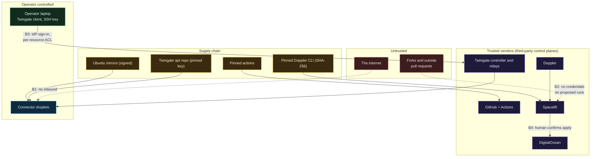

# Threat model

Security controls only make sense against named threats. This page lists what is worth protecting, who might go after it, where the trust boundaries are, what stops each threat, and what is left over and accepted on purpose.

It is a lab with a $30 budget and one operator, and the threat model is sized to that. Nation-state targeting of a hobby cloud account is out of scope; the internet's background noise, credential theft and supply-chain mistakes are very much in scope.

## Assets

| Asset | Why it matters |
|---|---|
| DigitalOcean write token | Can create, destroy or open anything in the account, and run up a bill |
| Twingate API token | Can grant itself access to every resource |
| Doppler service token | Reads every secret above |
| Connector tokens | Can impersonate a connector in the tenant |
| OpenTofu state in Spacelift | Contains connector tokens and the full resource map |
| The droplets | Today: the access path. Later: workloads and a link back to the homelab |
| The operator's identity | The repo is public; account identifiers, home ranges and names stay out |

## Trust boundaries

## Threats, controls, residual risk

| # | Threat | Controls | Residual |
|---|---|---|---|
| T1 | Internet scanning, brute force, exploit of an exposed service | Zero public inbound rules, attached by tag at creation; connectors are outbound-only; sshd keys only, one user | None from the network side today |
| T2 | Stolen Twingate credentials | Sign-in delegated to the identity provider (enforce MFA there); access limited to one host and port per resource; SSH key still required on the host | An attacker with both the identity and the SSH key gets a shell on a connector |
| T3 | Malicious pull request steals secrets from a plan | Proposed runs get no credentials; branch protection; one writer; push policy for forks (to be added before accepting outside PRs) | Script checks only guard honest code; the real boundary is who can push |
| T4 | Leaked Doppler service token | Read-only, one config, 90-day expiry, write-only in Spacelift, masked in logs | Reads all `prd` secrets until revoked |
| T5 | Connector token theft from the droplet | File is root-only 0600; one token per connector, revocable | **Accepted:** user-data is readable by any local process via the metadata endpoint; lockdown is a follow-up |
| T6 | Connector token theft from state | Marked sensitive; state lives only in Spacelift | **Accepted:** anyone who can read stack state sees it; restrict state access in Spacelift |
| T7 | Compromised GitHub Action | Every action pinned by commit SHA; `permissions: {}` by default; CI holds no cloud credential | A compromised pinned commit is still trusted until the pin changes |
| T8 | Tampered Doppler CLI download | Pinned version, pinned SHA-256 per architecture, fail closed | None beyond trusting the pinned release |
| T9 | Tampered Twingate package | Repository key checked against a pinned fingerprint before being trusted; apt verifies signatures | Trusting Twingate's signing key |
| T10 | Vendor compromise (Twingate, Spacelift, Doppler) | Narrow scopes; E2E encryption to connectors; separate SSH key gate | **Accepted:** inherent to using hosted control planes; see [Why ZTNA and not a VPN](Why-ZTNA-Not-a-VPN.md) |
| T11 | Runaway bill | Cost gate allowlist; approved totals in review; billing alerts at $10 and $25 | Bandwidth overage and resources created outside the repo |
| T12 | Lateral movement between droplets | DigitalOcean firewalls filter VPC-internal traffic; only connector-to-connector SSH by tag is allowed | Workload rules in stage 3 must keep the same discipline |
| T13 | Lockout (both connectors down) | Two connectors with staggered reboots and updates | **Accepted:** no console password by design; recovery is rebuilding the stateless droplets through Spacelift |
| T14 | Doxxing the operator through the public repo | Account identifiers, ranges and names in Doppler; SSH key comment stripped; secret scanning in CI | Human error in a commit message or doc |

## Accepted risks, collected

Accepting a risk is a decision, so each one is written down where a reviewer will see it:

1. Connector tokens in state and in user-data (T5, T6).
2. The metadata endpoint is not yet restricted to root (T5).
3. Hosted control planes are trusted (T10).
4. No break-glass console path (T13).
5. The Spacelift script's run-type checks are not a security boundary (T3).

## What would change the model

- **Stage 2** connects the cloud back to the homelab SIEM. That turns a compromised connector from "a cheap droplet" into "a foothold with a path home", so the home-side connector must sit on a VLAN that can reach only what it needs, and cloud-to-home access gets its own Twingate group and service account.
- **Stage 3** adds workloads with real data, which brings backups, patch cadence and per-service firewall rules into scope. Two of its pieces widen the model on purpose: Portainer's access to the Docker socket is root on the host, so whoever can sign in to Portainer owns the droplet (mitigated by reaching it only through Twingate, as the admins group); and a Matrix bridge is the first thing that must accept an inbound connection from outside the VPC, from the homeserver, which is why its placement follows the homeserver rather than opening a port. The daemons hold API tokens for the author's social accounts, so a compromised host can post as the author until those tokens are rotated in Doppler.
- **Anyone else getting write access** to the repository makes T3 real, and the Spacelift push policy plus required reviews become mandatory first.
