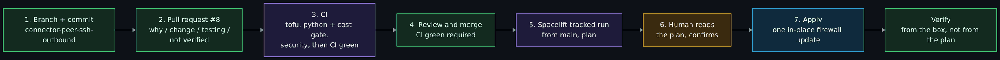

# Trace one change end to end

> Before this page: [Git, GitHub and pull requests](Git-GitHub-and-Pull-Requests.md) explains what a pull request and a CI check are, and [Fork, private stacks and the pipeline](Fork-Private-Stacks-and-the-Pipeline.md) draws the seven gates this page walks through. Needs a clone of the repository and the `gh` command-line tool, signed in, to look at the real pull request. Read-only; nothing here changes anything.

> Unfamiliar word or acronym? The [Glossary](Glossary.md) defines it.

The capstone page shows the pipeline as seven boxes. Boxes are easy to agree with and hard to believe. This page follows **one real, small change** through every box, using the pull request's actual files, and then asks what would have stopped three worse versions of it.

The change is pull request **#8, "fix: let each connector open SSH to the other (outbound rule)"**. It was chosen because it is small (one module, one stack, tests), it touched a module rather than only documentation, and it is the second half of a bug whose story is already told in [Lessons learned, "Connector-to-connector SSH timed out, twice"](Lessons-Learned.md#2-connector-to-connector-ssh-timed-out-twice). Pull request #7, "fix: let the connectors reach each other's SSH inside the VPC", was the first half.

Look at it yourself first:

```bash
gh pr view 8 --repo ChiefGyk3D/Clouds-Against-Humanity
gh pr diff 8 --repo ChiefGyk3D/Clouds-Against-Humanity --name-only
gh pr checks 8 --repo ChiefGyk3D/Clouds-Against-Humanity
```

## The whole path on one page

```mermaid
flowchart LR
    br["1. Branch + commit<br/>connector-peer-ssh-outbound"]:::you
    pr["2. Pull request #8<br/>why / change / testing /<br/>not verified"]:::you
    ci["3. CI<br/>tofu, python + cost gate,<br/>security, then CI green"]:::ctrl
    rev["4. Review and merge<br/>CI green required"]:::you
    sl["5. Spacelift tracked run<br/>from main, plan"]:::ctrl
    hu["6. Human reads<br/>the plan, confirms"]:::warn
    ap["7. Apply<br/>one in-place firewall update"]:::cloud
    ver["Verify<br/>from the box, not from the plan"]:::you

    br --> pr --> ci --> rev --> sl --> hu --> ap --> ver

    classDef you fill:#132a1f,stroke:#4ade80,color:#dcfce7
    classDef ctrl fill:#1e1b3a,stroke:#a78bfa,color:#ede9fe
    classDef warn fill:#3a2a0f,stroke:#fbbf24,color:#fef3c7
    classDef cloud fill:#0f2a3d,stroke:#38bdf8,color:#e0f2fe
```



<details>
<summary>Diagram source (Mermaid)</summary>



</details>

## What the change was

The connector firewall allowed no inbound traffic, so connector b dropped an SSH connection coming from connector a. Pull request #7 added the inbound half: TCP 22 admitted from droplets carrying the connector tag. It applied, and SSH to connector b still timed out. The reason, measured and written in #8's description: DigitalOcean lets a *new* connection leave a droplet only if an outbound rule permits it, and the connector firewall had no outbound rule for TCP 22. Replies are stateful; the first packet is not.

So #8 added an optional `outbound_to_tag_rules` input to `modules/firewall`, a rule in `stacks/10-access/main.tf` that sends TCP 22 to the connector tag, and tests. The rule names a tag, never an address. The pull request touched, among others:

| File | What changed |
|---|---|
| `modules/firewall/main.tf` | A `dynamic "outbound_rule"` block with `destination_tags = [var.tag]` |
| `modules/firewall/variables.tf` | `outbound_to_tag_rules`, default `[]`, validated like the inbound one |
| `modules/firewall/outputs.tf` | An `outbound_tag_rules` output so tests can pin the set |
| `stacks/10-access/main.tf` | `outbound_to_tag_rules = [{ protocol = "tcp", port_range = "22" }]` |
| `modules/firewall/tests/firewall.tftest.hcl`, `stacks/*/tests/` | Tests that pin the new rule and the unchanged baseline |
| `docs/stages/01-access.md` | The stage guide |

## Gate by gate

For each box: what it did *for this change*, which page explains it, and what it could not do.

| # | Gate | What it did for #8 | Explained on | What it could not tell you |
|---|---|---|---|---|
| 1 | **Branch and commit** | The change lived on a branch named `connector-peer-ssh-outbound`, not on `main`. Nothing it contained was live. | [Git, GitHub and pull requests](Git-GitHub-and-Pull-Requests.md) | Whether the idea was right |
| 2 | **Pull request** | The description has four headings: *Why* (the measured cause), *Change*, *Testing*, and *Not verified*. The last one says: "Mock providers only; the real behaviour needs the apply." That sentence is a gate: it tells the reviewer what green does not prove. | [Git, GitHub and pull requests](Git-GitHub-and-Pull-Requests.md#the-pull-request-how-a-change-is-proposed) | Nothing. It is a statement, not a check |
| 3 | **CI** | See below. | [CI, tests and the cost gate](CI-Tests-and-Cost-Gate.md) | Whether DigitalOcean actually honours the rule |
| 4 | **Review and merge** | `CI green` required, one writer. The reviewer reads the file list and the "Not verified" paragraph. | [Git, GitHub and pull requests](Git-GitHub-and-Pull-Requests.md#branch-protection-and-one-writer) | A rule that is wrong in a way every test agrees with |
| 5 | **Spacelift tracked run** | See below. | [Spacelift](Spacelift.md) | |
| 6 | **Human reads the plan** | The expected plan is one in-place update to one firewall. | [Why autodeploy is off](Spacelift.md#why-autodeploy-is-off) | Whether the change fixes the SSH timeout |
| 7 | **Apply** | One firewall updated. No droplet is rebuilt. | [Spacelift](Spacelift.md#the-run-lifecycle) | |

### Gate 3 in detail: what CI ran

`.github/workflows/ci.yml` today has three jobs and a gate, all calling shared workflows from git-your-ship-together pinned by commit:

- **`tofu`** runs `fmt -check`, `validate`, tflint and Trivy, then `tofu test` in each directory in the `directories:` list (`stacks/00-foundation`, `stacks/10-access`, `modules/vpc`, `modules/firewall`, `modules/twingate-bootstrap`, `modules/twingate-connector`). For #8 the tests that matter are in `modules/firewall/tests/firewall.tftest.hcl` and `stacks/10-access/tests/`. The stack test asserts the connector firewall has exactly one inbound rule, `tcp/22/cah-connector-tor1`, and exactly one tag-scoped outbound rule, also `tcp/22/cah-connector-tor1`, with the message "so a connector can open SSH to its peer and nothing else". Every provider is mocked, so this job holds no credential.
- **`python`** runs `python -I scripts/cost_check.py --root .` and then `pytest` and `ruff`. For #8 the cost gate had a simple job: a firewall is on the free list, no droplet was added, so the total stayed at $12.00 against the approved $12.00 in `docs/stages/approved.json`.
- **`security`** runs code scanning and secret scanning. The checks on the pull request itself listed CodeQL, Semgrep OSS and gitleaks, all passing.
- **`CI green`** fails unless all of the above finished as `success`. This is the one name branch protection requires.

The pull request description also says each safety property was broken on purpose and a test failed every time: the destination restriction, the stack port, and the baseline "no inbound" pin. That is the habit from [Labs: break it on purpose](Labs-Break-It-on-Purpose.md), applied by the author to their own change.

One more thing from `gh pr checks 8`: two checks named `spacelift/cah-00-foundation` and `spacelift/cah-10-access` show **fail**, while `CI green` shows pass. Those were Spacelift *proposed runs* of the pull request, which get no credentials by design and so can only fail at the provider. That was the "red check from a run that could never pass", and the fix landed later: [Lessons learned, number 10](Lessons-Learned.md#10-a-red-check-from-a-run-that-could-never-pass). If the paid-plan push policy is attached in Spacelift, it never proposes a run, so a pull request like #8 would show no Spacelift check at all. The policy file being in the repository does not activate it. On the free plan the fallback is narrow project roots and globs (`docs/spacelift-secrets.md` section 9), which only silences docs-only pull requests: a pull request that changes a module or stack, like #8, would still get a proposed run and the same red check. A red check that did not block the merge is also a reminder of what `CI green` is: the only check branch protection requires.

### Gate 5 in detail: what Spacelift does after the merge

Merging to `main` is when Spacelift first looks at the change. The push policy (`.spacelift/policies/push.rego`) asks whether the changed files are in the stack's own directory or under `modules/`, `scripts/spacelift/` or `.spacelift/`. Pull request #8 changed files under `modules/firewall/` and `stacks/10-access/`, so both stacks are affected. It must be attached in Spacelift to count; see [Push policies: paid plan versus free plan](Spacelift.md#push-policies-paid-plan-versus-free-plan). A docs-only merge would start nothing.

For each affected stack it starts a **tracked run** on `main`:

1. `before_init` loads the secrets that stack lists in `.spacelift/config.yml` from Doppler, and only because this is a tracked run on `main`. See [Doppler and secrets](Doppler-and-Secrets.md#how-the-hook-works).
2. `tofu plan`. Autodeploy is off, so the run stops and waits.

What a human should expect to see, from the pull request's description: for `cah-10-access`, **one in-place change to the connector firewall** and nothing else; for `cah-00-foundation`, **no changes**, because the baseline firewall is unchanged and the shared module change adds only an empty-by-default input. That second prediction is the cheap check: a stack that should not change and does is a finding.

### Gate 6: what reading the plan means

Read three things. Is the verb right (`update in-place`, not `replace` or `destroy`)? Is the resource count right (one, not two)? Is the diff the thing the pull request said? A firewall edit that shows a droplet replacement means something else was in the diff. Confirm only when the plan matches the story. Then `before_apply` fetches the secrets again, because the apply phase may start in a fresh container, and `tofu apply` runs.

## How you would verify

Three different things can be true. A plan succeeding means OpenTofu computed a diff. A successful *apply* means DigitalOcean accepted the firewall update. Neither says the change fixed the bug: that needs real connectivity, checked from outside the pipeline. The pull request's own "Not verified" section names the real checks, run from outside the pipeline:

1. From connector a, open a TCP connection to connector b's private address on port 22 and see it succeed (the pull request used `timeout 5 bash -c '</dev/tcp/<connector b private ip>/22'` and expected it to report open).
2. SSH through Twingate to both connector addresses, several times. The original symptom was intermittent, so one success proves little.
3. From a machine outside the VPC, scan the connectors and confirm everything is still filtered. A fix that opens the hole you were told is closed is not a fix.

Check 3 is the one people skip, because the bug is solved and nobody feels like checking. It is the verification of the *security* property, not the feature.

## What would have stopped it: three bad variants

Take #8 and make it worse in three different ways. For each, **predict which gate stops it, and where**, before reading.

### Variant A: "just open port 22 to everyone"

The author, tired of the timeout, adds an inbound rule for TCP 22 from `0.0.0.0/0` and `::/0` to the connector firewall, and merges.

**Predict.** Which gate, which file, and what does the failure message look like?

**Reference answer.** The `tofu` job, at `tofu test`. `modules/firewall/tests/firewall.tftest.hcl` asserts the baseline has zero inbound rules and that tag-scoped inbound rules carry `source_tags` equal to the module tag and no source addresses; `stacks/10-access/tests/` asserts the connector firewall's only inbound rule is `tcp/22/cah-connector-tor1`. In [Lab 1](Labs-Break-It-on-Purpose.md#lab-1-open-the-firewall) you can watch this happen. The failure comes from the module's own output code, not from the assertion the author intended, because an address-based rule has no `source_tags`; the control still stops the change, and the message points at the wrong thing. `CI green` fails, the merge button stays off. If the author also edited the tests to match, nothing automated stops it: the review gate (4) and the fact that the changed *test* is in the diff are what remain. That is why a pull request that changes both a rule and the test that guards it deserves a slower read.

### Variant B: "while I'm here, add a managed database"

The same pull request also adds a `digitalocean_database_cluster` for a future stage.

**Predict.** Does a tofu test notice? Does the cost gate?

**Reference answer.** Not `tofu test`: mocked providers would happily plan it. The **cost gate**, in the `python` job, stops it. `scripts/cost_check.py` keeps an allowlist of free `digitalocean_*` resource types and refuses every other type by name; a droplet is allowed only inside `modules/twingate-connector/main.tf` (`allowed_sources` in `docs/stages/approved.json`). A database cluster is neither, so the job fails with a message naming the type. Approving it is not just editing JSON. The gate fails for a resource type it cannot price even if `approved.json` allows a file for it: `resource_cost` in `scripts/cost_check.py` has a price model only for DigitalOcean droplets (and AWS instances), and anything else raises "no price model for kind". So making a database legitimate means extending the gate itself: a price model for that kind, the price data in `docs/cost-prices.json`, a `cost.json` entry, the source file added to that provider's `allowed_sources` in `docs/stages/approved.json`, and a raised `approved_monthly_total`, all in a reviewed diff. The friction is the point. The gate cannot see a resource created outside the repository or bandwidth overage; those are what the billing alerts at $10 and $25 are for. See [The cost gate](CI-Tests-and-Cost-Gate.md#the-cost-gate).

### Variant C: a one-line change to the first-boot template

Someone edits a hardening setting in `modules/twingate-bootstrap/cloud-init.yaml.tftpl`, say the `MaxAuthTries` line. All tests pass, since the tests assert the intended settings and the author updated them.

**Predict.** Which gate is the first one that can catch the *consequence*, as opposed to the content?

**Reference answer.** Nothing in CI. The content is correct; the consequence is that the template feeds `user_data`, and [any change to it forces the droplet to be rebuilt](Droplet-Hardening.md#why-cloud-init-and-not-ansible). Both connectors share the same bootstrap template, so one plan can replace both, which is a lockout risk (T13). The first gate that sees the consequence is **gate 6**: the Spacelift plan shows both droplets as `replace`, not `update in-place`. Confirmation approves the whole saved plan, not individual replacements, and the staggered reboot times do not sequence replacements, only nightly reboots. So the person who sees two replacements for a "one-line" change discards the run, and the change has to be shipped as separate reviewed plans that each replace one connector, with a health check (SSH through Twingate to the new connector) between applies. That is the human-confirm gate doing what no script can, which is why [autodeploy is off](Spacelift.md#why-autodeploy-is-off). Notice that neither CI nor the cost gate had anything to say. A gate that fires on a change is not the same as a gate that fires on its effect.

## Try it yourself

- Pick a different merged pull request from `gh pr list --state merged --limit 30 --repo ChiefGyk3D/Clouds-Against-Humanity` that touched a module or the docs, and fill in the seven-gate table for it. Write "nothing" in the boxes that did nothing, then decide for each whether it is a gate that only matters when something is wrong, or decoration.
- Write down a fourth bad variant that *none* of the gates in this repository would stop, and say what you would add to stop it. If you cannot think of one, read [Threat model, accepted risks](Threat-Model.md#accepted-risks-collected) and pick one.
- Do the same trace for a change that touches `scripts/spacelift/doppler-env.sh`. Which gates behave differently, and why is the review step doing more of the work than it did for #8? [Threat model exercise, "What if 3"](Threat-Model-Exercise.md#what-if-3-a-malicious-pull-request) is the companion.

Next: the [Terraform reference](Terraform-Reference.md) if you want the code behind the stacks in this trace, or the [Threat model exercise](Threat-Model-Exercise.md), whose what-if scenarios reuse this trace. Back to the [Reading order](Reading-Order.md).
