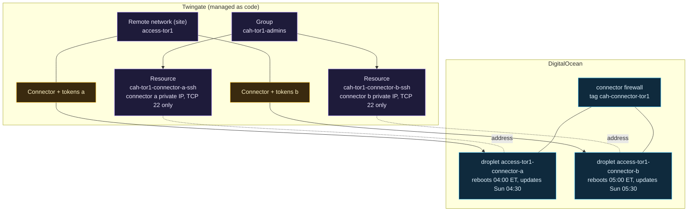

# Twingate

> Before this page: [Networking basics](Networking-Basics-for-This-Project.md) explains why an outbound-only connector can still be reached, and [Identity, secrets and zero trust basics](Identity-Secrets-and-Zero-Trust-Basics.md) explains groups, identity providers and per-resource access.

Twingate is the only way to reach a droplet in this project. This page covers the moving parts, how they are wired up in `stacks/10-access`, and why each choice was made. For the "why not a VPN" argument itself, see [Why ZTNA and not a VPN](Why-ZTNA-Not-a-VPN.md).

## The four pieces

| Piece | Runs where | What it does | What it does not do |
|---|---|---|---|
| **Controller** | Twingate's cloud | Holds configuration, delegates sign-in to the identity provider, signs ACLs for clients and connectors | Never carries your traffic |
| **Client** | Your laptop | Signs you in, gets a signed ACL, intercepts traffic only for addresses on that ACL, builds the tunnel | Route anything that is not an assigned resource |
| **Connector** | Your network (here: two droplets) | Keeps outbound connections to the controller and relays, verifies every client connection, forwards to the resource | Listen on any public port |
| **Relay** | Twingate's cloud | Joins client and connector when a direct path is impossible, like a TURN server | Terminate or store the encrypted connection |

Source: [How Twingate works](https://www.twingate.com/docs/how-twingate-works).

## What `stacks/10-access` builds

Diagram source (Mermaid)

> **Screenshot to take yourself:** the Twingate admin console, the Connectors page and the Resources page.
> Capture: the Remote Network with both connectors listed, then the Resources page with one resource per host and port.
> Look for: each connector's status reading Alive (check the wording your console version uses), the two connectors in one remote network, and resources that name one address and one port, not a whole range.
> Redact: the tenant name in the address bar and header, connector names that carry a hostname, IP addresses and CIDR ranges, group member names and email addresses, and the connector token if a dialog shows it.

## Decisions and why

### Two connectors, not one

Twingate recommends at least two active connectors per remote network so one can be down without losing access. That matters more than usual here, because **SSH to a connector goes through Twingate**: if the only connector dies, so does the only way in. Two `s-1vcpu-1gb` droplets cost $12 a month instead of $6, and that was the cheapest insurance on the bill.

They are also deliberately out of step:

- Each reboots (only if an update requires it) an hour apart: 04:00 and 05:00 Eastern.
- Each updates the connector package on Sundays, half an hour after its own reboot window: 04:30 and 05:30.

So there is never a moment where both are restarting.

### One resource per host and port, never "the whole VPC"

It would be one line to create a resource for `10.78.0.0/24` with all ports open. That would rebuild a VPN with extra steps. Each resource here is a single private address with `tcp` restricted to port 22, UDP denied and ICMP off. When stage 3 adds workloads, each gets its own narrow resource.

### Access is a group, and the group is code

`twingate_group.admins` holds the user ids from Doppler (`ADMIN_USER_IDS`). The stack refuses an empty list, because a missing secret would otherwise create a host nobody can reach. Granting or removing access is a pull request plus a Spacelift run, which means it is reviewed and logged like any other change.

### The site is created by OpenTofu

An earlier version expected a hand-made site. Now the stack creates `access-<region>` itself, so the whole access layer can be destroyed and rebuilt from code. If you are following along, delete any hand-made site with that name first, or the apply collides with it.

### Install from Twingate's signed apt repository, not `setup.sh`

The first build piped Twingate's setup script into bash, both connectors came up "successfully" with no config file and a dead service, and the log said everything was fine. The fix and the reasoning are on [Lessons learned](Lessons-Learned.md). The short version: cloud-init writes `/etc/twingate/connector.conf` itself (root-only, mode 0600), installs `twingate-connector` from `https://packages.twingate.com/apt/` after checking the repository key against a pinned fingerprint, and only reports success when the service is actually active.

### Why connector a may SSH to connector b

Twingate can route a session for connector b's address through connector a. Connector a then opens TCP 22 to b inside the VPC, and DigitalOcean firewalls filter VPC-internal traffic too. So the connector firewall allows TCP 22 between droplets that carry the connector tag, in both directions, and from nothing else. [DigitalOcean network and firewalls](DigitalOcean-Network-and-Firewalls.md) explains why that needed an outbound rule as well as an inbound one.

## Outbound ports the connector needs

| Port | Why |
|---|---|
| TCP 443 | Controller and relay connections, package downloads |
| TCP 80 | Ubuntu package mirrors |
| TCP and UDP 53 | DNS |
| UDP 123 | NTP via chrony |
| TCP 30000 to 31000 | Twingate relay connections |
| UDP, any port | Peer-to-peer connections with clients, per Twingate's [outbound allowlist article](https://help.twingate.com/articles/1198271128-allowlist-for-outbound-connections-to-twingate-infrastructure) |

All outbound. Inbound from the internet: none.

## Connector telemetry (off by default)

The connector can write its own logs, expose Prometheus metrics and carry labels. All of it is configured on the connector, in `/etc/twingate/connector.conf`; none of it lives in the Admin Console or the Twingate provider. One variable, `connector_telemetry`, turns it on in both stacks. Default `{}` changes nothing. The research and sources are in the [findings note](https://github.com/ChiefGyk3D/Clouds-Against-Humanity/blob/main/docs/superpowers/specs/2026-10-17-twingate-connector-telemetry-findings.md) (read 2026-10-16).

| Setting | Line in `connector.conf` | Verified from Twingate's docs |
|---|---|---|
| `log_level` | `TWINGATE_LOG_LEVEL=3, 4, 5 or 7` | Yes. 3 is the default, 7 is DEBUG and very verbose. There is no log format setting. |
| `connection_logs` | `TWINGATE_LOG_ANALYTICS=v3` | Yes, for systemd. One JSON object per connection, on stdout, so in the journal (`journalctl -u twingate-connector`), prefixed `ANALYTICS `. Each line names the user's email, client IP and city. |
| `metrics_port` | `TWINGATE_METRICS_PORT=<port>` | Yes. Needs connector v1.80.0 or later. Plain HTTP at `/metrics`, no authentication. Which interface it listens on is **not documented**. |
| `labels` | `TWINGATE_LABEL_<KEY>=<value>` | The mechanism is documented; its use in the systemd config file is **not shown** on the pages read. Check the connector page after the first apply. |
| `status_updates_enabled` | none (a provider attribute) | Yes, in the provider schema. The provider default is `true`, which is what the live connectors already have; this code does not send it unless you set it. |

There is no health-check port. The check is a command on the host, `twingate-connectorctl health`, and it only says the service runs, not that the connector reached Twingate.

Turning any of the first four on changes `user_data`, so the plan shows a **replace** of the droplet (or instance), not an in-place update. Use `connector_telemetry_instances` to do it one connector at a time: `["a"]`, apply, SSH through Twingate to the new connector, then `["a", "b"]` (for a later change to settings already on, put the old value in `connector_telemetry_previous` so the connector not yet changed keeps its config; [Trace one change end to end](Trace-One-Change-End-to-End.md), variant C). Merging with the variable unset is expected to plan no change, but a template hash cannot prove a live plan: confirm with the saved plan in Spacelift before applying. Labels are shown in the Twingate Admin Console, so never put a secret in one. No firewall port is opened by this. Reading the metrics from another host needs a separate change: a firewall rule from that host's tag (`inbound_from_other_tags`), a rule from the connector tag for the other connector, and a Twingate resource for the endpoint. Treat the port as reachable by anything the firewall lets through, because the bind address is not something you can set.

## Accepted risk: the connector tokens

The connector's access and refresh tokens end up in two places: OpenTofu state (held by Spacelift) and the droplet's cloud-init user-data. They are marked sensitive, each token belongs to one connector and is revocable, and rotation is documented. The open follow-up is that any process on the droplet can currently read user-data from the metadata endpoint at `169.254.169.254`; locking that to root is on the list. See [Threat model](Threat-Model.md).

## Rotating a connector token

Replace `module.connector_a.module.bootstrap.twingate_connector_tokens.this` (or `connector_b`; the tokens moved into the shared bootstrap module, and the old address no longer exists once a run has applied that change) through a Spacelift run with the replace option, one connector at a time. Because the token is in user-data, the droplet is rebuilt and probably gets a new private IP; its SSH resource follows the new address automatically. The other connector keeps access up meanwhile.

## Verify it yourself

1. Both connectors show online in the Twingate admin console under `access-tor1`.
2. From the Twingate client: `ssh cah-admin@<private IP>` works for each connector.
3. From anywhere outside Twingate: `nmap -Pn -p 22,80,443 <public IP>` reports every port filtered. Scanning your own droplet is fine; scanning other people's is not.

Next: [DigitalOcean network and firewalls](DigitalOcean-Network-and-Firewalls.md), step 13 of the core path on the [Reading order](Reading-Order.md) page.
