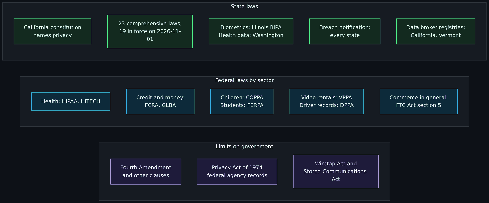
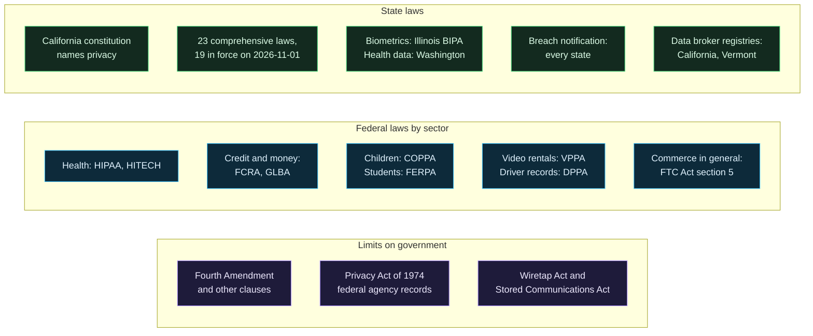
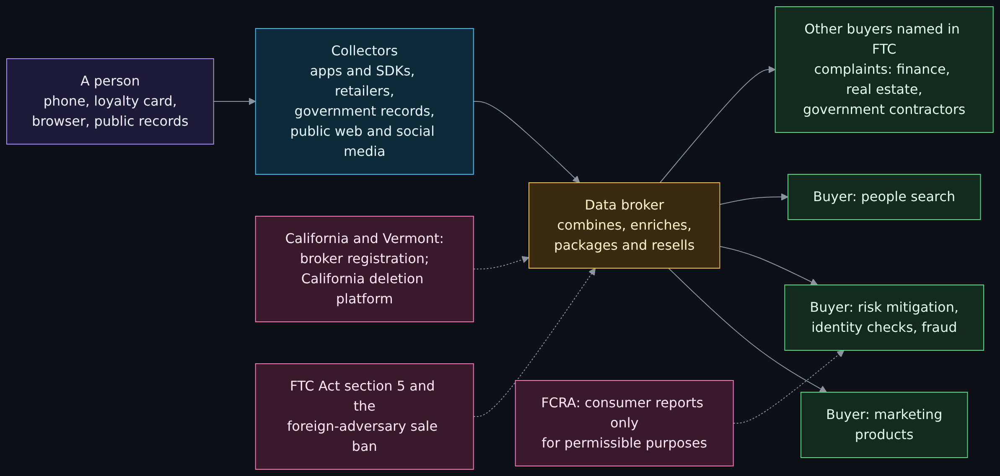
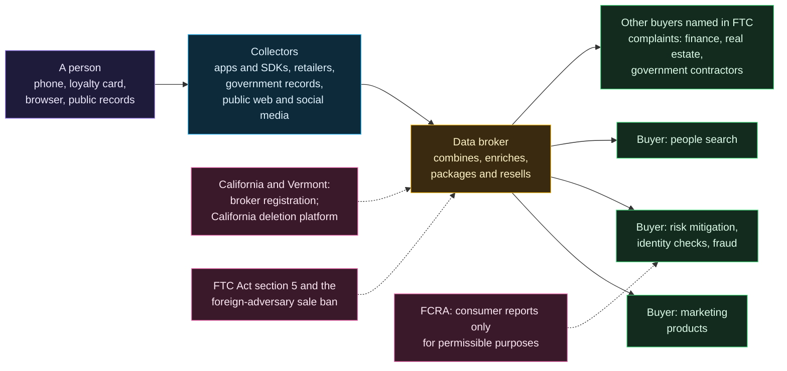
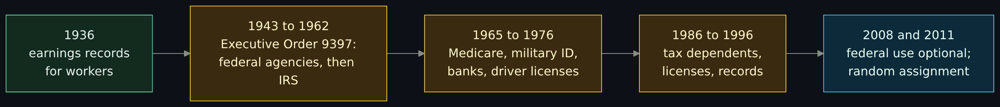
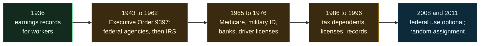

# US privacy law: no general right to privacy, the patchwork, data brokers, Social Security numbers and license plate readers

Page two of three in the GRC and compliance set. Read it when you want to know what the United States actually has for privacy: what the Constitution does and does not say, which federal laws cover which kinds of data, what the states have added, who the data brokers are and what the law says about them, why the Social Security number is a poor key to a person, and what is documented about license plate readers and Flock. The facts come first, each with a date and a source. Near the end is one clearly headed section with the maintainer's opinion, and each of his four points sits next to what the sources say about it. It ends with a free exercise: pick a state and a kind of data and work out which laws apply, then read how a broker says you can ask for your own data.

> Unfamiliar word or acronym? The [Glossary](Glossary.md) defines it.

> **Status: unverified draft, written from reading.** On **2026-11-01** I downloaded and read the sources named in the [claims register](#claims-register): the Supreme Court opinions in Griswold, Katz, Whalen, Smith, Jones, Carpenter and Dobbs; the Government Publishing Office's printing of the Constitution; the text of the federal statutes and regulations in the law table; the IAPP state privacy law chart dated 8 September 2026; the California Attorney General's CCPA page and the California Privacy Protection Agency's Delete Act text and pages; Vermont's data broker statute; the Illinois Supreme Court's Rosenbach opinion; Washington's My Health My Data Act; the FTC's 2014 data broker report and press pages; Federal Register records for the CFPB and the Justice Department; the Social Security Administration's history article, randomization page and identity theft booklet; a California State Auditor report; Virginia's license plate reader statute; Flock's own policy pages and blog posts; news and advocacy accounts of the Flock cases; and English translations of three Chinese laws. The only things I executed were downloads and reading tools. **Not run:** every step of the free exercise by a reader; no request was sent to any broker, no account was made, no camera or system was touched, and nothing here is a result of testing anything. **Not read:** the full text of most state privacy statutes (I read the IAPP chart, not the laws), the HITECH Act's own text beyond two sections, the FCRA's enforcement sections, any court filing in the Flock cases, the Illinois audit itself, the Chinese-language laws, and the sources I could not retrieve, listed in [Not verified, plainly](#not-verified-plainly). Where a source and this page disagree, trust the source and tell us.

> **Prerequisites.** None beyond curiosity. [Privacy versus security](Privacy-vs-Security-Blinds-and-Locks-Physical-Security-and-Monero.md#privacy-law-basics-at-a-high-level) gives the first look at privacy law, and [the CIA triad](The-CIA-Triad-Confidentiality-Integrity-Availability.md) names the property that privacy and security share. No account, install or tool is needed: this page is reading, plus one exercise on public pages. About 90 minutes (est.).

> **Where this runs, and the rule.** Nowhere: it is a reading lesson. It is defensive and educational. This page is education, not legal advice; what applies to a real person or organization depends on facts, places and dates that a lawyer must check. The factual sections state what the texts say, dated, and give no opinion on whether a rule is good. The opinion lives only in the one section headed as his opinion, written in his words from his brief, and it is not presented as fact anywhere. The page names no employer, no host and no private person.

## What you will be able to do

- Say what the Constitution does and does not say about privacy, and state the Fourth Amendment cases from Katz to Carpenter in one sentence each.
- Name the main federal privacy laws, what each covers, who enforces it and where it stops, and say plainly that SOX is a financial-controls law and not a privacy law.
- Explain the FTC's Section 5 authority and why it is not a privacy statute.
- List the states with comprehensive privacy laws on the day I read the tracker, with effective dates, and say how many are in force.
- Describe biometric laws, breach notification laws and state health data laws, with a case for each.
- Say what a data broker is, follow data from a person to a broker to a buyer, and name the documented rules and actions with dates.
- Say what the Social Security number was made for, how it drifted, and why it is a poor way to prove who you are.
- Separate what is established from what is contested about license plate readers and Flock.
- Read the maintainer's four opinions next to the sources that support or limit them.
- Work out which laws apply to a state and a data type, and read a broker's published process for asking for your data.

## Where this page sits in the set

The maintainer asked for this set on 2026-11-01. Page one (issue 402, [GRC in plain terms](GRC-Governance-Risk-and-Compliance-in-Plain-Terms-Laws-Frameworks-and-Attestations.md)) is the foundation and carries the vocabulary used here: law, regulation, framework, control, evidence. This is page two (issue 403). Page three (issue 404, [privacy law around the world](Privacy-Law-Around-the-World-GDPR-PIPEDA-POPIA-and-PIPL-Compared-With-the-United-States.md)) covers other countries. Where this page touches another country, it does so only for the single comparison the maintainer's opinion makes.

## What the wiki already says (and the gap)

| Idea | Where it is today | The gap this page fills |
|---|---|---|
| Privacy as blinds, security as locks | [Privacy versus security](Privacy-vs-Security-Blinds-and-Locks-Physical-Security-and-Monero.md#privacy-law-basics-at-a-high-level) | It gives the GDPR as the example of privacy law and says other places have their own. This page covers the United States. |
| Retention, purge and legal hold for data in an account | [Cross-tenant data governance](Cross-Tenant-Data-Governance-Retention-and-DLP.md#retention-and-purge) | It is the engineering side of storage limitation. This page is the law that sometimes sets the limit. |
| The three properties a control protects | [The CIA triad](The-CIA-Triad-Confidentiality-Integrity-Availability.md) | Confidentiality is the property most privacy laws name first. |
| Hashes, salts, keys and signatures | [Cryptography fundamentals](Cryptography-Fundamentals-Symmetric-Asymmetric-Hashing-Certificates-and-Keys.md) and [Hashing, encryption and keys](Hashing-Encryption-and-Keys.md) | The Social Security number section uses their vocabulary to say what a better identifier and authenticator look like. |
| Why law, framework and attestation differ | Page one of this set | This page applies that vocabulary to privacy. |

## What the Constitution does and does not say about privacy

The text first. The Government Publishing Office's printing of the Constitution as amended (House Document 110-50) is the version I searched on 2026-11-01. The word "privacy" does not appear in it. What it does contain is the Fourth Amendment: "The right of the people to be secure in their persons, houses, papers, and effects, against unreasonable searches and seizures, shall not be violated, and no Warrants shall issue, but upon probable cause, supported by Oath or affirmation, and particularly describing the place to be searched, and the persons or things to be seized." That limits the government, and the Court has been careful about how far it reaches.

In Katz v. United States (1967) the Court said so itself: "the Fourth Amendment cannot be translated into a general constitutional 'right to privacy.'" It added that the Amendment "protects individual privacy against certain kinds of governmental intrusion, but its protections go further, and often have nothing to do with privacy at all," and that "the protection of a person's general right to privacy, his right to be let alone by other people, is, like the protection of his property and of his very life, left largely to the law of the individual States" (dashes in the original shown here as commas). Katz is also the case that made the Fourth Amendment about people and not places, which is where the "reasonable expectation of privacy" test comes from.

| Case | Citation | Year | What the Court said, in its own words |
|---|---|---|---|
| Griswold v. Connecticut | 381 U.S. 479 | 1965 | "Various guarantees create zones of privacy." The Connecticut ban on using contraceptives "violates the right of marital privacy which is within the penumbra of specific guarantees of the Bill of Rights" (the syllabus). |
| Katz v. United States | 389 U.S. 347 | 1967 | The Fourth Amendment "protects people, not places," and "cannot be translated into a general constitutional 'right to privacy.'" |
| Whalen v. Roe | 429 U.S. 589 | 1977 | The Court upheld New York's computerized record of prescriptions for certain drugs. It said it was "not unaware of the threat to privacy implicit in the accumulation of vast amounts of personal information in computerized data banks," that a duty to avoid unwarranted disclosure "arguably has its roots in the Constitution," and that it "need not, and do not, decide" that question. |
| Smith v. Maryland | 442 U.S. 735 | 1979 | Installing a pen register to record the numbers a person dials was not a search. By "voluntarily" conveying the numbers to the phone company, the caller "assumed the risk that the company would reveal" them (the syllabus). This is the third-party doctrine. |
| United States v. Jones | 565 U.S. 400 | 2012 | Attaching a GPS device to a car and using it to monitor the car's movements for 28 days "constitutes a search," decided on the physical intrusion on an "effect." Katz's test "has been added to, but not substituted for" the older trespass test. |
| Carpenter v. United States | 585 U.S. ___ | 2018 | Getting 127 days of cell-site location records (12,898 location points) from a phone company was a search that generally needs a warrant. "Our decision today is a narrow one," and the Court did "not disturb the application of Smith and Miller or call into question conventional surveillance techniques and tools, such as security cameras." |
| Dobbs v. Jackson Women's Health Organization | No. 19-1392 | 2022 | Decided June 24, 2022. The majority noted that "Roe termed this a right to privacy," held that "The Constitution makes no reference to abortion, and no such right is implicitly protected by any constitutional provision," and emphasized that "Nothing in this opinion should be understood to cast doubt on precedents that do not concern abortion." |

Read together: the Constitution protects against certain government searches and has been read to protect some private choices (Griswold's "zones of privacy"), but the Court itself says there is no general constitutional right to privacy against everyone, and it has not settled how far a duty to avoid disclosing personal data reaches (Whalen). Carpenter is the modern limit on what the government can get from a company that holds your data without a warrant, and it says in the same breath what it does not decide. How these cases apply to license plate readers is in [its own section](#license-plate-readers-and-flock).

The states are a different story. California's constitution, Article I, section 1, says: "All people are by nature free and independent and have inalienable rights. Among these are enjoying and defending life and liberty, acquiring, possessing, and protecting property, and pursuing and obtaining safety, happiness, and privacy." The page I read records the section as added on November 5, 1974, by Proposition 7. I did not check which other state constitutions name privacy, so I make no count.

## The patchwork: laws by sector and by state

No federal statute covers personal data in general. What exists is a set of laws, each written for one kind of holder or one kind of data, plus state laws that are starting to fill the gaps. The picture below is a map of the laws on this page, grouped as the sections group them. It has no arrows because nothing flows between the groups: a single piece of data, such as a purchase history, can fall under several of them or under none.

Diagram source (Mermaid)

Three things stand out. The sector laws are about who holds the data (a hospital, a bank, a school), not about what the data is, so a fitness app that holds health data is outside HIPAA; Washington's legislature wrote exactly that into its own law, as the states section shows. The government-facing laws and the Constitution restrain officials, not companies. And the state column is the only one that has been growing: twenty-three comprehensive laws on the IAPP's list of 8 September 2026, up from nineteen in its chart of November 2025.

## The federal laws and the FTC in one table

Each row is from the statute's text, read on 2026-11-01. "Enacted" is the date or year the Code's own history note gives. "Who enforces" is what the text I read says, and where it says nothing in the sections I read, the cell says so.

| Law | Enacted | Who it covers | What it protects | Who enforces | Notable limits |
|---|---|---|---|---|---|
| FCRA (Fair Credit Reporting Act), 15 U.S.C. 1681 | October 26, 1970 | Consumer reporting agencies, and those who use their reports | A consumer reporting agency "may furnish a consumer report under the following circumstances and no other" (court order, the consumer's written instructions, credit, employment, insurance and a few listed business purposes); one free disclosure a year on request (section 1681j) | The FTC says in its 2014 report that it has enforced it since enactment; I did not read the enforcement sections | Covers consumer reports used for listed purposes; most data brokers say they are not consumer reporting agencies, which is why the CFPB proposed a rule in 2024 (withdrawn in 2025, see below) |
| Privacy Act of 1974, 5 U.S.C. 552a | December 31, 1974 | Federal agencies; an "individual" is a citizen or a lawful permanent resident | Records in a "system of records" retrieved by name or identifier: no disclosure without the person's written consent unless an exception such as a "routine use" applies | Not read (the civil remedies subsection) | Federal agencies only, not states or businesses; it also has a section limiting government demands for the Social Security number, covered below |
| FERPA (Family Educational Rights and Privacy Act), 20 U.S.C. 1232g | August 21, 1974 | Schools and agencies that receive federal education funds ("No funds shall be made available" to one that does not comply) | Parents' right to inspect and review education records (within 45 days of a request) and to challenge them; no release of records without written consent except for listed purposes | The federal government through funding conditions | The lever is funding, not a fine; "directory information" has its own rules |
| Wiretap Act (ECPA Title I), 18 U.S.C. 2511 | June 19, 1968 (extended by ECPA in 1986) | Anyone who "intentionally intercepts" a wire, oral or electronic communication | The contents of communications while they are sent | Criminal penalties of up to five years (section 2511(4)(a)); I did not read the civil provisions | Has statutory exceptions that I did not summarize |
| Stored Communications Act (ECPA Title II), 18 U.S.C. 2701 | October 21, 1986 | Anyone who "intentionally accesses without authorization a facility through which an electronic communication service is provided" | Communications held in electronic storage | Criminal: up to 1 year for a first offense, or up to 5 years for commercial advantage or in furtherance of another crime | Conduct authorized by the provider or user, or by sections 2703, 2704 or 2518 (government access), is excluded; Carpenter held a section 2703(d) order is not enough for 127 days of location records |
| VPPA (Video Privacy Protection Act), 18 U.S.C. 2710 | November 5, 1988 | A "video tape service provider": a business that rents, sells or delivers prerecorded video cassette tapes or similar audio visual materials | What a consumer requested or obtained, as personally identifiable information | The person harmed can sue: actual damages "but not less than liquidated damages in an amount of $2,500" | Exceptions for consent, ordinary course of business, law enforcement orders and more; records must be destroyed within a year of no longer being needed |
| DPPA (Driver's Privacy Protection Act), 18 U.S.C. 2721 | September 13, 1994 | State motor vehicle departments and their contractors | Personal information in motor vehicle records | Not read (sections 2722 to 2724) | Fourteen permitted uses, including by government agencies, insurers and licensed private investigators; others need the person's express consent |
| HIPAA Privacy Rule and Security Rule, 45 CFR Parts 160 and 164 | August 21, 1996 | Covered entities (health plans, health care clearinghouses, and providers who transmit health information electronically) and their business associates | Protected health information | The Secretary of Health and Human Services (penalties in 42 U.S.C. 1320d-5) | Does not reach health data held by others, such as many apps and websites |
| HITECH Act (Pub. L. 111-5, Title XIII) | February 17, 2009 | Covered entities and business associates | Breach notification for unsecured protected health information; four penalty tiers | The Secretary of Health and Human Services | Dollar amounts are adjusted for inflation each year in a separate regulation |
| COPPA (Children's Online Privacy Protection Act), 15 U.S.C. 6501 | October 21, 1998 | Operators of websites or online services directed to children, or with actual knowledge they are collecting from a child; "child" means under 13 | Notice and verifiable parental consent before collecting a child's personal information | The FTC: a violation of the rule "shall be treated as" a violation of an FTC rule on unfair or deceptive acts | Under 13 only; the statute bars inconsistent state liability for the same activity |
| GLBA (Gramm-Leach-Bliley Act) privacy provisions, 15 U.S.C. 6802 | November 12, 1999 | Financial institutions | Notice, and a chance to opt out, before sharing nonpublic personal information with nonaffiliated third parties | Federal regulators; page one of this set covers the FTC's Safeguards Rule | It is an opt-out, not an opt-in, and section 6802(e) lists exceptions (consent, fraud prevention, law enforcement, consumer reporting and more) |
| SOX (Sarbanes-Oxley Act) | July 30, 2002 | Public companies and their auditors | Reliable financial reports through internal controls; it is not a privacy law | The SEC and the courts (see page one of this set, which read the text) | It touches personal data only because the systems that produce financial numbers are in scope for the controls; I did not re-read the text for this page |
| FTC Act, section 5, 15 U.S.C. 45 | September 26, 1914 | "Persons, partnerships, or corporations" except banks, savings and loan institutions, federal credit unions, common carriers and a few others | "Unfair or deceptive acts or practices in or affecting commerce" are "declared unlawful" | The Federal Trade Commission | Not a privacy statute: it lists no rights, and it reaches privacy only when a practice is deceptive or unfair; the listed exceptions leave banks and common carriers to other regulators |

The FTC Act row matters most for the rest of this page, because it is the general law that data brokers, apps and websites meet when no sector law applies. The data broker section lists what the FTC has done with it, and the text above is why its reach stops at banks and common carriers.

### SOX, said plainly

The Sarbanes-Oxley Act is on this list because compliance teams often put it next to privacy laws. It belongs next to them only in a budget meeting. It is a securities law about whether a public company's financial reports can be trusted; page one of this set covers it as a controls and evidence law. Nothing in it gives you a right over your data.

## HIPAA and HITECH, a little closer

HIPAA's Privacy Rule applies to a short list. The definition in 45 CFR 160.103 says a covered entity is "(1) A health plan. (2) A health care clearinghouse. (3) A health care provider who transmits any health information in electronic form in connection with a transaction covered by this subchapter." The general rule in 45 CFR 164.502(a) is that a covered entity or business associate "may not use or disclose protected health information, except as permitted or required by this subpart." HHS's Privacy Rule page says the rule gives individuals "rights to examine and obtain a copy of their health records" and "to request corrections," and lists, in its history, an April 26, 2024 final rule on reproductive health care privacy; I did not check what became of that rule.

HITECH, enacted as part of Public Law 111-5 on February 17, 2009, did two things this page can state from the Code. Section 13402, codified at 42 U.S.C. 17932, requires a covered entity to notify each affected individual of a breach of unsecured protected health information "without unreasonable delay and in no case later than 60 calendar days after the discovery of a breach," puts the burden of proof on the entity, and requires media notice when more than 500 residents of a state are affected. Section 13410 rewrote the penalty section, 42 U.S.C. 1320d-5, into four tiers: $100 per violation (not knowing), $1,000 (reasonable cause), $10,000 (willful neglect, corrected) and $50,000 (willful neglect, not corrected), with yearly caps of $25,000, $100,000, $250,000 and $1,500,000 for identical violations. The regulation at 45 CFR 160.404, as of 2026-10-29, restates the range as $100 to $50,000 per violation and $1,500,000 a year, and says the amounts are adjusted for inflation in 45 CFR part 102, which I did not read. Before February 18, 2009 the limit was $100 per violation and $25,000 a year.

## The states

### Comprehensive state laws

A comprehensive law covers most businesses and most personal data, not one sector. The IAPP (a privacy professionals' association) keeps the tracker most privacy lawyers cite. I read its chart PDF, created on 8 September 2026 (2026-09-08) and titled the "2026" edition, and the tracker page, which says "Last updated 8 Sept. 2026." The chart's "Laws signed (to date)" list has 23 states. Counting by the effective dates the chart gives, 19 were in force on 2026-11-01 and 4 were not yet. The IAPP counts only laws it considers comprehensive; narrower state laws are not in the table. I read the chart, not the statutes, so what each law requires is for the statute and a lawyer.

| State | Law, as the tracker names it | Effective (ISO date) | In force on 2026-11-01 |
|---|---|---|---|
| Alabama | Alabama Personal Data Protection Act | 2027-05-01 | not yet |
| California | California Consumer Privacy Act (CCPA, enacted 2018) | 2020-01-01 | yes |
| Colorado | Colorado Privacy Act | 2023-07-01 | yes |
| Connecticut | Connecticut Data Privacy Act | 2023-07-01 | yes |
| Delaware | Delaware Personal Data Privacy Act | 2025-01-01 | yes |
| Indiana | Indiana Consumer Data Protection Act | 2026-01-01 | yes |
| Iowa | Iowa Consumer Data Protection Act | 2025-01-01 | yes |
| Kentucky | Kentucky Consumer Data Protection Act | 2026-01-01 | yes |
| Louisiana | Louisiana Data Privacy Act | 2027-01-01 | not yet |
| Maryland | Maryland Online Data Privacy Act | 2025-10-01 | yes |
| Minnesota | Minnesota Consumer Data Privacy Act | 2025-07-31 | yes |
| Montana | Montana Consumer Data Privacy Act | 2024-10-01 | yes |
| Nebraska | Nebraska Data Privacy Act | 2025-01-01 | yes |
| New Hampshire | SB 255 (the chart shows no common name) | 2025-01-01 | yes |
| New Jersey | SB 332 (the chart shows no common name) | 2025-01-15 | yes |
| Oklahoma | SB 546 (the chart shows no common name) | 2027-01-01 | not yet |
| Oregon | Oregon Consumer Privacy Act | 2024-07-01 | yes |
| Rhode Island | Rhode Island Data Transparency and Privacy Protection Act | 2026-01-01 | yes |
| Tennessee | Tennessee Information Protection Act | 2025-07-01 | yes |
| Texas | Texas Data Privacy and Security Act | 2024-07-01 | yes |
| Utah | Utah Consumer Privacy Act | 2023-12-31 | yes |
| Vermont | Vermont Data Privacy and Online Surveillance Act | 2028-01-01 | not yet |
| Virginia | Virginia Consumer Data Protection Act | 2023-01-01 | yes |

Two cautions. The effective dates are the tracker's, and a law can be amended; the IAPP chart is a snapshot of 8 September 2026 and I did not look for changes since. And "in force" says nothing about enforcement: I did not read how actively any state has enforced its law.

### California

The California Attorney General's CCPA page, updated on August 28, 2026, says the CCPA gives consumers the right to know, to delete, to opt out of the sale or sharing of their personal information (including through a global privacy signal), and to non-discrimination. In November 2020 voters approved Proposition 24, the CPRA, which amended the CCPA with new protections that began on January 1, 2023, among them the right to correct and the right to limit use of sensitive personal information (a category that includes Social Security numbers and precise geolocation). It applies to for-profit businesses that do business in California and have gross annual revenue over $25 million, or buy, sell or share the personal information of 100,000 or more California residents or households, or earn 50% or more of revenue from selling personal information. It generally does not apply to nonprofits or government agencies. You can sue only over a data breach caused by a business's failure to keep reasonable security, for actual damages or statutory damages of up to $750 per incident; for other violations only the Attorney General or the California Privacy Protection Agency may act.

### Biometric laws

Illinois's Biometric Information Privacy Act (740 ILCS 14, "BIPA") is the best-known state biometric law because it lets people sue. I read it as quoted in the Illinois Supreme Court's opinion in Rosenbach v. Six Flags Entertainment Corp., filed January 25, 2019. Section 20 gives a person "aggrieved" by a violation a right of action, with liquidated damages of $1,000 for a negligent violation or $5,000 for an intentional or reckless one, or actual damages if greater. The Court held that a person "need not allege some actual injury or adverse effect, beyond violation of his or her rights under the Act" to be aggrieved. Other states have biometric laws; I did not read them, and I did not check later changes to the Illinois statute, so I state no current damages rule beyond what the 2019 opinion quotes.

### Breach notification

The National Conference of State Legislatures page, updated January 17, 2022, says: "All 50 states, the District of Columbia, Guam, Puerto Rico and the Virgin Islands have laws requiring private businesses, and in most states, governmental entities as well, to notify individuals of security breaches of information involving personally identifiable information." The laws differ on what counts as a breach, how fast to notify and whom, and I read none of them. The federal HITECH rule above covers health data on top of the state laws.

### State health and consumer data laws

The Washington My Health My Data Act (chapter 191, Laws of 2023, RCW 19.373) shows what a state does where HIPAA stops. The legislature's findings say HIPAA "only covers health data collected by specific health care entities," that data collected by "certain apps and websites" is not afforded the same protections, and that the act works to "close the gap." Its definition of "consumer health data" is "personal information that is linked or reasonably linkable to a consumer and that identifies the consumer's past, present, or future physical or mental health status." RCW 19.373.090 says a violation "is an unfair or deceptive act in trade or commerce" for the purposes of Washington's Consumer Protection Act, which is how the law is enforced. I did not read the consent rules or the rest of the act.

## Data brokers

### What data brokers are and what they sell

In May 2014 the FTC reported on nine data brokers it studied by order. They "collect personal information about consumers from a wide range of sources and provide it for a variety of purposes, including verifying an individual's identity, marketing products, and detecting fraud," and "consumers are often unaware of their existence" because the brokers "generally never interact with consumers." The report found the nine got "most of their data from other data brokers," described one database with information on 1.4 billion consumer transactions, another that "adds three billion new records each month," and one broker with 3,000 data segments for nearly every U.S. consumer, and sorted the products into marketing, risk mitigation and people search. California's law defines a data broker as "a business that knowingly collects and sells to third parties the personal information of a consumer with whom the business does not have a direct relationship," and excludes entities covered by the FCRA or GLBA to the extent they are covered. Vermont's definition is similar, and its list of "brokered personal information" includes a "Social Security number or other government-issued identification number."

### How personal data flows

The first diagram is only a map of who hands data to whom, built from the FTC's 2014 report and its X-Mode complaint. It does not say how large any step is, and it does not say that any one person's data took the whole route.

Diagram source (Mermaid)

Read it left to right: a person leaves traces, collectors gather them, a broker combines and resells, and buyers use the result. The dotted lines are the rules from the next section, placed at the step they touch. The broker's buyers are the FTC's own categories (marketing, risk mitigation, people search) plus the clients the FTC's X-Mode press release names: "hundreds of clients in industries ranging from real estate to finance, as well as private government contractors."

### What the law and the regulators have done, with dates

| Date | Action | What it shows |
|---|---|---|
| May 2014 | FTC report on nine data brokers | The first large government look at the industry; it asked Congress for transparency and accountability legislation. I did not read the later history of that request. |
| August 29, 2022 | The FTC sued Kochava in the U.S. District Court for the District of Idaho | The FTC alleged that the company's location data feeds from hundreds of millions of devices could be used to trace people to sensitive places. These are allegations; the release says "The case will be decided by the court," and I did not check the outcome. |
| January 9, 2024 | The FTC announced a proposed order against X-Mode Social and Outlogic | Described as the FTC's "first settlement with a data broker concerning the collection and sale of sensitive location information"; the proposed order would bar sharing or selling sensitive location data. It is a proposed order that I did not follow to final approval. |
| April 24, 2024 | Protecting Americans' Data from Foreign Adversaries Act enacted (15 U.S.C. 9901) | It is unlawful for a data broker to sell or otherwise make available "personally identifiable sensitive data of a United States individual" to a foreign adversary country or an entity it controls; the FTC enforces. |
| December 13, 2024 | CFPB proposed a rule applying the FCRA to data brokers | The Federal Register abstract says it was designed to ensure FCRA protections apply "to sensitive consumer information that the statute was enacted to protect, including information sold by data brokers." |
| January 8, 2025 | Justice Department final rule on bulk sensitive data (28 CFR Part 202), effective April 8, 2025 | Restricts certain data transactions with countries of concern; 28 CFR 202.601 lists China, Cuba, Iran, North Korea, Russia and Venezuela. |
| May 15, 2025 | CFPB withdrew the December 2024 proposal | "The Bureau has determined that legislative rulemaking is not necessary or appropriate at this time." It will "not take any further action on the NPRM." |
| January 1, 2026 and August 1, 2026 | California's Delete Request and Opt-out Platform (DROP) | Since January 1, 2026 residents may use DROP to submit one deletion request to every registered broker; beginning August 1, 2026 brokers must check it at least every 45 days and process requests. |

### State broker rules

California's Delete Act (Civil Code 1798.99.80 and following, as posted by the California Privacy Protection Agency with an effective date of 01/01/2026) requires data brokers to register every January. The Agency's 2026 page gives the registration fee as $6,000. Section 1798.99.86 required the Agency to build an "accessible deletion mechanism" by January 1, 2026 that lets a consumer, "through a single verifiable consumer request," ask "every data broker that maintains any personal information" to delete it. Beginning August 1, 2026 a broker must access it at least every 45 days, process requests within 45 days, and keep deleting at least every 45 days afterward unless the consumer asks otherwise. If a request cannot be verified, the broker must treat it as an opt-out of sale or sharing. The mechanism has exceptions, set out in section 1798.99.86(c)(2), and independent audits begin on January 1, 2028 and repeat every three years.

Vermont's statute, 9 V.S.A. 2446, in the version I read says a data broker must register with the Secretary of State by January 31 each year, pay $100, and describe its opt-out options, its security breaches and whether it holds data on minors; a broker that fails to register owes $50 a day up to $10,000 a year. A second version of the same section, effective January 1, 2027, raises the fee to $900 and moves the deadline to July 1. A registry tells the public who the brokers are. Neither state's law, as I read it, makes selling the data illegal.

### Data removal: what the published processes do, and their limits

A data removal service asks brokers on your behalf to delete or suppress your record. What the published rules say about the limits:

- **It reaches only the brokers the service or the law covers.** California's DROP reaches brokers registered with the Agency, and the Delete Act's definition leaves out entities covered by the FCRA, GLBA or the state insurance privacy law to the extent they are covered, so the credit bureaus are handled by their own processes, such as the FCRA's free yearly disclosure (15 U.S.C. 1681j).
- **Deletion has exceptions.** Section 1798.99.86(c)(2) lets a broker keep information that is reasonably necessary for a purpose in section 1798.105(d), or where deletion is not required by other sections.
- **It only lasts as long as the rule makes it last.** California requires repeat deletion every 45 days and bars selling new information after a deletion request unless an exception applies, but that is a duty on registered brokers, not a wall around you.
- **I found no primary source that measures how well paid removal services work.** I know a 2024 study by a consumer organization exists, I could not retrieve it, and I state no result from it.

## Social Security numbers

### What the number was made for

The Social Security Administration's history article (Social Security Bulletin, volume 69 number 2) says the number "was created in 1936 for the sole purpose of tracking the earnings histories of U.S. workers, for use in determining Social Security benefit entitlement and computing benefit levels." It adds that the card "was never intended to serve as a personal identification document," because it "does not establish that the person presenting the card is actually the person whose name and SSN appear on the card." As of December 2008 SSA had issued "over 450 million original SSNs." The article's own question is why the number "has become an unofficial national identifier."

### How the number drifted

Diagram source (Mermaid)

| Year | What happened | Source |
|---|---|---|
| 1936 | SSA begins assigning the nine-digit number to track workers' earnings. | SSA randomization page |
| 1943 | Executive Order 9397 tells federal agencies to use the number when they set up a new system of permanent account numbers for individuals. | SSA history article, Exhibit 2 |
| 1962 | The IRS begins using the number for federal tax reporting. | SSA history article, Exhibit 2 |
| 1965 | Medicare enrollment requires numbering people aged 65 or older. | SSA history article, Exhibit 2 |
| 1969 | The Department of Defense starts using it as a military identification number. | SSA history article, Exhibit 2 |
| 1970 | Legislation requires banks, savings and loans, credit unions and securities dealers to obtain customers' numbers. | SSA history article, Exhibit 2 |
| 1974 | Section 7 of the Privacy Act makes it unlawful for a government agency to deny a right, benefit or privilege because someone refuses to give the number (with exceptions), and requires an agency that asks for it to say whether disclosure is mandatory or voluntary. | Note to 5 U.S.C. 552a |
| 1976 | Legislation lets states require it for taxes, state programs, driver's licenses and vehicle registrations. | SSA history article, Exhibit 2 |
| 1986 | Legislation requires it for dependents over age 5 on a tax return, for commercial driver's licenses and for student loan applicants. | SSA history article, Exhibit 2 |
| 1996 | Welfare reform requires it on professional licenses, driver's licenses, death certificates, birth records, divorce decrees, marriage licenses and more (Congress repealed some display requirements in 1999). | SSA history article, Exhibit 2 |
| 2008 | Executive Order 13478 rescinds Executive Order 9397 and makes federal agencies' use of the number optional. | SSA history article, Exhibit 2 |
| 2011 | On June 25, 2011 SSA changes how numbers are issued ("randomization"). | SSA randomization page |

The article says "Generally, there are no restrictions in federal law precluding the use of the SSN by the private sector, so businesses may ask individuals for an SSN whenever they wish." That sentence was written in 2009 from a 2006 source, and I did not look for changes since. It also notes that as of 2004, 41 states and the District of Columbia, and 75 percent of counties, displayed numbers in public records, and that about 42 million Medicare cards showed the full number.

### Why it is a poor authenticator

An identifier says which record you mean. An authenticator proves you are the person that record is about. The number was built as the first and has been used as both, and it fails the second job in four documented ways.

- **It is not secret.** It is on cards, forms, tax documents and, until recently, public records and Medicare cards (the figures above). SSA's own booklet says "Identity theft is one of the fastest growing crimes in America" (edition of March 2026).
- **Older numbers are not random.** Until June 25, 2011 the first three digits were an area number tied to where the application was made, and the middle two a group number. SSA's randomization page says the change "eliminated the geographical significance" of the first three digits and was meant to "help protect the integrity of the SSN" and extend the nine-digit number's life; it says there are "approximately 420 million numbers available for assignment." A 2009 paper in the Proceedings of the National Academy of Sciences, whose abstract I read, found that birth date and place of birth "can be exploited to predict" a person's number, and that "for younger cohorts the correlation allows statistical inference of private SSNs." I read only the abstract.
- **It is not rotated.** SSA's booklet says it "may" assign a new number only if you have done all you can to fix the misuse and someone is still using yours, and that it will not for a merely lost card. It adds that "using a new number won't guarantee a fresh start," because credit reporting companies and other agencies keep records under the old one.
- **It is used as a password by systems that treat knowing it as proof.** I have no source for how many do; the article's remark that the card "does not contain information that would allow it to be used as proof of identity" is the SSA's own statement of the problem.

### Breaches, in general terms

The FTC's July 22, 2019 announcement of the Equifax settlement says the 2017 breach affected approximately 147 million consumers and exposed "millions of names and dates of birth, Social Security numbers, physical addresses, and other personal information that could lead to identity theft and fraud." The settlement terms and the case are in the table on page one of this set; the lesson here is only that a number which cannot be changed is worth stealing in bulk.

### What a better identifier and authenticator look like

This is how the wiki's cryptography lessons describe the tools. It is not a proposal for what the United States should do, and I invent no policy.

- **A public identifier and a separate secret.** A username or account number can be public if the proof is something else. [Hashing, encryption and keys](Hashing-Encryption-and-Keys.md) explains why a password is stored as a salted slow hash and never as the password itself.
- **A proof that never reveals the secret.** A digital signature proves you hold a private key without sending it; [Cryptography fundamentals](Cryptography-Fundamentals-Symmetric-Asymmetric-Hashing-Certificates-and-Keys.md#digital-signatures) covers signatures and key custody. A key can be revoked and replaced; a Social Security number, as above, mostly cannot.
- **Tokenization (general knowledge, not sourced here).** A system stores a random stand-in for a sensitive number and keeps the real number in one tightly guarded place, so a breach of the main database yields tokens, not numbers.
- **A caution from a real replacement.** The Centers for Medicare and Medicaid Services says it removed Social Security number based claim numbers from Medicare cards and now uses the Medicare Beneficiary Identifier, and that "The MBI is confidential like the SSN and should be protected as Personally Identifiable Information." A new number is still just a number: what changes is that it can be replaced if it leaks.

## License plate readers and Flock

This section is built to hold the facts apart from the argument. Every statement below is dated and has a source in the register, nothing here accuses a named person, and where I could not tell which of two accounts is right I say so.

### What an automated license plate reader records

An automated license plate reader (ALPR) is a camera plus software that turns images of plates and vehicles into searchable data. California's State Auditor describes the software as extracting "the license plate number from the image" and storing it "with the date, time, and location of the scan and sometimes a partial image of the vehicle, in a searchable database," and comparing the number to "hot lists" of vehicles of interest. Flock's own policy page, last updated June 30, 2026, lists what its system holds: license plate image, vehicle image, vehicle characteristics such as color and make, plate number, plate state, date, time and camera location, and it says every query is logged with the user name, date, time, purpose and plate searched. Its trust page says the system does not collect biometric data, driver information or facial recognition data. I read the company's pages as the company's description, not as a test of the product.

### Retention, sharing and audits

- **California agencies, audited in 2020.** The State Auditor's report 2019-118, February 2020, reviewed four agencies. It found that most of what they stored was unrelated to investigations: "99.9 percent of the 320 million images Los Angeles stores are for vehicles that were not on a hot list when the image was made." It found retention of one year (Fresno), two years (Sacramento and Marin) and at least five years (Los Angeles), sharing with "hundreds of entities" or, in Sacramento's case, "over a thousand entities," and "little to no auditing and monitoring." It also says, as a premise, that "there is no reasonable expectation of privacy regarding a license plate," and still concludes that "the use and retention of those images raises privacy concerns." That is an audit, not a court ruling, and it is about local agencies in general, not about Flock.
- **Virginia, by statute.** Section 2.2-5517 of the Code of Virginia (enacted by the 2025 Acts, chapter 720, shown on the page I read on 2026-11-01) lets an agency use a system only for a criminal investigation where there is reasonable suspicion, an active missing or endangered person investigation, or notifications about listed matters; requires that system data be purged after 21 days and audit trail data after two years; bars selling the data or sharing it with any database of another state, federal, private or commercial entity; and says a notification "does not, by itself, constitute reasonable suspicion" for a stop.
- **Flock's retention, from its own pages.** In a post dated August 13, 2026 the company says that when it started "we set the default ALPR retention period to 30 days," and that it is now recommending and defaulting to 7 days, with "Evidence Mode" to preserve specific data; "existing customers will keep their current" periods. Its LPR policy page (last updated June 30, 2026) says data is "hard deleted on a rolling 7-day basis by default." But on 2026-11-01 its Myths vs Facts page still said it "defaults to 30-day data retention." The company's own pages disagree, so I could not tell what any given customer's period is. The same post says the company will require all law enforcement customers to adopt an abnormal-activity review feature, and case codes for searches, by the end of 2026.
- **Illinois, in the company's own words.** Flock's post of June 12, 2025 says "Recent audits in Illinois raised important concerns about how license plate reader (LPR) data from several agencies across the state was accessed and shared," that some out-of-state agencies had "accessed Illinois data for impermissible reasons, despite affirming compliance with Illinois law (625 ILCS 5/2-130)," and that after an internal audit begun in May "47 agencies have been removed from access to Illinois data." I did not read the audit or the statute.
- **Federal access.** NPR reported on February 17, 2026 that many city officials "realized after the fact that they were sharing their data more broadly than they had known, and that federal agencies, including U.S. Border Patrol, had searched their data," that the company admitted in August 2025 to a pilot with Customs and Border Protection and later with Homeland Security Investigations, and that a company statement said federal agencies "would no longer be given access to state or nationwide lookup networks." NPR also reported at least 30 localities had deactivated cameras or canceled contracts since the start of 2025.
- **The Texas search.** The company says Flock "does not independently determine or authorize user searches" and describes a nationwide search by a Texas county sheriff's office as a search for a missing person. The independent site 404 Media reported on May 29, 2025 a search of more than 83,000 cameras for a woman said to have had a self-administered abortion. The Dallas Morning News reported on June 13, 2025 that the sheriff described it as a welfare check. The Electronic Frontier Foundation, an advocacy group, reported on October 7, 2025 that records it obtained show the search log reason "had an abortion, search for female" and a sworn affidavit describing a "death investigation" of a "non-viable fetus." The company's account and the affidavit describe the same case differently, and I did not read the affidavit or any court filing myself.

### Court cases and state action

Carpenter, above, decided that 127 days of cell-site records is a search, and it expressly did not "call into question conventional surveillance techniques and tools, such as security cameras." Whether a network of plate readers that stores where every car was is such a conventional tool is the open question. In October 2024 a federal suit was filed in the Eastern District of Virginia by residents of two cities against Norfolk, which had contracted for 172 Flock cameras; Ars Technica reported the complaint seeks a declaration that the program violates the Fourth Amendment and an order to delete the data, and that Flock, not a party, said "Fourth Amendment case law overwhelmingly shows that license plate readers do not constitute a warrantless search." I did not find a decision in that case and I do not know how it ended. State action I could read is the Virginia statute above and California's SB 34 of 2015, which the State Auditor says took effect in 2016 and requires usage and privacy policies.

### What is established, and what is contested

| Statement | Status | Date | Source |
|---|---|---|---|
| Flock's cameras record plate and vehicle images, vehicle characteristics, plate number and state, date, time and location, and queries are logged with user and purpose (the company's own policy text). | Established | June 30, 2026 | [Flock LPR policy](https://www.flocksafety.com/legal/lpr-policy) |
| What the default retention period is: the company's policy page and its August 2026 post say 7 days, its Myths vs Facts page said 30 days on 2026-11-01, and existing customers keep their own. | Contested | August 13, 2026 | [Flock post](https://www.flocksafety.com/blog/flock-guardrails-address-lpr-privacy-concerns-and-police-transparency) and [Myths vs Facts](https://www.flocksafety.com/trust/myths-facts) |
| Four California agencies kept images for one to five years, shared widely, and rarely audited searches (a State Auditor report, 2020). | Established | February 2020 | [Report 2019-118](https://www.auditor.ca.gov/pdfs/reports/2019-118.pdf) |
| Virginia law limits system data to 21 days and bars sharing it with other states' or federal databases (statute text). | Established | 2025 chapter 720, text read 2026-11-01 | [Code of Virginia 2.2-5517](https://law.lis.virginia.gov/vacode/title2.2/chapter55.6/section2.2-5517/) |
| Out-of-state agencies searched Illinois camera data for reasons Illinois law does not allow, and the company removed 47 agencies' access (the company's own statement). | Established | June 12, 2025 | [Flock response](https://www.flocksafety.com/blog/flock-safetys-response-to-illinois-lpr-data-use-and-out-of-state-sharing-concerns) |
| Federal agencies searched some cities' Flock data, including through a pilot the company later acknowledged (reported by NPR, with the company's statement). | Established | February 17, 2026 | [NPR](https://www.npr.org/2026/02/17/nx-s1-5612825/flock-contracts-canceled-immigration-survillance-concerns) |
| A Texas county sheriff's office ran a nationwide search for a woman (the company, the sheriff's office as reported, 404 Media and the Dallas Morning News agree a nationwide search occurred). | Established | May 29, 2025 | [404 Media](https://www.404media.co/a-texas-cop-searched-license-plate-cameras-nationwide-for-a-woman-who-got-an-abortion/) |
| Why the search was run: a welfare check for a missing person, or an abortion investigation. | Contested | October 7, 2025 | [Dallas Morning News](https://www.dallasnews.com/news/texas/2025/06/13/after-finding-fetal-remains-north-texas-cops-used-camera-network-to-search-for-woman/) and [EFF](https://www.eff.org/deeplinks/2025/10/flock-safety-and-texas-sheriff-claimed-license-plate-search-was-missing-person-it) |
| Whether a plate reader network that stores where every car went is a warrantless search under the Fourth Amendment (a suit was filed; I did not find a decision). | Contested | October 22, 2024 | [Ars Technica](https://arstechnica.com/tech-policy/2024/10/lawsuit-city-cameras-make-it-impossible-to-drive-anywhere-without-being-tracked/) |
| The company's claim of "fewer than 9 human-reported errors for every 1 million alerts" (a company statement; I read no independent measurement). | Not established | August 13, 2026 | [Flock post](https://www.flocksafety.com/blog/flock-guardrails-address-lpr-privacy-concerns-and-police-transparency) |

## The maintainer's view (on his soap box)

Everything above is the factual part, and it tries to stay inside its sources. This section is different: it is his view, the maintainer's opinion, in his words from his brief of 2026-11-01, and he is standing on his soap box. It is opinion, not established fact, and nothing here is presented as a result. For each of his four points I put what the sources above say right next to it: where they support it, where they limit it, and where they say nothing. I rendered his brief into first person; he should read it for voice before it is published.

**Point 1. There is no right to privacy in the United States, he says, and many other countries have laws that say there is.**

In his words: "Contrary to popular belief, you do not actually have a right to privacy in the United States. Many other countries have enacted laws that say you do."

What the sources say. They support the federal half. The Constitution's text does not contain the word, and in Katz the Court said the Fourth Amendment "cannot be translated into a general constitutional 'right to privacy'" and that a general right to be let alone by other people is "left largely to the law of the individual States." In Whalen the Court declined to decide how far a constitutional duty to avoid disclosure reaches. They also limit the claim: the Court has found specific privacy protections (the Fourth Amendment against government searches, Griswold's "zones of privacy"), California's constitution lists privacy among its inalienable rights, and 19 states had a comprehensive law in force on 2026-11-01. So "no general federal constitutional right" is what the sources show; "no privacy rights of any kind" is not. The "many other countries" half is not covered by the sources on this page, apart from China's law below; page three of this set (issue 404) covers other countries.

**Point 2. The average Chinese citizen has more online privacy protection against companies than Americans, he says, even though China is accused of social scoring and mass surveillance, and he finds that consistent with how the Flock debate is still going in the US.**

In his words: "The average Chinese citizen has more online privacy protection against companies than Americans do, even though China is accused of social scoring and mass surveillance. I find that consistent with how the debate about Flock is still going in the US."

What the sources say, stated precisely. The Personal Information Protection Law (PIPL), passed on August 20, 2021 and in force on November 1, 2021 (DigiChina's translation), is one statute that binds companies and other handlers of personal information. It requires a lawful basis such as consent (Article 13), limits collection to "the smallest scope" needed (Article 6), gives individuals rights to consult, copy and ask for deletion (Articles 45 and 47), and in grave cases allows "a fine of not more than 50 million Yuan, or 5% of annual revenue" (Article 66). It is enforced: on July 21, 2022 the Cyberspace Administration of China published a decision against the ride-hailing company DiDi, finding 16 illegal acts under the Cybersecurity Law, the Data Security Law and the PIPL, including "excessive" collection of passengers' facial recognition information (107 million items) and the illegal processing of 64.709 billion items of personal information in all. That supports a comprehensive, enforced protection from companies, set against a US patchwork. It does not show how much protection a person actually gets in either country; I read no independent measurement. And US protection depends on the state: 19 comprehensive state laws are in force, and a person in a state with none has the patchwork only.

The protection is from companies, not from the state. The PIPL does contain a section on state organs (Articles 33 to 37), so its text does not simply exempt the state: Article 33 applies the law to their handling of personal information. Article 34 says state organs must act "according to the powers and procedures provided in laws or administrative regulations" and "may not exceed the scope or extent necessary." But Article 35 lets them skip notifying people where confidentiality is required or where "notification will impede State organs' fulfillment of their statutory duties," Article 13 lists "fulfill statutory duties and responsibilities" as a lawful basis without consent, and under Article 68 a state organ that fails its duties is ordered to correct by "their superior organs or the departments fulfilling personal information protection duties." Other laws push the other way: the National Intelligence Law, Article 7, says "All organizations and citizens shall support, assist, and cooperate with national intelligence efforts in accordance with law" (China Law Translate; passed June 27, 2017, as amended in 2018), and the Cybersecurity Law, Article 28, says network operators "shall provide technical support and assistance to public security organs and national security organs." Article 24 requires real identity information for many online services. So the careful statement is this: the PIPL constrains how companies handle data, with fines; its limits on the state exist in the text but come with broad exceptions and are enforced mostly from within. The comparison in this point is therefore about protection from companies, not from the state.

On the accusations, the sources say this. The State Council's planning outline for a social credit system was issued on 14 June 2014. The MERICS analysis of March 3, 2021 (updated May 9, 2022) concludes there is no single national score for individuals: "There will not be a unified 'Social Credit Score'" rating how each person behaves, and the system is "regulated by thousands of documents" and fragmented, with blacklists and compliance files in place of one score. On surveillance, the UN human rights office's assessment of Xinjiang, dated August 31, 2022, reports "allegations of extensive forms of intensive surveillance and control," describes what "has been alleged to be a sophisticated, large-scale and systematized surveillance system," and says some detention "may constitute international crimes, in particular crimes against humanity." Those are allegations about one region, reported as such. Whether the Flock debate is "consistent" with any of this is his reading; the sources above only show that the debate is open: cities canceling contracts, a Virginia statute with a 21-day limit, a pending Fourth Amendment suit and a company whose own pages disagree on retention.

**Point 3. If there were a true right to privacy, the Flock-style tracking and the sale of personal data for about a dollar, to the point that identity theft is easy, would not be allowed, he says.**

In his words: "If there were a true right to privacy, that and the sale of personal data for about a dollar, to the point that identity theft is easy, would not be allowed."

What the sources say. They limit the logic and support part of the facts. A constitutional right would not by itself stop a company from selling data: Katz says a general right "to be let alone by other people" is left largely to the states, and the Constitution's limits run against the government. What does restrain sellers is statute, and it is partial: the FCRA allows consumer reports only for listed purposes, the DPPA limits what a state motor vehicle department may release, a 2024 federal law bars data brokers from selling sensitive data to foreign adversaries, California and Vermont make brokers register, and California residents can ask every registered broker to delete their data. No source I read bans the general sale of personal data to domestic buyers. I could not source "about a dollar": I found no document that prices a person's data at one dollar, so I neither confirm nor deny it. On "identity theft is easy," SSA's booklet calls identity theft "one of the fastest growing crimes in America" and the Equifax settlement concerned data on about 147 million people, but I found no measure of how easy it is. This point is his judgment about what a right should forbid; the sources show what the law forbids today.

**Point 4. Social Security numbers should not be used as ID, he says.**

In his words: "Social Security numbers should not be used as ID."

What the sources say. They support the starting point and limit the practicality. SSA itself says the card "was never intended to serve as a personal identification document." Executive Order 9397 made federal use of the number the default in 1943, and Executive Order 13478 made it optional in 2008. Section 7 of the Privacy Act, in 1974, limits government demands for it. The Centers for Medicare and Medicaid Services removed it from Medicare cards. But the law still requires it in many places (the article notes employers "must collect SSNs for tax reporting purposes"), about 450 million have been issued, and the replacement the CMS chose is "confidential like the SSN," so a new number needs the same care. The sources do not say what should replace it; that, too, is opinion.

**A further view of his, on certifications.** In my view, a certification or an attestation report is only a snapshot, one mistake can ruin what it describes, and the late-October-2025 exposure of an EY database backup is my example, which is why I see an irony in a firm that oversees many certifications possibly failing one itself. This is his opinion, not established fact. Whether any particular firm would pass or fail a SOC 2 depends on its scope and criteria, which public reporting does not settle; no source I read says that firm failed or held any report, and I read no source on the exposure itself. What a snapshot does and does not tell you is covered in the section called "What a certification or report does and does not tell you" on page one of this set (pull request 422, not on main when I wrote this, so it is named and not linked; a later link is needed).

## Free exercise: which laws apply, and a broker's published process

This exercise has two parts. Both use public pages and your own reading; neither needs an account, and neither asks you to send anything.

**Part A. Pick a state and a data type.** Choose one state and one kind of data from this list: location data from a phone app, a purchase history, health information typed into an app, a child's name on a game site, a video you watched, your driver's license record, your Social Security number. Use the law table and the state table to answer: (1) Which sector laws could cover the holder of this data, and which clearly do not? (2) Is the state in the state table, and was its law in force on 2026-11-01? (3) Does a biometric, health or breach law apply? (4) Is the FTC's Section 5 the only general law left? (5) Would the Constitution matter, and if so only when the government is the one asking for the data? Write the answer in a few lines and say what you could not tell without reading the statute.

**Part B. A broker's published process.** Read how a data broker says you can ask for your own data, without sending anything. I read the LexisNexis Risk Solutions consumer disclosure page on 2026-11-01. It says you can request and receive a report online ("After your request is submitted, you will receive a letter via U.S. Mail with details explaining how to access your report online"), by mailing a printable form, or by phone; that residents of some states can ask to opt out of sale of their personal information; that you can request a security freeze; and that the FACT Act "entitles you to obtain one free copy of your applicable consumer report from certain consumer reporting agencies during a 12-month period." Then read, on the California Privacy Protection Agency's pages, how DROP works since January 1, 2026. Write down: what the broker would need to know about you to find your record, what you would be handing over to get your data, and which of the two routes (a single broker's process or DROP) fits which goal. Do not submit anything until you have decided that the identifying details are worth giving.

**Answer key (do the exercise first).** For Part A with Texas and location data from a phone app: Texas is in the state table with the Texas Data Privacy and Security Act, in force since 2024-07-01 (I did not read what it requires of location data, so the next step is the statute); the FTC's Section 5 applies to a broker or app that deceives or acts unfairly (the Kochava and X-Mode actions above are the examples, both allegations or proposed orders); HIPAA does not apply unless the holder is a covered entity; GLBA applies only if the holder is a financial institution; Carpenter matters only if the government is the one asking, and it is about records held by a carrier. For Part A with Washington and health information typed into an app: HIPAA likely does not reach the app (the legislature's own finding), and the My Health My Data Act is the law to read. For Part B, the expected observation is a trade: to see what a broker holds you must prove who you are to that broker, and DROP gets one deletion request to many registered brokers but does not reach entities covered by the FCRA or GLBA.

**Not run:** no request was submitted to any broker, no account was made, no form beyond the public landing pages was opened, and no state or federal agency was contacted. The answers above are from reading.

## Exercises

1. **Which row?** For each of Griswold, Katz, Smith, Jones and Carpenter, say in one sentence what government action was at issue and whether it was a search.
2. **Sector or comprehensive?** Sort these laws into "about one kind of holder or data" and "covers most businesses": HIPAA, COPPA, GLBA, the CCPA, the Virginia Consumer Data Protection Act, the VPPA.
3. **Count the states.** Using only the dates in the state table, count how many laws would have been in force on 2025-01-01, and explain why a count taken a year later differs.
4. **Draw the route.** Trace one piece of your own data (an email address, a location ping) through the data flow diagram and mark which of the dotted rules could apply at each step, and which could not.
5. **Identifier or authenticator?** For a student ID number, a password, a signed message and a Social Security number, say which is the identifier, which is the authenticator, and which is trying to be both.
6. **Established or contested?** Take a news story about a license plate reader and sort its statements into established, contested and not established, with a date and a source for each, using the table above as the model.

## Not verified, plainly

- **Nothing here was tested.** No system was probed, no broker contacted, no camera or portal used, and no request submitted.
- **What I read.** The seven court opinions named in the Constitution table (the Illinois Supreme Court's Rosenbach opinion as well); House Document 110-50; the statutes in the law table as published in the 2023 edition of the United States Code (and the 2024 edition for 15 U.S.C. 9901); 45 CFR 160.103, 160.404 and 164.502 and 28 CFR 202.601 from the eCFR as of 2026-10-29; the IAPP chart and tracker page of 8 September 2026; the California Attorney General's CCPA page of August 28, 2026; the Delete Act text effective 01/01/2026 and two Agency pages; 9 V.S.A. 2430 and 2446; RCW 19.373; the NCSL breach page; the FTC's 2014 report and its Kochava, X-Mode and Equifax announcements; the Federal Register records for the CFPB proposal and withdrawal and the Justice Department rule; the SSA history article, randomization page and booklet; the CMS Medicare card page; the abstract of a 2009 PNAS paper; the State Auditor's report; Virginia section 2.2-5517; Flock's LPR policy, trust, Myths vs Facts and two blog posts; NPR, the Dallas Morning News, 404 Media, Ars Technica and the Electronic Frontier Foundation on the cases above; the DigiChina translations of the PIPL and the Cybersecurity Law; the China Law Translate version of the National Intelligence Law; the Cyberspace Administration of China's Q&A of July 21, 2022 (in Chinese); the MERICS report; the State Council's 2014 outline; the UN human rights office's Xinjiang assessment; and the LexisNexis consumer disclosure page.
- **How I read the blocked pages.** The FTC, HHS, SSA, the California Legislature's site and the Illinois legislature's site refused or failed my command-line requests. I read an archived copy of the same page from the Internet Archive's Wayback Machine (web.archive.org) on 2026-11-01, noted in the register, and did not compare it with the live page. The Illinois General Assembly's pages (BIPA, section 2-130 of the vehicle code) did not load at all, so I read BIPA only as quoted by the Illinois Supreme Court.
- **What I did not read.** The state privacy statutes themselves (the IAPP chart is a summary by a trade association); other states' biometric and breach statutes; the HITECH Act beyond two Code sections; the FCRA enforcement sections and the DPPA remedies; the Privacy Act's civil remedies; the Illinois audit; any court filing in the Flock, Kochava or X-Mode matters, and the outcome of any of them; the Texas affidavit; the Supreme Court's opinions beyond the parts named; the PIPL in Chinese; the study on paid data removal services (I could not retrieve it); any independent accuracy test of license plate readers; and a source for the price of a person's data.
- **A Wikipedia article on Flock** was used only as a list of leads to find primary sources. No statement on this page rests on it.
- **Dates.** Statutes are as of the Code edition named; the IAPP chart is as of 8 September 2026; the NCSL breach page is as of January 17, 2022 and may be out of date; Flock's pages are as of 2026-11-01 and the company changes them. A later change would not be seen.
- **General knowledge, marked as such.** The acronym ECPA for the 1986 act, the tokenization description, and the point that constitutional limits run against the government (apart from what Katz says) are common knowledge that I did not source on a page.
- **Reading, not law.** My reading of the Chinese laws is of English translations by DigiChina and China Law Translate, not the Chinese text, and I am not an expert in Chinese law.
- **The first-person wording** of the opinion section is a rendering of the maintainer's brief; he should read it for voice, and in Point 3 I took "that" to mean the surveillance practices debated in the Flock section.

## Claims register

Every row carries a status: **Read** means the statement is on the page named, read on the date shown (**2026-11-01**); **Run on** means I ran it myself that day; **Constructed** means made up by the author; **est.** means I could not read it on a source's own page; **General knowledge** means common knowledge I did not source.

| Claim | Source | Status |
|---|---|---|
| Carpenter: 127 days, 12,898 points, a search, "a narrow one", security cameras not called into question | Supreme Court, [Carpenter v. United States, No. 16-402](https://www.supremecourt.gov/opinions/17pdf/16-402_h315.pdf), June 22, 2018 | Read 2026-11-01 |
| Katz: "cannot be translated into a general constitutional 'right to privacy'", left largely to the States | Library of Congress, [Katz v. United States, 389 U.S. 347](https://tile.loc.gov/storage-services/service/ll/usrep/usrep389/usrep389347/usrep389347.pdf), December 18, 1967 | Read 2026-11-01 |
| Smith: pen register not a search, assumed the risk | Library of Congress, [Smith v. Maryland, 442 U.S. 735](https://tile.loc.gov/storage-services/service/ll/usrep/usrep442/usrep442735/usrep442735.pdf), June 20, 1979 | Read 2026-11-01 |
| Jones: GPS, 28 days, a search, Katz added to trespass | Library of Congress, [United States v. Jones, 565 U.S. 400](https://tile.loc.gov/storage-services/service/ll/usrep/usrep565/usrep565400/usrep565400.pdf), January 23, 2012 | Read 2026-11-01 |
| Griswold: zones of privacy, marital privacy | Library of Congress, [Griswold v. Connecticut, 381 U.S. 479](https://tile.loc.gov/storage-services/service/ll/usrep/usrep381/usrep381479/usrep381479.pdf), June 7, 1965 | Read 2026-11-01 |
| Whalen: threat to privacy in data banks, duty "arguably" rooted in the Constitution, not decided | Library of Congress, [Whalen v. Roe, 429 U.S. 589](https://tile.loc.gov/storage-services/service/ll/usrep/usrep429/usrep429589/usrep429589.pdf), February 22, 1977 | Read 2026-11-01 |
| Dobbs: decided June 24, 2022; "Roe termed this a right to privacy"; no reference to abortion; other precedents | Supreme Court, [Dobbs v. Jackson Women's Health Organization, No. 19-1392](https://www.supremecourt.gov/opinions/21pdf/19-1392_6j37.pdf) | Read 2026-11-01 (syllabus and the holding; not the whole opinion) |
| The word "privacy" does not appear in the Constitution as amended; the Fourth Amendment text | GPO, [House Document 110-50, The Constitution of the United States of America as amended](https://www.govinfo.gov/content/pkg/CDOC-110hdoc50/html/CDOC-110hdoc50.htm) | Read 2026-11-01 (searched for the word) |
| California Constitution Article I section 1 names privacy; added November 5, 1974, by Proposition 7 | California Legislative Information, [Article I](https://leginfo.legislature.ca.gov/faces/codes_displayText.xhtml?lawCode=CONS&article=I), read through web.archive.org (capture of 2026-08-18) | Read 2026-11-01 |
| Privacy Act of 1974: agencies, systems of records, consent, "individual", section 7 on Social Security numbers | GPO, [5 U.S.C. 552a, 2023 edition](https://www.govinfo.gov/content/pkg/USCODE-2023-title5/html/USCODE-2023-title5-partI-chap5-subchapII-sec552a.htm) | Read 2026-11-01 |
| Wiretap Act: intentional interception, five-year penalty, 1968 origin | GPO, [18 U.S.C. 2511](https://www.govinfo.gov/content/pkg/USCODE-2023-title18/html/USCODE-2023-title18-partI-chap119-sec2511.htm) | Read 2026-11-01 |
| Stored Communications Act: unauthorized access, penalties, exceptions, 1986 | GPO, [18 U.S.C. 2701](https://www.govinfo.gov/content/pkg/USCODE-2023-title18/html/USCODE-2023-title18-partI-chap121-sec2701.htm) | Read 2026-11-01 |
| VPPA: definitions, $2,500 liquidated damages, 1988 | GPO, [18 U.S.C. 2710](https://www.govinfo.gov/content/pkg/USCODE-2023-title18/html/USCODE-2023-title18-partI-chap121-sec2710.htm) | Read 2026-11-01 |
| DPPA: motor vehicle records, permitted uses, 1994 | GPO, [18 U.S.C. 2721](https://www.govinfo.gov/content/pkg/USCODE-2023-title18/html/USCODE-2023-title18-partI-chap123-sec2721.htm) | Read 2026-11-01 |
| COPPA: operators, child under 13, FTC enforcement, 1998 | GPO, [15 U.S.C. 6502](https://www.govinfo.gov/content/pkg/USCODE-2023-title15/html/USCODE-2023-title15-chap91-sec6502.htm) and [6501](https://www.govinfo.gov/content/pkg/USCODE-2023-title15/html/USCODE-2023-title15-chap91-sec6501.htm) | Read 2026-11-01 |
| FERPA: funding condition, 45 days, consent, 1974 | GPO, [20 U.S.C. 1232g](https://www.govinfo.gov/content/pkg/USCODE-2023-title20/html/USCODE-2023-title20-chap31-subchapIII-part4-sec1232g.htm) | Read 2026-11-01 |
| FCRA: permissible purposes "and no other"; free yearly disclosure | GPO, [15 U.S.C. 1681b](https://www.govinfo.gov/content/pkg/USCODE-2023-title15/html/USCODE-2023-title15-chap41-subchapIII-sec1681b.htm) and [1681j](https://www.govinfo.gov/content/pkg/USCODE-2023-title15/html/USCODE-2023-title15-chap41-subchapIII-sec1681j.htm) | Read 2026-11-01 |
| GLBA: notice and opt-out, exceptions, 1999 | GPO, [15 U.S.C. 6802](https://www.govinfo.gov/content/pkg/USCODE-2023-title15/html/USCODE-2023-title15-chap94-subchapI-sec6802.htm) | Read 2026-11-01 |
| FTC Act section 5 text, exceptions, 1914 | GPO, [15 U.S.C. 45](https://www.govinfo.gov/content/pkg/USCODE-2023-title15/html/USCODE-2023-title15-chap2-subchapI-sec45.htm) | Read 2026-11-01 |
| HITECH section 13402: 60 calendar days, burden of proof, media notice over 500 | GPO, [42 U.S.C. 17932](https://www.govinfo.gov/content/pkg/USCODE-2023-title42/html/USCODE-2023-title42-chap156-subchapIII-partA-sec17932.htm) | Read 2026-11-01 |
| Four penalty tiers and yearly caps | GPO, [42 U.S.C. 1320d-5](https://www.govinfo.gov/content/pkg/USCODE-2023-title42/html/USCODE-2023-title42-chap7-subchapXI-partC-sec1320d-5.htm) | Read 2026-11-01 |
| Covered entity definition; penalty ranges; the general disclosure rule | eCFR, [45 CFR Part 160](https://www.ecfr.gov/current/title-45/part-160) (160.103, 160.404) and [Part 164](https://www.ecfr.gov/current/title-45/part-164/subpart-E/section-164.502), as of 2026-10-29 | Read 2026-11-01 |
| HHS Privacy Rule page: who it covers, individual rights, April 26, 2024 rule in the history | HHS, [The HIPAA Privacy Rule](https://www.hhs.gov/hipaa/for-professionals/privacy/index.html), read through web.archive.org (capture of 2026-10-28) | Read 2026-11-01 |
| SOX is a financial-controls law and not a privacy law | Page one of this set (issue 402), which read [Public Law 107-204](https://www.govinfo.gov/content/pkg/PLAW-107publ204/html/PLAW-107publ204.htm) | Read 2026-11-01 (relied on page one; not re-read here) |
| 23 comprehensive state laws signed, effective dates, "2026" chart of 8 September 2026 | IAPP, [US State Privacy Legislation Tracker](https://iapp.org/resources/article/us-state-privacy-legislation-tracker/) and [its chart PDF](https://assets.contentstack.io/v3/assets/bltd4dd5b2d705252bc/blt90070182553bdfe6/State_Comp_Privacy_Law_Chart.pdf) | Read 2026-11-01 (the chart, not the statutes) |
| CCPA and CPRA rights, thresholds, private right of action, $750, Proposition 24, January 1, 2023 | California Attorney General, [CCPA](https://oag.ca.gov/privacy/ccpa), updated August 28, 2026 | Read 2026-11-01 |
| Illinois BIPA section 20 damages and the "aggrieved" holding | Illinois Supreme Court, [Rosenbach v. Six Flags, 2019 IL 123186](https://www.illinoiscourts.gov/Opinions/SupremeCourt/2019/123186.pdf), filed January 25, 2019 | Read 2026-11-01 (the statute only as quoted there) |
| Washington My Health My Data Act: findings, definition, Consumer Protection Act | Washington Legislature, [RCW 19.373](https://app.leg.wa.gov/RCW/default.aspx?cite=19.373&full=true) | Read 2026-11-01 |
| Breach notification laws in all 50 states and more; page updated January 17, 2022 | NCSL, [Security Breach Notification Laws](https://www.ncsl.org/technology-and-communication/security-breach-notification-laws) | Read 2026-11-01 |
| Data broker study of nine brokers: sources, products, scale | FTC, [Data Brokers: A Call for Transparency and Accountability](https://www.ftc.gov/system/files/documents/reports/data-brokers-call-transparency-accountability-report-federal-trade-commission-may-2014/140527databrokerreport.pdf), May 2014, read through web.archive.org (capture of 2026-10-21) | Read 2026-11-01 |
| Kochava complaint, August 29, 2022, District of Idaho | FTC, [press release](https://www.ftc.gov/news-events/news/press-releases/2022/08/ftc-sues-kochava-selling-data-tracks-people-reproductive-health-clinics-places-worship-other), read through web.archive.org (capture of 2026-10-12) | Read 2026-11-01 |
| X-Mode and Outlogic proposed order, January 9, 2024; the clients named | FTC, [press release](https://www.ftc.gov/news-events/news/press-releases/2024/01/ftc-order-prohibits-data-broker-x-mode-social-outlogic-selling-sensitive-location-data), read through web.archive.org (capture of 2026-10-13) | Read 2026-11-01 |
| Equifax: approximately 147 million consumers, July 22, 2019 | FTC, [press release](https://www.ftc.gov/news-events/news/press-releases/2019/07/equifax-pay-575-million-part-settlement-ftc-cfpb-states-related-2017-data-breach), read through web.archive.org (capture of 2026-10-17) | Read 2026-11-01 |
| Foreign-adversary data sale ban, April 24, 2024 | GPO, [15 U.S.C. 9901, 2024 edition](https://www.govinfo.gov/content/pkg/USCODE-2024-title15/html/USCODE-2024-title15-chap123-sec9901.htm) | Read 2026-11-01 |
| CFPB proposed rule, December 13, 2024 | Federal Register, [Protecting Americans From Harmful Data Broker Practices (Regulation V)](https://www.federalregister.gov/documents/2024/12/13/2024-28690/protecting-americans-from-harmful-data-broker-practices-regulation-v) | Read 2026-11-01 (the abstract, through the Federal Register API) |
| CFPB withdrawal, May 15, 2025 | Federal Register, [Withdrawal of Proposed Rule](https://www.federalregister.gov/documents/2025/05/15/2025-08644/protecting-americans-from-harmful-data-broker-practices-regulation-v-withdrawal-of-proposed-rule) | Read 2026-11-01 (the abstract, through the Federal Register API) |
| Justice Department rule, January 8, 2025, effective April 8, 2025; countries of concern | Federal Register, [2024-31486](https://www.federalregister.gov/documents/2025/01/08/2024-31486/preventing-access-to-us-sensitive-personal-data-and-government-related-data-by-countries-of-concern) and eCFR, [28 CFR 202.601](https://www.ecfr.gov/current/title-28/part-202/section-202.601) | Read 2026-11-01 |
| Delete Act: definition, accessible deletion mechanism, 45 days, August 1, 2026, audits from 2028 | California Privacy Protection Agency, [Delete Act statute, effective 01/01/2026](https://cppa.ca.gov/regulations/pdf/data_broker_reg_delete_act_statute_eff_20260101.pdf) | Read 2026-11-01 |
| Registration fee $6,000; DROP live January 1, 2026; brokers' August 1, 2026 duty | California Privacy Protection Agency, [Data Brokers](https://cppa.ca.gov/data_brokers/) and [Data Broker Registry](https://cppa.ca.gov/data_broker_registry/) | Read 2026-11-01 |
| Vermont broker definition, registration, penalties, 2027 version | Vermont General Assembly, [9 V.S.A. 2446](https://legislature.vermont.gov/statutes/section/09/062/02446) and [2430](https://legislature.vermont.gov/statutes/section/09/062/02430) | Read 2026-11-01 |
| SSN created 1936 for earnings; card never intended as identification; Exhibit 2 history; 2004 figures; private-sector remark | SSA, [The Story of the Social Security Number, Social Security Bulletin 69(2)](https://www.ssa.gov/policy/docs/ssb/v69n2/v69n2p55.html), read through web.archive.org (capture of 2026-10-24) | Read 2026-11-01 |
| Randomization on June 25, 2011; about 420 million numbers | SSA, [Social Security Number Randomization](https://www.ssa.gov/employer/randomization.html), read through web.archive.org (capture of 2026-10-24) | Read 2026-11-01 |
| New number only in limited cases; "fresh start"; identity theft fast-growing; March 2026 edition | SSA, [Identity Theft and Your Social Security Number, Publication 05-10064](https://www.ssa.gov/pubs/EN-05-10064.pdf), read through web.archive.org (capture of 2026-10-23) | Read 2026-11-01 |
| Medicare Beneficiary Identifier replaced SSN-based claim numbers on cards | CMS, [New Medicare Card](https://www.cms.gov/medicare/new-medicare-card) | Read 2026-11-01 |
| SSNs can be predicted from public data (abstract) | PubMed, [PNAS 106(27) 2009, record 19581585](https://pubmed.ncbi.nlm.nih.gov/19581585/), abstract read through the Europe PMC service | Read 2026-11-01 (abstract only) |
| ALPR audit findings: 320 million images, 99.9 percent, retention, sharing, auditing | California State Auditor, [Report 2019-118](https://www.auditor.ca.gov/pdfs/reports/2019-118.pdf), February 2020 | Read 2026-11-01 (the summary and recommendations) |
| Flock data fields, query logging, retention of 7 days, June 30, 2026 | Flock Safety, [License Plate Reader Policy](https://www.flocksafety.com/legal/lpr-policy) | Read 2026-11-01 |
| Myths vs Facts page says 30-day default; trust page says no biometric collection | Flock Safety, [Myths vs Facts](https://www.flocksafety.com/trust/myths-facts) and [Data Security](https://www.flocksafety.com/trust/data-privacy) | Read 2026-11-01 |
| August 13, 2026 post: 30-day start, 7-day default, required audit review and case codes, accuracy claim | Flock Safety, [Privacy, accountability, security and transparency safeguards](https://www.flocksafety.com/blog/flock-guardrails-address-lpr-privacy-concerns-and-police-transparency) | Read 2026-11-01 |
| Illinois audits, 47 agencies removed, the company's account of the Texas search, June 12, 2025 | Flock Safety, [Response to Illinois LPR data use](https://www.flocksafety.com/blog/flock-safetys-response-to-illinois-lpr-data-use-and-out-of-state-sharing-concerns) | Read 2026-11-01 |
| Virginia section 2.2-5517: 21 days, purposes, no sharing, audit trail | Code of Virginia, [section 2.2-5517](https://law.lis.virginia.gov/vacode/title2.2/chapter55.6/section2.2-5517/) | Read 2026-11-01 |
| Cities canceling, federal access, the CBP pilot, the company's statement | NPR, [Why some cities are ditching their Flock license plate readers](https://www.npr.org/2026/02/17/nx-s1-5612825/flock-contracts-canceled-immigration-survillance-concerns), February 17, 2026 | Read 2026-11-01 |
| Norfolk suit, October 2024, 172 cameras, the company's response | Ars Technica, [Lawsuit: City cameras make it impossible to drive anywhere without being tracked](https://arstechnica.com/tech-policy/2024/10/lawsuit-city-cameras-make-it-impossible-to-drive-anywhere-without-being-tracked/), October 22, 2024 | Read 2026-11-01 |
| Texas search: 83,000 cameras, first reported | 404 Media, [A Texas cop searched license plate cameras nationwide for a woman who got an abortion](https://www.404media.co/a-texas-cop-searched-license-plate-cameras-nationwide-for-a-woman-who-got-an-abortion/), May 29, 2025 | Read 2026-11-01 |
| Texas search: the sheriff's welfare-check account | Dallas Morning News, [After finding fetal remains, North Texas cops used camera network to search for woman](https://www.dallasnews.com/news/texas/2025/06/13/after-finding-fetal-remains-north-texas-cops-used-camera-network-to-search-for-woman/), June 13, 2025 | Read 2026-11-01 |
| Texas search: the log reason and the affidavit as reported | Electronic Frontier Foundation, [Flock Safety and Texas Sheriff Claimed License Plate Search Was for a Missing Person. It Was an Abortion Investigation.](https://www.eff.org/deeplinks/2025/10/flock-safety-and-texas-sheriff-claimed-license-plate-search-was-missing-person-it), October 7, 2025 | Read 2026-11-01 (an advocacy group's account of records it obtained) |
| PIPL text: Articles 6, 13, 24, 33 to 37, 45, 47, 66, 68 and 74; passed August 20, 2021 | DigiChina (Stanford), [Translation: Personal Information Protection Law](https://digichina.stanford.edu/work/translation-personal-information-protection-law-of-the-peoples-republic-of-china-effective-nov-1-2021/) | Read 2026-11-01 |
| National Intelligence Law Article 7 | China Law Translate, [National Intelligence Law (as amended in 2018)](https://www.chinalawtranslate.com/en/national-intelligence-law-of-the-p-r-c-2017/) | Read 2026-11-01 |
| Cybersecurity Law Articles 24 and 28 | DigiChina (Stanford), [Translation: Cybersecurity Law](https://digichina.stanford.edu/work/translation-cybersecurity-law-of-the-peoples-republic-of-china-effective-june-1-2017/) | Read 2026-11-01 |
| DiDi decision: 16 illegal acts, 64.709 billion items, July 21, 2022 | Cyberspace Administration of China, [Q&A on the decision](http://www.cac.gov.cn/2022-07/21/c_1660021534364976.htm) (Chinese) | Read 2026-11-01 (my reading of the Chinese text; the fine amount is not on that page) |
| No single national score for individuals; fragmented system | MERICS, [China's Social Credit System in 2021](https://merics.org/en/report/chinas-social-credit-system-2021-fragmentation-towards-integration), March 3, 2021, updated May 9, 2022 | Read 2026-11-01 |
| Social credit planning outline, State Council, 14 June 2014 | China Copyright and Media, [Planning Outline for the Construction of a Social Credit System (2014-2020)](https://chinacopyrightandmedia.wordpress.com/2014/06/14/planning-outline-for-the-construction-of-a-social-credit-system-2014-2020/) | Read 2026-11-01 |
| Xinjiang surveillance allegations and the crimes against humanity finding, August 31, 2022 | UN human rights office, [OHCHR Assessment of human rights concerns in Xinjiang](https://www.ohchr.org/sites/default/files/documents/countries/2022-08-31/22-08-31-final-assesment.pdf) | Read 2026-11-01 |
| A broker's published process for a report, opt-out, freeze and the FACT Act | LexisNexis Risk Solutions, [Consumer Disclosure](https://consumer.risk.lexisnexis.com/) | Read 2026-11-01 (the landing page only) |
| The acronym ECPA for the 1986 act; the tokenization description; constitutional limits run against the government | General knowledge | General knowledge; not read on a page today |
| The stance and the rules for the set; the four opinions in the opinion section | The maintainer's framing, issues 402 and 403 (2026-11-01) | Read in the issues; a framing, not a source claim (**est.**) |
