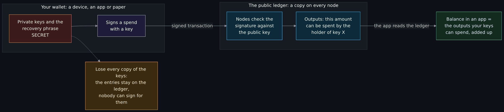
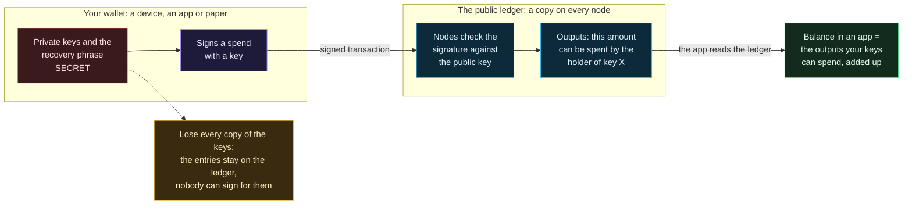
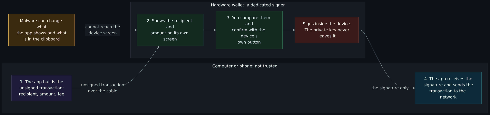
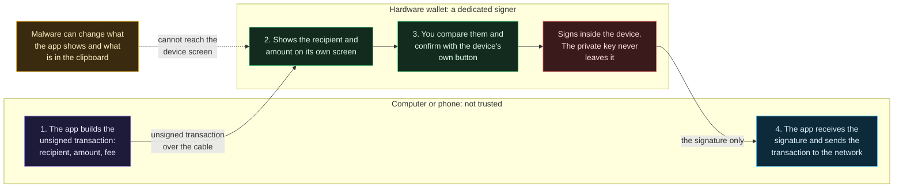
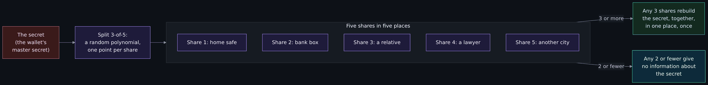
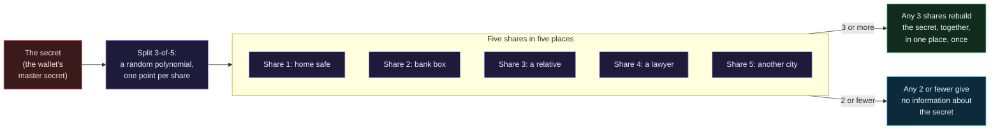
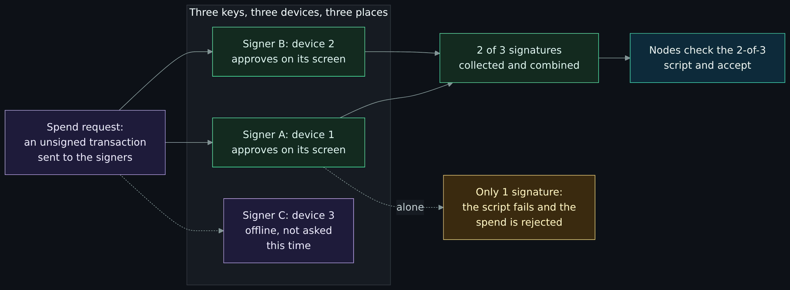
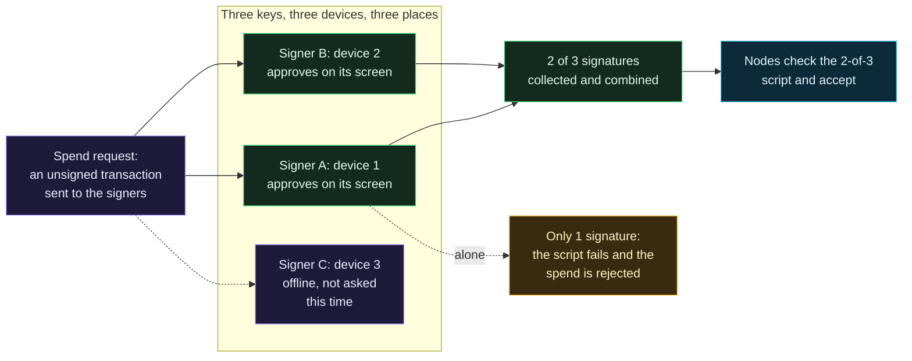

# Wallets and key custody: hot and cold, hardware wallets, recovery phrases, Shamir and multisig

<!-- BEGIN GENERATED PAGE NAV top: rewritten from docs/wiki/_nav.yaml by scripts/gen_wiki_nav.py; edit the manifest, not this block -->
[Home](Home.md) > [Track 3: Privacy, anonymity and cryptocurrency](Contents.md#track-3-privacy-anonymity-and-cryptocurrency) > Wallets and key custody

Previous: [How Monero works](How-Monero-Works-Compared-with-Bitcoin-and-Ethereum-DeFi-Mixers-Swaps-and-Ransomware.md) / Next: [Paper wallets and offline key generation](Paper-Wallets-Generators-and-Offline-Key-Generation-Tails-Electrum-and-Monero.md)
<!-- END GENERATED PAGE NAV top -->

Page four of five in the cryptocurrency set. Read it when you work in security or IT and the question has become "who holds the keys, and what happens when they are lost, stolen or demanded?". It explains what a wallet actually is (keys, not coins), the hot and cold kinds, the threat model for each, what a hardware wallet really protects and what it does not, how recovery phrases work (BIP39), how to store one, how Shamir secret sharing (SLIP39) and multisignature wallets spread the risk, what custody means for a company, and how wallets differ for Bitcoin, Ethereum and Monero. It passes on the maintainer's recommendation of one hardware wallet, with an affiliate link and a disclosure, and says exactly what I could and could not verify about it.

> Unfamiliar word or acronym? The [Glossary](Glossary.md) defines it.

> **Affiliate disclosure (read this first).** This page recommends one hardware wallet, the Trezor, and links to it with the maintainer's affiliate link. If you buy through that link, this project may receive a commission from Trezor at no cost to the reader. The link is marked every time it appears. You do not have to use it: you can buy the same device from the manufacturer's own store or an authorized reseller without it (see [buying and first use](#buying-and-first-use)). The reasons for the recommendation are listed so you can check them, and the parts I could not verify are marked.

> **Status: unverified draft, written from reading. Nothing on this page was run on a blockchain network, a node or a hardware wallet: I ran no node, no wallet, no signing software, no Shamir tool and no device, and I created and restored no wallet.** On **2026-11-01** I downloaded and read the pages named in the [claims register](#claims-register): six Bitcoin and SatoshiLabs improvement proposals (BIP11, BIP32, BIP39, BIP44, BIP174 and SLIP39) and a list of registered coin types (SLIP44), two Bitcoin developer guide pages and Bitcoin Core's wallet-management document, the Ethereum.org accounts page and the ERC-20 standard, three Monero project pages, the NIST glossary entries for three terms, the Trezor firmware repository's license file, README and five documentation files, and ten Trezor web pages. The only things I executed were `curl` downloads, `grep`, short Python snippets for arithmetic, and the drill script on this page, which I ran against the official English word list and checked against all 24 English test vectors published with the BIP39 reference implementation (a scratch run; this repository's test uses a made-up word list). **Not run:** any wallet or device in any step of the free exercise by a reader, Bitcoin Core, a Trezor or its emulator, Trezor Suite, any Shamir tool, any multisig setup, and the affiliate link (I did not open it). **Not read:** any other vendor's documentation, the Monero project's current documentation (the Moneropedia page I read says it is deprecated), Trezor's step-by-step pages on passphrases, multi-share setup and downloading Suite, and the sources named under [Not verified](#not-verified-plainly). The developer guide pages carry a copyright footer of 2009-2020. Trezor's pages show no edit date, so they are dated only by the day I read them. A claim I could not read on a source's own page is marked **est.** Where a source and this page disagree, trust the source and tell us.

> **Prerequisites.** [Hashing, encryption and keys](Hashing-Encryption-and-Keys.md) for what a key pair and a signature are, and [How Bitcoin works](How-Bitcoin-Works-Keys-UTXOs-Mining-and-Why-It-Is-Pseudonymous-and-Traceable.md#keys-addresses-and-signatures) for how a key becomes an address. No account is needed to read. The free exercise needs a wallet or a device that holds nothing and never will. About 100 minutes (est.).

> **Where this runs, and the rule.** The reading runs nowhere; the exercise runs on a throwaway wallet with no funds. It is defensive and educational. It gives no how-to for anything illegal and no instruction for moving anyone's money. It has no price talk, no coin shilling and no trading advice. There is no real recovery phrase, key or wallet address on this page: the placeholders are labeled as placeholders, and the only 64-digit value is the SHA-256 of a public word list.

## What you will be able to do

- Say why a wallet holds keys and not coins, and what the ledger holds instead.
- Tell hot, cold, signing-only, hardware and paper setups apart, and name the main threats each one faces and each one stops.
- Say what a hardware wallet protects (the key never leaves the device, you confirm on its own screen) and what it does not.
- Explain what a BIP39 recovery phrase is, how its word list and checksum work, what the optional passphrase does, and why the phrase is the wallet.
- Store a phrase sensibly (and say what not to do), and verify that a backup restores.
- Explain Shamir secret sharing in plain terms with its trade-offs, and multisignature wallets with what they protect against and what they add.
- Describe custody for a company in general terms: policy, approvals, separation of duties, hardware security modules (HSMs) and audit.
- Say how Bitcoin, Ethereum and Monero wallets differ.

## Where this page sits in the set

The maintainer asked for this set on 2026-11-01. Page one, [Blockchain fundamentals: hashes, blocks, nodes, consensus and forks](Blockchain-Fundamentals-Hashes-Blocks-Nodes-Consensus-and-Forks.md) (issue 396), explains the ledger. Page two, [How Bitcoin works](How-Bitcoin-Works-Keys-UTXOs-Mining-and-Why-It-Is-Pseudonymous-and-Traceable.md) (issue 397), explains keys, addresses and why Bitcoin is traceable. Page three, [how Monero works compared with Bitcoin and Ethereum, plus DeFi, mixers and tumblers and why ransomware makes this job knowledge](How-Monero-Works-Compared-with-Bitcoin-and-Ethereum-DeFi-Mixers-Swaps-and-Ransomware.md) (issue 398), explains how Monero hides its transactions and what a view key and a spend key do. This is page four (issue 399). Page five covers running Monero properly: a hardware wallet, the Qubes and Whonix offline-wallet design and why PiNodeXMR is used for an always-on node (issue 400, with the Qubes and Whonix exercises in issue 372).

Read beside this page: [Cryptography fundamentals](Cryptography-Fundamentals-Symmetric-Asymmetric-Hashing-Certificates-and-Keys.md#key-management-and-custody-the-hard-part), which covers the whole life of a key; [Privacy versus security](Privacy-vs-Security-Blinds-and-Locks-Physical-Security-and-Monero.md); and the [PiNodeXMR section](Tor-I2P-and-the-Darknet-Without-the-Myths.md#what-pinodexmr-documents) of the Tor and I2P overview.

## What the wiki already says (and the gap)

| Idea | Where it is today | The gap this page fills |
|---|---|---|
| Key lifecycle: generate, store, back up, revoke | [Key management and custody](Cryptography-Fundamentals-Symmetric-Asymmetric-Hashing-Certificates-and-Keys.md#key-management-and-custody-the-hard-part) | It is general. This page applies it to the one key where loss has no recourse. |
| Hardware keys and passphrases | [Keeping keys](Hashing-Encryption-and-Keys.md#keeping-keys-storage-passphrases-and-hardware-keys) | It covers a hardware key for logins. This page covers a device that signs payments. |
| A backup is not a recovery | [Testing](Business-Continuity-and-Disaster-Recovery-BCP-and-DR.md#testing-a-backup-is-not-a-recovery) | The same rule, applied to a recovery phrase in the exercise below. |
| Keys, addresses and hierarchical wallets | [How Bitcoin works](How-Bitcoin-Works-Keys-UTXOs-Mining-and-Why-It-Is-Pseudonymous-and-Traceable.md#keys-addresses-and-signatures) | It read one paragraph on the design and left wallets and custody to this page. |

## A wallet holds keys, not coins

Ethereum.org says it plainly in its page on accounts: "You never really hold cryptocurrency, you hold private keys" and "the funds are always on Ethereum's ledger." The same is true for Bitcoin, and page two shows how: an output on the ledger can be spent by whoever can produce a valid signature for it. The **wallet** is the thing that keeps the keys and makes the signatures. The **ledger** is the shared record that says which outputs exist and who may spend them.

Two consequences matter for the job.

1. **A balance in an app is a reading of the ledger.** The app adds up the entries your keys can spend. Lose the app and nothing on the ledger changes. Lose every copy of the keys and the entries stay on the ledger, but nobody can sign for them.
2. **Whoever holds the keys holds the money.** There is no account to recover and no one to call. Bitcoin's developer guide calls the three jobs of a wallet "separable": a public key distribution program, a signing program and a networked program. Most of the rest of this page is about where the signing program lives.



<details>
<summary>Diagram source (Mermaid)</summary>



</details>

Read the picture left to right. The red box is the only secret. The wallet signs, the nodes check, and the balance is read back from the ledger. The dotted line is the failure the rest of the page is about.

## Hot, cold and the kinds of wallet

The Monero project's old reference page gives a usable definition of hot: "a wallet which is currently or has ever been connected to the internet or loaded onto any device that has or may in the future be connected to the internet or any untrusted source." Cold is the opposite: the key has never been on such a device. The line is not always clean, which is why the table below lists setups and not just two words.

| Setup | Where the key lives | What touches the internet | Notes |
|---|---|---|---|
| Full-service software wallet (phone or desktop) | On the same device that browses the web | The device itself | The developer guide: easy to use, but "the compromise of such devices is a common occurrence" |
| Encrypted wallet file on a dedicated machine (the Core wallet, below) | In a file on a general-purpose computer | The machine, when it syncs | Encryption protects the file at rest; see below for what it does not stop |
| Signing-only (offline) wallet | On a computer that never connects to a network | Only a networked, watch-only wallet | Data crosses on removable media; the guide says this "greatly" reduces attack vectors |
| Hardware wallet | In a dedicated device that signs and does not export the key | The computer it is plugged into | The guide: dedicated devices "eliminate many of the vulnerabilities present in operating systems designed for general use" |
| Paper or steel backup | As words or a code on a physical object | Nothing, until someone types it into a device | A backup, not a way to spend: spending means restoring into a wallet |
| Custodial account | At a third party | The third party's systems | You hold a claim on the provider, not the keys (est.); see the custody section |

The developer guide describes the split behind the middle rows. A **networked** wallet holds only public keys (the "watch-only" or "online" wallet), builds an unsigned transaction and hands it over. The **signing-only** wallet checks it, signs it with the parent private key and hands it back. The hardware wallet is that second wallet in a dedicated box. A hardware wallet is usually called cold storage, with a caveat: it is plugged into an online computer to sign, and what makes it cold is that the key is never exported.

## Before hardware wallets: the Core wallet on a netbook

This section is the author's account, in his words as told to the page's writer, and is not sourced. Before hardware wallets, the practical threat model was the Core wallet on Linux, encrypted at rest, on a small netbook that held the full blockchain. He did that until he moved to hardware wallets around 2016, as they became popular. It is worth taking seriously, because it shows why hardware wallets were built.

**Why that setup worked.**

- **A small, dedicated machine.** A netbook with one job has little software on it and few reasons to open untrusted files. Less software means fewer ways in.
- **Encryption at rest.** Bitcoin Core's wallet-management document says the `wallet.dat` file "is not encrypted by default" and that the `encryptwallet` command encrypts the private keys. An encrypted file in a stolen or copied backup is much less useful to a thief.
- **A full node on the same machine.** The wallet did not have to ask a stranger what the ledger said (see page one on full nodes versus light clients, and the PiNodeXMR example for the Monero version).
- **Time-limited unlocking.** The document describes `walletpassphrase` with a timeout in seconds, after which the decryption key leaves memory and you must unlock again.

**Where it fell short.**

- **The key and the screen share one computer.** Whatever the netbook's screen showed was the only check on where the money was going. Malware on that machine could change both.
- **Encryption does not stop a keylogger.** The document: wallet encryption "may also not protect against more sophisticated attacks. An attacker can, for example, obtain the password by installing a keylogger." The developer guide agrees: encryption "cannot protect against an attack designed to capture the encryption key or to read the decrypted keys from memory."
- **Backups were easy to get wrong.** The document says non-HD wallets, which were all there was before Bitcoin Core version 0.13, "must be backed up every 100 keys used since the previous backup." After encrypting a wallet, "a new HD seed is generated", so any older backup misses what the new seed receives. A backup made before the change did not cover new money.
- **One passphrase, no way back.** The document: "There is no way to recover a passphrase," and if it is lost, "all the coins in the wallet will also be lost forever."
- **A netbook is one disk.** The backup file the document describes lives "on one or multiple offline devices" that the owner must keep, test and keep malware-free. The word "test" is in the document: "Backup files can be regularly tested to avoid problems in the future."

The hardware wallet answers the first two points directly. It does not answer the last three; those are about recovery phrases and are the second half of the page.

## The threat model

A threat model for a wallet names what you protect (the ability to sign), who or what attacks it, and where each defense stops. The table lists the threats the maintainer's brief named. A cell says what a setup does; the last column says what also helps and where the claim comes from.

| Threat | Software (hot) wallet | Hardware wallet | What also helps, and the source |
|---|---|---|---|
| Malware steals the key | Exposed: the key is on the infected device | Reduced: the key never leaves the device | The developer guide on full-service wallets and hardware wallets |
| Clipboard swap or a changed address on screen | Exposed: you paste what malware wrote | Reduced: you check the address on the device's own screen | Trezor says clipboard malware "can swap an address after you copy it" and that the device display "can't tell you whether an address someone gave you is the right one" |
| Phishing, fake apps, fake support | Exposed | Not reduced: a phrase typed into a fake site is gone | Trezor: "any request for your wallet backup, PIN, passwords, or codes is always a scam" |
| Tampered or counterfeit device (supply chain) | Not applicable | The main risk of buying one | Buy from the maker or an authorized reseller and check on first use (below) |
| Theft of the device | Depends on the lock on the device | PIN with an attempt limit | Trezor says the secure element in the Safe 3 and Safe 5 erases the secret after 16 wrong PINs |
| Physical coercion | Not stopped | Not stopped | No setup stops a person who is forced; a passphrase can hide a second wallet, and multisig spreads the keys across places and people (est.) |
| Loss, fire, flood | Lost with the device | Lost with the device | Back up the phrase and spread the backups; split it (Shamir) or spread the keys (multisig) |
| Bit rot and fading | Not applicable | Not applicable | Paper fades, flash media can lose data, steel does not (est.); test the restore on a schedule, as the Core document advises for backup files |
| Phrase photographed or in the cloud | A photo library or notes app syncs it | Same | Trezor: "Never share or create digital copies of your wallet backup" |
| The human leak | Anyone who sees or hears the phrase | Same | Trezor: "Never reveal wallet backup, PIN, or passphrase"; support will not ask |
| A bug in the device or the app | Exposed | Exposed too | Trezor's security portal lists resolved issues; see below |

"Reduced" is a deliberate word. A hardware wallet shrinks a set of threats and leaves the others where they were.

## What a hardware wallet protects, and what it does not



<details>
<summary>Diagram source (Mermaid)</summary>



</details>

This is the flow the developer guide describes for hardware wallets: connect the device, let the networked wallet send the transaction details to it, "review the transaction details on the hardware wallet's screen", let it sign, and let the networked wallet broadcast. The Partially Signed Bitcoin Transaction format (BIP174) exists for exactly this handoff: it carries what a signer needs, so that "the signer can be offline", and it lets "offline signers such as air-gapped wallets and hardware wallets" sign "without risk of being defrauded". Its rule for a signer includes that it may compute "the addresses and values being sent, and the transaction fee" and show them for confirmation.

**What it protects.**

- **The key stays inside.** Only the signature leaves, never the key.
- **You confirm on a screen the computer does not control.** Trezor calls it the Trusted Display: malware "can change what you see on those screens, but it cannot change what your Trezor shows you."
- **A stolen device is not an open wallet.** The PIN is enforced in hardware on the models with a secure element (below).
- **Signing happens in a dedicated environment**, away from the browser and the email client.

**What it does not protect.**

- **The wrong destination.** The device shows the address it was given. Trezor's own wording: it "can't tell you whether an address someone gave you is the right one."
- **A phrase you give away.** Phishing, a photographed card or a helpful stranger on the phone defeat the device completely.
- **A fake or tampered device.** The defense is where you buy it and the checks on first use.
- **Approvals you do not understand.** On Ethereum, a signature can grant a contract permission to move your tokens later. The device can show it; it cannot tell you it is unwise (see the Ethereum row below).
- **Bugs in the device and the app.** Trezor's security portal, read on 2026-11-01, lists resolved vulnerabilities by title and date, including a missing bounds check in image decoding (August 12, 2026) and a Monero payment ID that could be signed without being shown (August 13, 2026). I read only the titles. The portal's "relevant topics" also name "bypassing user confirmation" and "physical and supply chain attacks" as in scope. Open source means the code can be examined and fixed in public. It does not mean it has no bugs.
- **Coercion, loss and your own mistakes.** See the threat table.

## The hardware wallet I recommend: Trezor

> **Affiliate disclosure.** The link below is the maintainer's affiliate link. If you buy through it, this project may receive a commission from Trezor at no cost to the reader. You can buy from the manufacturer's own store or an authorized reseller without it, and the checks in the next section apply either way.

The maintainer recommends the Trezor because its firmware is open source, and recommends buying it through the maintainer's affiliate link to support the project: **[The Trezor, through the maintainer's affiliate link](https://affil.trezor.io/aff_c?offer_id=133&aff_id=32739)** (this is an affiliate link). Trezor's own scam-warning page lists `affil.trezor.io` as one of its two affiliate-link domains, so the host is the one Trezor names. I did not open the link, so I cannot say where it lands, what is on the page, or whether it changes what you pay. "No cost to the reader" is the maintainer's statement; I did not compare checkout totals. I name and compare no amounts.

**What I verified about "open source" (read 2026-11-01).**

- **The license is public, per directory.** The repository's license file says the repository "is a monorepo and different parts of monorepo are licensed under different licenses": `core` GPLv3, `legacy` LGPLv3, `crypto` "mostly" MIT, and so on. The GitHub repository metadata I read shows no single license for the whole repository, which matches that statement.
- **Trezor says the firmware has always been open source.** Its security-and-safety page: "The software used in Trezor devices has always been open-source to be fully auditable."
- **A build you can compare.** The repository's reproducible-build document invites the community "to participate in the verification of the firmware," describes a Docker-based build for the Trezor One and the later models, and a comparison with the official image. The comparison is not bit-for-bit, because official images are signed and local builds are not: you zero out the signature bytes, then compare SHA-256 hashes.
- **A development emulator exists.** The emulator is "a unix version of Core firmware that runs on your computer." The same document warns that it is "for *development purposes only*", that it uses a pseudo random number generator, that "no security or hardening efforts are made here," and that using it for anything else "runs the risk of losing funds."
- **Trezor acknowledges DIY devices.** Its device-authentication page says the check "should only be disabled if you need to connect unofficial devices to Trezor Suite, such as DIY builds."
- **Custom firmware has a cost.** The Trezor One build document says installing custom-built firmware "will erase the recovery seed stored on the device" and that you "should never do this on Trezor that contains coins". It also says unofficial builds need `PRODUCTION=0`.

**The Raspberry Pi Zero claim: what is sourced now.** The maintainer's position is that the design is open enough to be reproduced with commodity hardware such as a Raspberry Pi Zero. None of the Trezor documents I read for this page names a Raspberry Pi (I searched the files I had downloaded for "Raspberry" on 2026-11-01 and found no match). A later search that day found a community project that does it, called PiTrezor. It is not Trezor's project. What its pages say, read on 2026-11-01:

- **What it is.** The PiTrezor page says it shows "how to create your own hardware bitcoin wallet based on the original trezor source code and that run on it on a raspberry pi zero (or pi 4)." It lists support for the Pi Zero, Zero 2W and Pi 4, says it uses "the original trezor One code" with "only a thin layer" to adapt it to the Raspberry Pi's Linux platform, and its news list shows an update on 1 May 2026 (release 1.14.1.0). The repository it points to is a public fork of the Trezor firmware monorepo; GitHub's metadata (read 2026-11-01) shows the last push on 2026-05-01. I did not read the fork's code.
- **What its author says it gives up.** "The main difference of this device versus the real trezor device is that the pi zero stores everything on the SD card," and "anybody that has your SD card can access your seed words and private key." The author's answer is a passphrase, and he recommends always using one. The page also carries a no-warranty notice that says the software is not promised to be "secure or error-free."
- **What the Wasabi Wallet blog says** (post dated 11 September 2021; I read an archive copy, because the live host did not load for me). PiTrezor is "a port of the original code," but it "doesn't mean that the port itself is vetted by security professionals or maintained to include the latest updates." It advises building DIY devices into a multisig setup, not trusting one with large amounts, and it quotes Trezor's chief executive saying there are around 40 Trezor clones and that their modified code does not always get the scrutiny it should.
- **What WalletScrutiny says.** Its review (read 2026-11-01; the page is dated 2022-04-11 and was last compiled 2025-05-15) gives the verdict "diy," says the site "appears to be a guide on how to make a hardware wallet using a raspberry pi" and a Trezor One fork, notes that the firmware is precompiled, and says that, because the project's impact is low, "we leave further investigation to others." Its advice: "If you want to build your PiTrezor, better compile the firmware yourself, too." It did not check that the precompiled image matches the source, and neither did I. I did not see an "outdated" mark or a "not for non-technical users" line on the copy I read.
- **The maintainer's account (not a source).** The maintainer says he built one himself, first hand. That is his account. I did not watch it, test it or find a record of it beyond the sources above, and nothing on this page depends on it.

So the precise position is:

- **Supported by what I read:** a community project (PiTrezor) ports the Trezor One firmware to a Raspberry Pi Zero, with the Pi Zero 2W and Pi 4 as other targets; its author says the seed and keys sit in a file on the SD card and recommends a passphrase; and two outside sources describe it as a DIY project whose port is not vetted by security professionals. Also supported: the Trezor source is public and licensed per directory, the firmware can be built and compared to the official image, a desktop emulator runs the firmware code on a computer for development, and Trezor itself expects some people to connect unofficial DIY devices.
- **Not supported by what I read:** that a device built this way gives the protection of the real hardware. The emulator's own disclaimer says security and hardening "are only made available on physical Trezor hardware," the PiTrezor author says the seed is readable by anyone who has the SD card, and the Safe 3 and Safe 5 add a secure element (below). None of the pages I read says in so many words that a Pi Zero has no secure element; that it has none is my reading (est.), and I did not check the board's documentation. A general-purpose single-board computer is also the opposite of the "dedicated" signer the developer guide praises (est., my inference). I tested no device and checked no PiTrezor image against its source.
- **So:** read "open source" as "anyone can read, build, audit and fix the code", which is documented. Read the Pi build as "a hobbyist port that works with Trezor's tools, for people who accept the trade-offs above." Do not read it as "any board makes an equivalent wallet." The advice to buy the real device stands.

**What the hardware adds.** Trezor's pages say the Safe 3 and Safe 5 carry an OPTIGA Trust M secure element, and the Safe 7 adds a second one (TROPIC01) and a hardened microcontroller. The secure element enforces the PIN without storing it, enforces attempt limits (16 wrong PINs on the Safe 3 and Safe 5, 10 on the Safe 7, after which the secret is erased), stores a factory certificate that proves the device is genuine, and contributes randomness when the seed is made. Trezor says the OPTIGA chip is "certified to Common Criteria EAL6+" and that its documentation does not require a non-disclosure agreement; I did not check the certificate. The firmware-model pages I read list the Model One and Model T without a secure element section. I read no statement about them either way, and I compare no other vendor: I read no other vendor's documentation, so this page makes no comparison and no claim about any other device.

### Buying and first use

Buy only from the manufacturer or its authorized channels. Trezor's site has a page of authorized resellers by country (`trezor.io/resellers`, read 2026-11-01) and its scam page lists the official domains. Do not buy a used device, or one from a stranger's listing, whatever the discount (est.; general advice, not a Trezor statement). On first use, Trezor's guide for the Safe 3 (read 2026-11-01; the guides for the other models differ) lists these checks:

1. **The packaging and the holographic seal.** The seal over the USB-C port should be "clean, firmly attached, and free from tears or residue." Peeling it leaves a "VOID" residue, which is normal. If the seal was damaged or missing, "pause setup and contact Trezor support for guidance."
2. **The backup cards must be blank.** If words are already printed or written on them, "do not use the device." You fill them in yourself when the device makes your wallet.
3. **The firmware.** The Safe 3 "leaves the factory without firmware installed"; Trezor Suite installs the latest signed firmware, and "Each time you connect your Trezor, the bootloader checks the firmware signature" (a warning appears if it is unofficial).
4. **The device authentication check.** The device holds a certificate issued at the factory, and Trezor Suite checks it. For the Safe 7 Trezor describes a challenge-response: Suite sends a random challenge and checks the signed answer against Trezor's public keys. For the Safe 3 it says the secure element and the main chip both take part in the check. Trezor says to leave the check on unless you deliberately connect an unofficial device.
5. **Make the wallet yourself, on the device.** Never use a phrase that came with the box, a seller or a "setup helper".

Download Trezor Suite only from Trezor's own site; its scam page points to an article on verifying the download, which I did not read.

## Recovery phrases: BIP39

A **recovery phrase** (also called a mnemonic, seed phrase or wallet backup) is a list of words that encodes the secret from which every key in a wallet is derived. Trezor calls it "the most important part of your wallet setup." The standard behind it is BIP39 (assigned 2013-09-10, status Deployed, read in full).

**How the words and the checksum work.**

1. Make random entropy of **ENT** bits, from 128 to 256 in multiples of 32.
2. Take the first ENT/32 bits of its SHA-256 hash as a checksum and append them.
3. Split the result into groups of 11 bits. Each group is a number from 0 to 2047 and picks a word from a list of 2,048 words.

| Entropy (bits) | Checksum (bits) | Entropy plus checksum | Words |
|---|---|---|---|
| 128 | 4 | 132 | 12 |
| 160 | 5 | 165 | 15 |
| 192 | 6 | 198 | 18 |
| 224 | 7 | 231 | 21 |
| 256 | 8 | 264 | 24 |

The standard's reasons for the list: the first four letters of a word identify it, similar words ("build" and "built") are avoided, and the list is sorted. It strongly discourages non-English lists because most wallets support only English. The standard itself admits **shortcomings**: the checksum "is short", so "1-in-256 errors will be missed" (this is the standard's wording for the general case; for a 12-word phrase the checksum has 4 bits, so about one random wrong word in sixteen goes unnoticed, which the drill below shows), there is no versioning, and the conversion is one-way.

**From words to keys.** The phrase is turned into a binary seed with PBKDF2, HMAC-SHA512, 2,048 rounds, with the string "mnemonic" plus the optional passphrase as the salt. The 512-bit result is the input for BIP32 hierarchical keys. Two facts follow:

- **The phrase is the wallet.** Anyone who has the phrase (and the passphrase, if one is set) can derive every key, past and future, on any device. The device holds nothing the phrase does not.
- **The passphrase is not a password check.** "Every passphrase generates a valid seed (and thus a deterministic wallet) but only the correct one will make the desired wallet available." A mistyped passphrase does not fail. It opens a different, empty wallet. That is the "plausible deniability" the standard mentions, and it is also a way to scare yourself on restore day.

**Three different things called a passphrase or PIN.**

| Name | What it protects | Where it is checked | Lost means |
|---|---|---|---|
| Wallet file passphrase (Bitcoin Core) | The file holding the private keys | The wallet software, on unlock | Coins lost forever if there is no other backup of the keys ("not the seed", the document says) |
| BIP39 passphrase | It is part of the seed itself | Nowhere: any value derives a wallet | The funds are in a wallet you can no longer reach |
| Device PIN | Access to the device | The device, with an attempt limit | Wipe the device and restore from the phrase |

## Storing a phrase

The aim is that the phrase survives a fire, a flood, a burglary and a careless week, and that nobody who should not read it can. Sources and reasoning:

- **Offline, on a physical object, written by hand.** Trezor: "Always keep your wallet backup offline, private, and protected from damage or loss." The Core document: backups on "one or multiple offline devices" that are "reliable enough to work in an emergency and be malware free".
- **No photos, no cloud, no notes app, no password-manager sync.** Trezor: "Never share or create digital copies of your wallet backup." A photo of a card is a digital copy, and many phones upload photos automatically (general knowledge, est.).
- **Steel versus paper.** Paper is cheap and fails to fire, water and fading ink. A stamped or engraved metal plate survives much more (est.). Metal backup products exist (Trezor's own menu lists one); I tested none and endorse none. Whatever you choose, write legibly, number the words and keep the word order.
- **Geographic spread.** One copy at home and one somewhere else (a safe deposit box, a trusted relative) protects against a local disaster. Every copy is also another place to lose. Splitting the phrase (Shamir, below) is the structured version of this trade (est.).
- **Do not store the passphrase with the phrase.** If they sit together the passphrase protects nothing (est.).
- **Test it.** A backup you have never restored from is a guess. The exercise below is the test, and the [BCP page](Business-Continuity-and-Disaster-Recovery-BCP-and-DR.md#testing-a-backup-is-not-a-recovery) explains why.
- **Write down the procedure, not the secret.** Who knows where the copies are, how to reach them and what to do first belongs in a runbook with the secret left out; see [runbooks](Business-Continuity-and-Disaster-Recovery-BCP-and-DR.md#runbooks-contact-trees-roles-and-communications).

## One seed, many coins: derivation paths and how wallets differ

A **hierarchical deterministic (HD) wallet** derives a tree of keys from one root. BIP32 defines the tree: a parent key and an index give a child key, with a seed as the root (BIP32 allows 128 to 512 bits; BIP39 makes 512) and "hardened" children that cannot be derived from the public parent alone. Its useful trick is the **extended public key**: from it, software can derive every non-hardened child public key without any private key, which is how a watch-only wallet can show your addresses while the hardware wallet holds the signing keys. For the same reason, anyone who gets an extended public key can see all the addresses it derives (est., the same linkability as page two).

### Bitcoin

BIP44 fixes the path levels, with an apostrophe marking hardened derivation:

`m / purpose' / coin_type' / account' / change / address_index`

| Level | Value | Meaning |
|---|---|---|
| purpose | 44' | the structure of this standard |
| coin_type | 0' for Bitcoin, 1' for testnet | one subtree per coin; the full list is kept in SLIP44 |
| account | 0', 1', ... | independent identities |
| change | 0 external, 1 internal | external addresses are given out; internal ones receive change |
| address_index | 0, 1, 2, ... | the individual addresses |

The BIP sets an **address gap limit** of 20: software stops looking after 20 unused addresses in a row. Bitcoin Core's document also names BIP44, 49, 84 and 86 as standard paths (I read only the names). The lesson: the same phrase in different software, or with a different path, can show an empty wallet. The funds are not gone; the software is looking in a different place (est.). Record the wallet software and, for anything unusual, the path with your backup procedure.

### Ethereum

Ethereum has **externally-owned accounts** (controlled by a key pair) and **contract accounts** (controlled by code and with no private key), per Ethereum.org. An account is a key pair, and SLIP44 registers Ether as coin type 60 for the BIP44 structure. What changes the threat model is **approvals**. ERC-20, the common token standard, has an `approve` function that "allows _spender to withdraw from your account multiple times, up to the _value amount." Signing one gives a contract standing permission. Trezor's scam page says to "never approve token allowances you don't fully understand" and that such actions "can give a smart contract permission to drain assets from the entire wallet on that network". A hardware wallet shows what it decodes; the judgment is still yours.

### Monero

Monero's wallet is a separate design with its own seed, not BIP39. The Moneropedia pages I read (the mnemonic-seed page is marked deprecated and points to the Monero project's newer documentation, which I did not read) say:

- The official wallet's seed is **25 words, the last used as a checksum**, which correspond to a 256-bit integer that is the private **spend key**; the page also mentions 16-word seeds that embed the wallet's restoration height.
- The private **view key** is derived by hashing the private spend key with Keccak-256. Each account has both a spend key (to sign) and a view key (to see incoming transactions).
- A private view key "can be shared": sharing it lets another person see incoming transactions for that address, but, the page says, outgoing transactions "cannot be reliably viewed as of June 2017", so a balance seen through a view key "should not be relied upon". The spend key is what moves funds, and the 25 words give both: sharing them "is the equivalent of allowing another person complete access to your funds."

How Monero hides sender, receiver and amount is page three's subject (issue 398). The page-four fact is that the seed is the same kind of object: whoever has the words has the wallet, and the same storage rules apply. Running a wallet properly, including a hardware wallet and an offline design, is page five (issue 400).

**Which backup do you need?**

| Wallet type | What restores it |
|---|---|
| Single-key Bitcoin or Ethereum wallet | The BIP39 phrase, plus the passphrase if one was set |
| Trezor with a SLIP39 backup | One 20-word share, or the threshold number of shares for a multi-share backup |
| Multisig wallet | At least m of the n signer backups, plus the wallet's configuration (est.) |
| Core wallet file | The file from `backupwallet`, plus its wallet passphrase if encrypted |
| Monero wallet | The 25-word seed (or the spend key it represents) |

## Shamir secret sharing (SLIP39)

**Shamir's secret sharing** splits a secret into *n* shares so that any *k* of them rebuild it and fewer than *k* reveal nothing. NIST's glossary calls the idea **split knowledge**: a key is split into shares "each of which provides no knowledge of the key", and "knowledge of any k – 1 key shares provides no information about the key other than, possibly, its length." SLIP39 (created 2017-12-18, status Final, read through its sharing and recovery algorithms) applies it to wallet backups.



<details>
<summary>Diagram source (Mermaid)</summary>



</details>

**How it works, in a toy.** Pick a secret and build a polynomial of degree *k* minus 1 whose constant term is the secret. Each share is one point on it. For *k* = 2 the polynomial is a line, and two points define a line. The toy uses whole numbers modulo 97, with the secret 42 and the line f(x) = 42 + 7x:

| Share | x | f(x) mod 97 |
|---|---|---|
| A | 1 | 49 |
| B | 2 | 56 |
| C | 3 | 63 |

Any two shares recover the secret: from A and C, the line through (1, 49) and (3, 63) crosses x = 0 at 42. One share, such as B at (2, 56), tells you nothing: for every possible secret from 0 to 96 there is a line through (0, secret) and (2, 56), so all 97 secrets remain equally possible. SLIP39 does the same arithmetic in a different field: it applies it to each byte of the secret in GF(256), and it places the secret at x = 255 and a digest at x = 254 so that a wrong recovery is detected. What the toy shows is the shape, not the real field.

**What SLIP39 specifies (read 2026-11-01).**

- **Words and sizes.** Each share is a mnemonic of 10-bit words from a list of 1,024. A 128-bit secret gives a 20-word share and a 256-bit secret a 33-word share. The first two words encode a random identifier and the iteration exponent, so shares from the same backup start with the same two words and "the user can immediately tell whether the correct shares are being combined".
- **Two levels.** There can be up to 16 groups, each with up to 16 members, with a group threshold and a member threshold. The standard's example: Alice keeps two shares herself, and also arranges that 3 of 5 friends plus 2 of 6 family members can together rebuild it, so that even if all six family members collude against her, they cannot obtain the encrypted master secret "without the help of at least three of Alice's friends or without stealing one of Alice's own shares."
- **A checksum and a digest** (an RS1024 checksum on each share, and the digest above) catch mistakes.
- **A passphrase** is part of the standard (not read in detail).

Trezor's backup page adds the device side: a single 20-word share is the default on newer models, a multi-share backup is an option on SLIP39-capable devices, the user chooses the total and the threshold (up to 16 shares), and its example is a 3-of-5 backup that survives two lost shares. It also says BIP39 backups are "widely supported by most crypto wallets", while a SLIP39 share needs software that understands it.

**Trade-offs.**

- **For:** loss of one or two places does not lose the wallet, and theft of one or two places does not lose the funds. The trust is spread across people and sites.
- **Against:**
  - Compatibility: a SLIP39 backup restores only in software that supports SLIP39. A BIP39 phrase restores nearly anywhere.
  - More secrets to track, label, store and test. A recovery that needs 3 of 5 holders is a coordination problem on the worst day.
  - Collusion: *k* holders who agree can rebuild it.
  - The secret is whole at restore time, in one device, once. Shamir protects the backup, not the signing. This is the key difference from multisig.
- **Not the same as multisig.** Shamir splits one key. Multisig uses several keys that are never combined. The next section covers that.

## Multisignature wallets

A **multisignature** (multisig) wallet requires *m* signatures from a set of *n* keys before an output can be spent. The Bitcoin developer guide: "m is the minimum number of signatures which must match a public key; n is the number of public keys being provided." BIP11 (2011) proposed the standard form `m {pubkey}...{pubkey} n OP_CHECKMULTISIG` and named two uses: a wallet protected by a service, where a 2-of-2 spend needs the user's possibly compromised computer and the service's approval, and three-party escrow with a 2-of-3. The guide adds that P2SH multisig is "now generally used".



<details>
<summary>Diagram source (Mermaid)</summary>



</details>

Read the picture left to right. A spend request goes to the signers; each approves on its own device's screen; once two signatures are combined the nodes accept the spend, and one alone is rejected. The signers do not need to be online together: BIP174 lets a partially signed transaction be passed around, and its Creator and Signer roles separate building from signing (I read those two roles).

**What it protects against.** With 2-of-3, any one key can be lost without losing the funds, and any one key can be stolen without losing them. A single compromised device, a single dishonest person, or a single bug in one vendor's firmware is not enough to spend. Because each signer approves on its own device, the checks from the hardware wallet section happen several times over.

**What it adds.**

- **Complexity.** More devices, more backups, more steps for each spend, and every signer must verify the same destination.
- **The configuration is part of the backup.** To spend you need *m* keys and the knowledge of all *n* public keys in the script (est.). Back up that configuration along with the signer backups.
- **Size and cost.** More signatures make a bigger transaction, and the guide says fees follow the transaction's byte size.
- **Theater risk.** Three keys in one drawer, or three devices from one buyer who made the three phrases in one sitting, give little more than one key.
- **Coordination.** On the worst day you need *m* people or places to cooperate.

On Ethereum, a multi-approval wallet is usually a contract account whose code counts the approvals, since contract accounts are "controlled by the logic of the smart contract code" (est.; the Ethereum.org page does not describe multisig). Its rules are then only as good as the contract.

## Custody and institutional custody

**Custody** means someone other than the end user holds the keys: an exchange, a bank, a payment processor, a company's own treasury team. The questions are the ones in the [key management section](Cryptography-Fundamentals-Symmetric-Asymmetric-Hashing-Certificates-and-Keys.md#key-management-and-custody-the-hard-part) of the cryptography lesson, with the difference this page opened with: there is no recourse if the keys are lost or misused. The list below is general, sourced where marked, and not a design for a specific company.

| Control | What it stops | How it fails |
|---|---|---|
| Written policy: who may move what, to where, with what limits | The ad hoc transfer made under pressure | Nobody reads it; it differs from what the system allows |
| Approvals: more than one person must agree | One person (or one stolen account) moving funds | Approvers rubber-stamp; the same person holds both accounts |
| Separation of duties | A single user with "enough privileges to misuse the system on their own" (NIST) | Roles that look separate but share a credential or a boss |
| HSM | A key leaving the system where it is used | A weak policy in front of the HSM approves anything |
| Split knowledge for master keys | No single custodian can use or leak the whole key | Shares lost; the quorum cannot be assembled |
| Audit trail and reconciliation | Unnoticed changes; denial after the fact | Logs the same insiders can edit |
| A tested recovery plan | Loss of a person, a site or a device | A plan nobody has rehearsed |

Definitions from NIST's glossary (read 2026-11-01): **separation of duty** is "the principle that no user should be given enough privileges to misuse the system on their own"; the two-person rule is its dynamic form, where the second user must be "any authorized user different from the first". A **hardware security module** is "a physical computing device that provides tamper-evident and intrusion-resistant safeguarding and management of digital keys and other secrets, as well as crypto-processing", with FIPS 140-2 naming its requirements. **Split knowledge** is the Shamir idea above.

**How a company can require multiple approvals.** There are three mechanisms, and they differ in who enforces the rule:

1. **On the ledger.** A multisig script or contract wallet makes the chain itself reject a spend with too few signatures. No policy engine can be bypassed, because the rule is checked by every node. The signers' keys may sit in HSMs or hardware wallets.
2. **In a custody platform.** A policy engine collects approvals from named people (often with limits, allow-lists and time delays) and only then asks a key store, such as an HSM, to sign. The rule is enforced by software the company or vendor runs, so its security is that of the software and the people who administer it (est.).
3. **In the key store.** The HSM or key ceremony requires a quorum to unlock or use a key, with the quorum built on split knowledge (est.).

These can be layered. The practical question for an auditor or an incident responder is where the rule is enforced and who can change it. Third-party custody adds counterparty risk: an exchange's keys are the exchange's, and an incident at the provider is your incident.

Recovery belongs in the same plan. [Business continuity and disaster recovery](Business-Continuity-and-Disaster-Recovery-BCP-and-DR.md) covers [runbooks and roles](Business-Continuity-and-Disaster-Recovery-BCP-and-DR.md#runbooks-contact-trees-roles-and-communications) and the rule that [a backup is not a recovery](Business-Continuity-and-Disaster-Recovery-BCP-and-DR.md#testing-a-backup-is-not-a-recovery) until it has been restored on purpose.

## Free exercise: create, back up, restore and verify with no funds

Goal: make a wallet that will never hold anything, back it up, destroy it, restore it from the backup and prove the restore matches. Everything here is throwaway. **Not run:** I ran no step of this exercise on a wallet or a device. I ran only the drill script of Part A, offline, as described in the banner.

### Part A: see the arithmetic (offline, no wallet)

This script makes a throwaway 12-word phrase, checks a phrase, and shows how often the checksum catches a single wrong word. It needs Python 3 and the official English word list from the BIP39 repository (`bip-0039/english.txt`; its SHA-256 is `2f5eed53a4727b4bf8880d8f3f199efc90e58503646d9ff8eff3a2ed3b24dbda` as of 2026-11-01). It opens no network connection and writes no file. Download the list once, check the hash, and run the script with `python3 -I`.

```python
"""wallet_drill.py - make, check and break a throwaway recovery phrase, offline.

Usage:  python3 -I wallet_drill.py WORDLIST.txt make
        python3 -I wallet_drill.py WORDLIST.txt check     (phrase on line 1 of stdin, passphrase optional on line 2)
        python3 -I wallet_drill.py WORDLIST.txt break

WORDLIST.txt is the 2048-word English list from the BIP39 repository. It opens no network connection and writes no file.
The phrase it makes is a throwaway: never put funds behind it, and clear your terminal when you are done.
"""

import hashlib
import random
import secrets
import sys
import unicodedata


def load(path):
    words = open(path, encoding="utf-8").read().split()
    if len(words) != 2048 or len(set(words)) != 2048:
        sys.exit("the word list must hold 2048 different words")
    return words


def to_phrase(entropy, words):
    """Entropy bytes to words: append ENT/32 checksum bits from SHA-256, then read 11 bits per word."""
    bits = "".join(f"{b:08b}" for b in entropy)
    digest = "".join(f"{b:08b}" for b in hashlib.sha256(entropy).digest())
    bits += digest[: len(entropy) * 8 // 32]
    return " ".join(words[int(bits[i : i + 11], 2)] for i in range(0, len(bits), 11))


def from_phrase(phrase, words):
    """Words back to entropy bytes, or None when a word is unknown or the checksum does not match."""
    index = {w: i for i, w in enumerate(words)}
    parts = phrase.split()
    if len(parts) not in (12, 15, 18, 21, 24) or any(p not in index for p in parts):
        return None
    bits = "".join(f"{index[p]:011b}" for p in parts)
    size = len(bits) * 32 // 33
    entropy = bytes(int(bits[i : i + 8], 2) for i in range(0, size, 8))
    return entropy if to_phrase(entropy, words) == " ".join(parts) else None


def norm(text):
    return unicodedata.normalize("NFKD", text).encode()


def seed(phrase, passphrase=""):
    """BIP39: PBKDF2-HMAC-SHA512, 2048 rounds, salt 'mnemonic' plus the passphrase."""
    return hashlib.pbkdf2_hmac("sha512", norm(phrase), b"mnemonic" + norm(passphrase), 2048)


def label(raw):
    """A short fingerprint to compare a backup with its restore without printing the seed."""
    return hashlib.sha256(raw).hexdigest()[:8]


def main(argv):
    if len(argv) != 3 or argv[2] not in ("make", "check", "break"):
        sys.exit(__doc__)
    words = load(argv[1])
    if argv[2] == "make":
        phrase = to_phrase(secrets.token_bytes(16), words)
        print("throwaway phrase:", phrase)
        print("fingerprint, no passphrase:", label(seed(phrase)))
    elif argv[2] == "check":
        lines = sys.stdin.read().split("\n")
        phrase, passphrase = lines[0].strip(), (lines[1] if len(lines) > 1 else "")
        ok = from_phrase(phrase, words) is not None
        print("checksum:", "ok" if ok else "FAILED (a word is wrong, unknown, or the count is not 12, 15, 18, 21 or 24)")
        print("fingerprint, no passphrase:", label(seed(phrase)))
        print("fingerprint, with passphrase:", label(seed(phrase, passphrase)))
    else:
        rng = random.Random(7)
        caught = trials = 0
        for _ in range(300):
            good = to_phrase(bytes(rng.randrange(256) for _ in range(16)), words).split()
            slot = rng.randrange(12)
            good[slot] = rng.choice([w for w in words if w != good[slot]])
            caught += from_phrase(" ".join(good), words) is None
            trials += 1
        print(f"one word swapped in {trials} made-up phrases: the checksum caught {caught}, missed {trials - caught}")
        print("a swap the checksum misses still gives a valid phrase, and a different wallet")


if __name__ == "__main__":
    main(sys.argv)
```

What to do with it, and what you should see:

1. Run `break`. About fifteen in sixteen swaps are caught (I got 282 of 300 on 2026-11-01), because a 12-word phrase has a 4-bit checksum. The rest are valid phrases for other wallets.
2. Run `make`, copy the phrase by hand onto paper, then run `check` and type it back. The fingerprints must match what `make` printed. This is the pattern for a real wallet: compare a non-secret value, never the secret.
3. Run `check` again with a second line of input (a passphrase). The with-passphrase fingerprint differs from the no-passphrase one, and neither is flagged as wrong. That is the BIP39 passphrase behavior above.

### Part B: a real wallet, with no funds

Pick one: a hardware wallet you are willing to wipe, in a state with nothing on it, **or** a software wallet on a test network. Do not use any device or wallet that holds, or ever held, value you care about. Exact menus differ by model and version, so follow the maker's own guide for each step.

- [ ] I am using a wallet or device that holds nothing and never will.
- [ ] I created the wallet and wrote the recovery phrase on paper by hand, in a private room, with no camera, no phone and no screen share nearby.
- [ ] I took no photo and typed the phrase into no website or document.
- [ ] I displayed the first receive address on the device's own screen (or the test-network wallet) and noted it on a separate sheet marked TEST. An address is public, and deriving it needs no funds.
- [ ] I wiped the device (factory reset) or deleted the wallet.
- [ ] I restored from the paper phrase, entering it on the device or in the same software.
- [ ] I compared the first receive address after the restore with the noted address. They match. If they do not, I wrote down what differed (the path, the passphrase, the software).
- [ ] I broke it on purpose: restored again with one wrong word and again with a wrong passphrase, and noted what each did (a checksum error, or a different empty wallet).
- [ ] I wrote a half-page recovery procedure with the secret left out: where the copies are, who can reach them, what to do first, how long it took.
- [ ] I destroyed the test backup and wiped the device or deleted the wallet again.
- [ ] Optional on a device that supports it: repeated the loop with a multi-share (SLIP39) backup and restored from the threshold number of shares.

## Exercises

1. **Ledger or wallet.** A colleague says "the money is on my phone." Say what is true and what is not, and what the loss of the phone changes.
2. **Rank the threats.** For a company holding an on-chain treasury, put the eleven rows of the threat table in order of likelihood and of impact. Say where your two orders differ.
3. **Read the screen.** A transaction summary on a laptop shows address A; the hardware wallet's screen shows address B. List three explanations and what you would do first.
4. **One word.** A 12-word phrase is read back with the fifth word wrong. Say what the checksum will do, how often it catches such an error, and what a restore would show if it did not.
5. **Choose.** One person, a small team and a regulated company each need a way to hold keys. Pick a design for each from the page (hardware wallet, SLIP39, multisig, custody platform) and name the main thing each design cannot do.
6. **The claim.** Rewrite the sentence "any Raspberry Pi can be a Trezor" in the strongest form the sources support, and in the weakest.

## Not verified, plainly

- Nothing was run on a wallet, a device, a node or a network (see the banner): no Bitcoin Core, no Trezor, no emulator, no Suite, no signing, no Shamir tool, no multisig. The code I ran: `curl` downloads, `grep`, short Python snippets (arithmetic and the toy), and the drill script, checked in a scratch run against the official word list and all 24 English BIP39 test vectors.
- **The Raspberry Pi Zero claim is sourced to a community project, not to Trezor.** No Trezor document I read names a Raspberry Pi. PiTrezor's own page, the Wasabi Wallet post (an archive copy, because the live host did not load) and WalletScrutiny's review say what is in the recommendation section. I read the first part of the PiTrezor page (introduction, news list, features, parts list and setup steps through the Suite step) and its security and no-warranty sections, not all of it. I read only the GitHub metadata of the fork, not its code or README. I did not check the precompiled image against the source, test any device, or look at the Pi's board documentation, so "a Pi Zero has no secure element" is my reading. The maintainer's statement that he built one is his account and is not independently checked. I did not search Trezor's forum, blog or wiki.
- **What I read.** BIP11, BIP32, BIP39, BIP44, BIP174 (the abstract, motivation and the Creator and Signer roles) and SLIP39 (the abstract through the share format, the sharing and recovery algorithms; the checksum, passphrase, encryption and wordlist sections not read in detail); SLIP44 (the Bitcoin, testnet, Ether and Monero rows); the developer guide's wallets page (the wallet parts, full-service, signing-only, offline and hardware sections) and the multisig paragraph of its transactions page; Bitcoin Core's `managing-wallets.md`; the Ethereum.org accounts page and the ERC-20 standard's approve text; the three Moneropedia pages; the three NIST glossary entries; Trezor's license file, repository README, and the Optiga, reproducible-build, emulator, documentation-index and legacy documents (the other build and miscellaneous documents were only searched for the word "Raspberry"); and ten Trezor web pages (security portal, security-and-safety, device authentication, secure element, Safe 3 authentication guide, trusted display, wallet backups, scams and phishing, resellers, affiliate program); and, for the Raspberry Pi Zero claim, the PiTrezor project page (in part), the Wasabi Wallet post (archive copy) and WalletScrutiny's PiTrezor review, with the fork's GitHub metadata.
- **What I did not read.** Trezor's pages on passphrases, multi-share setup, recovery steps, firmware updates and Suite verification; its compare page and pricing; the advisories behind the portal's titles; any other vendor's documentation (so this page compares nothing); the Monero project's current documentation; BIP43, BIP49, BIP84, BIP86, BIP48 and descriptor-wallet specifications; the Bitcoin Core source; any HSM or custody vendor's documents; and the full text of FIPS 140 and NIST SP 800-57.
- **Dates.** Developer guide pages carry a 2009-2020 footer; BIP39 was assigned in 2013, BIP44 in 2014, SLIP39 created in 2017; the Moneropedia statement about outgoing transactions is dated by its own text to June 2017 and its mnemonic page is marked deprecated; Trezor's pages show no edit date. I checked none against a later release.
- **The affiliate link** was not opened. "No cost to the reader" is the maintainer's statement. Trezor's affiliate page I read says affiliates are paid commission on the net order value of referred sales within a 30-day window; it does not say what a buyer pays.
- The Core wallet history (the netbook, the move around 2016) is the author's account and is not sourced. The "est." items are general knowledge or my inference and are marked where they appear: steel versus paper, geographic spread, the loss of a multisig configuration, how custody platforms enforce approvals, why a DIY board is weaker than the device, and coercion.
- No law, regulation, license rule or reporting duty was checked. This page is not legal advice, and it is not financial advice.
- The first-person wording is the page's writer's; the maintainer should read it for voice before it is published.

## Claims register

Every row carries a status: **Read** means the statement is on the page named, read on the date shown (**2026-11-01**); **Run on** means I ran it myself that day; **Constructed** means made up by the author for the lesson; **est.** means I could not read it on a source's own page; **General knowledge** means common knowledge I did not source. Developer guide pages carry a 2009-2020 copyright footer. Trezor's web pages show no edit date.

| Claim | Source | Status |
|---|---|---|
| Entropy, checksum, 11-bit groups, 2,048 words, the table, PBKDF2 with 2,048 rounds and the salt, the passphrase behavior, the shortcomings | [BIP39](https://raw.githubusercontent.com/bitcoin/bips/master/bip-0039.mediawiki), assigned 2013-09-10 | Read 2026-11-01 (all of it) |
| The 512-bit seed to hierarchical keys, hardened versus normal children, extended public keys, the non-hardened public derivation | [BIP32](https://raw.githubusercontent.com/bitcoin/bips/master/bip-0032.mediawiki) | Read 2026-11-01 (the sections on child derivation, the key tree and the master key; the rest not read) |
| The five path levels, hardened levels, change 0 and 1, the gap limit of 20, coin types 0 and 1 | [BIP44](https://raw.githubusercontent.com/bitcoin/bips/master/bip-0044.mediawiki), assigned 2014-04-24 | Read 2026-11-01 (path levels, gap limit and coin types) |
| Registered coin types: Bitcoin 0, testnet 1, Ether 60 | [SLIP44](https://raw.githubusercontent.com/satoshilabs/slips/master/slip-0044.md) | Read 2026-11-01 (those three rows) |
| M-of-N standard transactions, the 2-of-2 service and 2-of-3 escrow uses | [BIP11](https://raw.githubusercontent.com/bitcoin/bips/master/bip-0011.mediawiki), assigned 2011-10-18 | Read 2026-11-01 (all of it) |
| A partially signed transaction format for offline, air-gapped and hardware signers; the Creator and Signer roles | [BIP174](https://raw.githubusercontent.com/bitcoin/bips/master/bip-0174.mediawiki), version 1.4.4 | Read 2026-11-01 (the abstract, motivation, the Creator and Signer roles) |
| Shamir over GF(256), k minus 1 shares reveal nothing, the digest at 254 and secret at 255, the share format, 20 and 33 words, the two-level scheme and its example | [SLIP39](https://raw.githubusercontent.com/satoshilabs/slips/master/slip-0039.md), created 2017-12-18, status Final | Read 2026-11-01 (through the sharing and recovery algorithms; the rest not read in detail) |
| Three separable wallet parts; full-service, signing-only, offline and hardware wallets; the hardware-wallet workflow | [Bitcoin developer guide, Wallets](https://developer.bitcoin.org/devguide/wallets.html) | Read 2026-11-01 (the sections named) |
| Multisig m-of-n; P2SH multisig now generally used | [Bitcoin developer guide, Transactions](https://developer.bitcoin.org/devguide/transactions.html) | Read 2026-11-01 (the multisig paragraphs only) |
| The wallet file is not encrypted by default; encrypting, unlocking with a timeout, backups, HD from version 0.13, the keylogger caveat, passphrase loss, migrating to descriptor wallets | [Bitcoin Core, managing-wallets.md](https://raw.githubusercontent.com/bitcoin/bitcoin/master/doc/managing-wallets.md), master branch | Read 2026-11-01 (all of it) |
| "You never really hold cryptocurrency, you hold private keys"; externally-owned and contract accounts | [Ethereum.org, Ethereum accounts](https://ethereum.org/developers/docs/accounts/) | Read 2026-11-01 (the account types and key pairs text) |
| The `approve` function allows a spender to withdraw multiple times up to a value | [EIP-20, ERC-20 Token Standard](https://eips.ethereum.org/EIPS/eip-20) | Read 2026-11-01 (the approve text) |
| 25-word seed, last word a checksum, the 256-bit spend key, the view key derived by Keccak-256, hot wallet definition, the sharing warning; the page is marked deprecated | [Moneropedia, Mnemonic Seed](https://www.getmonero.org/resources/moneropedia/mnemonicseed.html) | Read 2026-11-01 |
| The spend key signs and is another form of the seed | [Moneropedia, Spend Key](https://www.getmonero.org/resources/moneropedia/spendkey.html) | Read 2026-11-01 |
| The view key can be shared; incoming only; "as of June 2017" | [Moneropedia, View Key](https://www.getmonero.org/resources/moneropedia/viewkey.html) | Read 2026-11-01 |
| Split knowledge | [NIST CSRC glossary, split knowledge](https://csrc.nist.gov/glossary/term/split_knowledge) (from SP 800-57 Part 1 Rev. 5) | Read 2026-11-01 |
| Separation of duty and the two-person rule | [NIST CSRC glossary, separation of duty](https://csrc.nist.gov/glossary/term/separation_of_duty) (from SP 800-192) | Read 2026-11-01 |
| Hardware security module | [NIST CSRC glossary, hardware security module](https://csrc.nist.gov/glossary/term/hardware_security_module_hsm) | Read 2026-11-01 |
| Per-directory licenses of the firmware monorepo | [trezor-firmware LICENSE.md](https://raw.githubusercontent.com/trezor/trezor-firmware/main/LICENSE.md) and the repository metadata at api.github.com | Read 2026-11-01 |
| Reproducible build and the signed-image comparison | [trezor-firmware, reproducible-build.md](https://raw.githubusercontent.com/trezor/trezor-firmware/main/docs/common/reproducible-build.md) | Read 2026-11-01 |
| The emulator is for development only | [trezor-firmware, emulator docs](https://raw.githubusercontent.com/trezor/trezor-firmware/main/docs/core/emulator/index.md) and [legacy docs](https://raw.githubusercontent.com/trezor/trezor-firmware/main/docs/legacy/index.md) | Read 2026-11-01 |
| Custom firmware erases the seed; Optiga PIN counters in the Safe 3 and Safe 5 | the legacy docs above and [optiga.md](https://raw.githubusercontent.com/trezor/trezor-firmware/main/docs/core/misc/optiga.md) | Read 2026-11-01 (the legacy warning; the optiga table header and counters) |
| Open source "to be fully auditable"; the boardloader, bootloader and firmware layers | [Trezor, Security and safety in Trezor](https://trezor.io/learn/security-privacy/how-trezor-keeps-you-safe/security-safety-in-trezor) | Read 2026-11-01 |
| The authenticity check; DIY builds; the factory certificate | [Trezor, device authentication check](https://trezor.io/learn/security-privacy/how-trezor-keeps-you-safe/trezor-safe-device-authentication-check) | Read 2026-11-01 |
| What the secure element does; 16 and 10 PIN attempts; EAL6+; no non-disclosure agreement | [Trezor, Secure Elements in Trezor Safe devices](https://trezor.io/learn/a/secure-element-in-trezor-safe-3) | Read 2026-11-01 |
| Seal, blank cards, firmware and secure element checks on first use | [Trezor, Authenticate Trezor Safe 3](https://trezor.io/guides/trezor-devices/trezor-safe-3/authenticate-trezor-safe-3) | Read 2026-11-01 (this model's guide only) |
| The Trusted Display and clipboard malware | [Trezor, What is a Trusted Display?](https://trezor.io/guides/trezor-devices/trezor-fundamentals/trezor-s-trusted-display-verify-every-address-on-your-device) | Read 2026-11-01 |
| Wallet backups: BIP39 and SLIP39, 12, 20 and 24 words, multi-share up to 16 shares | [Trezor, Understanding wallet backups](https://trezor.io/learn/security-privacy/personal-security-standards/understanding-trezor-wallet-backups-12-20-or-24-words) | Read 2026-11-01 |
| Phishing, no digital copies, approvals, official domains including the affiliate link domains | [Trezor, Common scams and phishing](https://trezor.io/learn/security-privacy/personal-security-standards/scams-and-phishing) | Read 2026-11-01 |
| Authorized resellers | [Trezor, Resellers](https://trezor.io/resellers) | Read 2026-11-01 (the heading and that a country list exists) |
| Resolved vulnerabilities listed by title and date; the topics in scope | [Trezor, Security portal](https://trezor.io/security) | Read 2026-11-01 (the titles only) |
| Affiliate commission on net order value; a 30-day window | [Trezor, Affiliate program](https://trezor.io/affiliate) | Read 2026-11-01 |
| The drill script reproduces all 24 English BIP39 vectors; the word list's SHA-256; 282 of 300 swaps caught | The author's own scratch run against the BIP39 repository's word list and the reference implementation's vectors file | Run on 2026-11-01 |
| The toy Shamir numbers and the BIP39 and SLIP39 size arithmetic | The author's own arithmetic, repeated by this page's test | Run on 2026-11-01 |
| The Core wallet on a netbook, and the move to hardware wallets around 2016 | The author's own account | General knowledge; the author's account, not sourced |
| The recommendation of the Trezor and the use of the affiliate link | The maintainer's framing, issue 399 and its shared rules (2026-11-01) | Read in the issue; a framing, not a source claim (**est.**) |
| "No cost to the reader" for the affiliate link | The maintainer's statement | **est.**; not checked against Trezor's terms |
| A community project (PiTrezor) ports the Trezor One firmware to a Raspberry Pi Zero; the seed sits in a file on the SD card; the author recommends a passphrase | [PiTrezor project page](https://www.pitrezor.com/2018/02/pitrezor-homemade-trezor-bitcoin-wallet.html) and the [fork's repository metadata](https://api.github.com/repos/heneault/trezor-firmware) | Read 2026-11-01 (the page's introduction, news, features, parts, setup steps, security and no-warranty text; the rest not read; the fork's code not read) |
| PiTrezor is a port that is not vetted by security professionals; multisig advised; about 40 Trezor clones | [Wasabi Wallet blog, DIY Hardware Wallets, Part II](https://blog.wasabiwallet.io/diy-hardware-wallets-part-ii/), 2021-09-11 | Read 2026-11-01 (an archive copy; the live host did not load) |
| PiTrezor's verdict is "diy"; the firmware is precompiled and not checked against the source | [WalletScrutiny, Pitrezor](https://old.walletscrutiny.com/hardware/pitrezor) | Read 2026-11-01 (all of the review text) |
| The maintainer built a PiTrezor himself | The maintainer's statement, issue 415 | **est.**; his first-hand account, not independently checked |
| A Pi Zero has no secure element, so a Pi build lacks the real device's protection | The author's own reading | **est.**; no source I read states it; the board documentation was not checked |
| Steel versus paper, geographic spread, passphrase storage, loss of a multisig configuration, custody enforcement, coercion | General knowledge | General knowledge; not read on a page today |

<!-- BEGIN GENERATED PAGE NAV bottom: rewritten from docs/wiki/_nav.yaml by scripts/gen_wiki_nav.py; edit the manifest, not this block -->
Where you are: [Home](Home.md) > [Track 3: Privacy, anonymity and cryptocurrency](Contents.md#track-3-privacy-anonymity-and-cryptocurrency) > Wallets and key custody

Previous: [How Monero works](How-Monero-Works-Compared-with-Bitcoin-and-Ethereum-DeFi-Mixers-Swaps-and-Ransomware.md) / Next: [Paper wallets and offline key generation](Paper-Wallets-Generators-and-Offline-Key-Generation-Tails-Electrum-and-Monero.md)

In this track: [Track 3: Privacy, anonymity and cryptocurrency](Contents.md#track-3-privacy-anonymity-and-cryptocurrency), 16 pages

- Cryptography and privacy: [Cryptography fundamentals](Cryptography-Fundamentals-Symmetric-Asymmetric-Hashing-Certificates-and-Keys.md) / [Privacy, security and anonymity](Privacy-Security-and-Anonymity-Three-Different-Things-and-Why-There-Is-No-Silver-Bullet.md) / [Privacy versus security](Privacy-vs-Security-Blinds-and-Locks-Physical-Security-and-Monero.md)
- Tor, I2P, VPN and browsing: [Tor, I2P and the darknet without the myths](Tor-I2P-and-the-Darknet-Without-the-Myths.md) / [How a VPN works](How-a-VPN-Works-Tunnels-What-It-Hides-What-It-Does-Not-and-What-an-Audit-Proves.md) / [How Tor works in depth](How-Tor-Works-in-Depth-Circuits-Relays-Directory-Authorities-and-Onion-Services.md) / [How I2P works](How-I2P-Works-Tunnels-Garlic-Routing-and-the-Network-Database.md) / [The browsing setups compared](The-Browsing-Setups-Compared-Tor-Browser-Brave-Whonix-Tails-and-Qubes-with-Whonix.md) / [The darknet landscape: markets, OPSEC and layering](The-Darknet-Landscape-Markets-OPSEC-Clearnet-and-Layering-Tor-I2P-and-VPN.md)
- Cryptocurrency: [Blockchain fundamentals](Blockchain-Fundamentals-Hashes-Blocks-Nodes-Consensus-and-Forks.md) / [How Bitcoin works](How-Bitcoin-Works-Keys-UTXOs-Mining-and-Why-It-Is-Pseudonymous-and-Traceable.md) / [How Monero works](How-Monero-Works-Compared-with-Bitcoin-and-Ethereum-DeFi-Mixers-Swaps-and-Ransomware.md) / **Wallets and key custody** / [Paper wallets and offline key generation](Paper-Wallets-Generators-and-Offline-Key-Generation-Tails-Electrum-and-Monero.md) / [Running Monero properly](Running-Monero-Properly-Hardware-Wallet-Qubes-and-Whonix-Offline-Wallet-and-PiNodeXMR.md)
- Radio and off-grid: [Radio and off-grid communication](Radio-Off-Grid-Communication-LoRa-Meshtastic-Reticulum-Ham-and-SIGINT.md)

Related pages:

- [Business continuity and disaster recovery](Business-Continuity-and-Disaster-Recovery-BCP-and-DR.md)
- [How Bitcoin works](How-Bitcoin-Works-Keys-UTXOs-Mining-and-Why-It-Is-Pseudonymous-and-Traceable.md)
- [How Monero works](How-Monero-Works-Compared-with-Bitcoin-and-Ethereum-DeFi-Mixers-Swaps-and-Ransomware.md)
- [Running Monero properly](Running-Monero-Properly-Hardware-Wallet-Qubes-and-Whonix-Offline-Wallet-and-PiNodeXMR.md)
- [Cryptography fundamentals](Cryptography-Fundamentals-Symmetric-Asymmetric-Hashing-Certificates-and-Keys.md)
- [Hashing, encryption and keys](Hashing-Encryption-and-Keys.md)
<!-- END GENERATED PAGE NAV bottom -->
