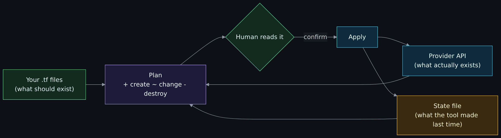
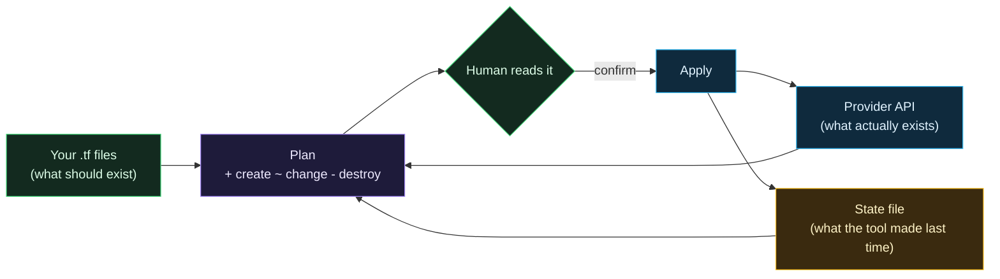

# What is infrastructure as code

> Unfamiliar word or acronym? The [Glossary](Glossary.md) defines it.

Start-from-zero page 4 of 8. Previous: [Identity, secrets and zero trust basics](Identity-Secrets-and-Zero-Trust-Basics.md). Next: [Git, GitHub and pull requests](Git-GitHub-and-Pull-Requests.md).

If you have ever rebuilt a Raspberry Pi from scratch and tried to remember every package you installed and every config file you edited, you already understand the problem that infrastructure as code solves.

## The problem: ClickOps

The normal way to set up a cloud environment is to log in to the provider's web console and click. Create a machine here, attach a firewall there, add a rule, change a setting. It works, and it is how most people start.

Six months later nobody knows exactly what exists, why that one rule is there, or whether the second environment matches the first. If the account is lost or the machine dies, the rebuild is from memory. If someone opens a port by accident, nothing notices. The industry's name for this is **ClickOps**, and it is said with a wince.

## The idea: describe it, then let a tool make it so

**Infrastructure as code** (IaC) means you write down, in text files, what the environment should look like: this network with this range, this firewall with these rules, this machine of this size with this tag. A tool reads the files, compares them with what actually exists, and creates, changes or deletes things until reality matches the files.

Three things fall out of that immediately:

1. **The files are the documentation.** There is no "what did we set up" question, because the answer is in the repository, with history.
2. **The files can be reviewed.** A change to the firewall is a change to a text file, and someone can read it before it happens.
3. **The environment can be rebuilt.** Delete everything, run the tool again, get the same thing. This is why "destroy and recreate" is the recovery plan for this project's droplets rather than a disaster.

## Terraform, OpenTofu, and why both names appear

**Terraform** is the tool that made this approach mainstream, created by HashiCorp in 2014. You write files in a language called **HCL** (HashiCorp Configuration Language), run `terraform plan` to see what would change, and `terraform apply` to do it.

In 2023 HashiCorp changed Terraform's license from open source to a "source available" license that restricts some uses. The community forked the last open-source version and continued it under the Linux Foundation as **OpenTofu**. Same language, same providers, same commands with `tofu` instead of `terraform`, open license (MPL 2.0).

This project uses OpenTofu. Many pages, settings and file names still say "Terraform" because the ecosystem does (the provider registry, Spacelift's workflow setting, the `.terraform.lock.hcl` file name). When you read "Terraform" here, read "OpenTofu". When you read a job posting that says Terraform, everything you learn here applies.

## The four words you need

### Provider

A **provider** is a plugin that knows how to talk to one service's API. The DigitalOcean provider knows how to create droplets and firewalls; the Twingate provider knows how to create connectors and access rules. You declare which providers you need and OpenTofu downloads them. In this repo, `versions.tf` in each folder lists them.

### Resource

A **resource** is one thing the tool manages: one VPC, one firewall, one droplet. You write a block that names the resource type and the settings you want. Here is the smallest real one in this repository, from `modules/vpc/main.tf`:

```hcl
resource "digitalocean_vpc" "this" {
  name     = "${var.layer}-${var.region}-vpc"
  region   = var.region
  ip_range = var.ip_range
}
```

Read it as: "there should be a DigitalOcean VPC, which I will refer to as `this`, named from the layer and region, in that region, with that address range." `var.region` means "the value of the input variable called region". That is most of HCL: blocks, names, and values. [Data formats and config files](Data-Formats-JSON-YAML-HCL.md#hcl-and-opentofu-syntax) reads a `variable` block line by line.

### Plan and apply

`tofu plan` reads your files, asks the provider what currently exists, and prints the difference as a list: `+` to create, `~` to change in place, `-` to destroy, `-/+` to destroy and recreate. Nothing happens. You read the plan.

`tofu apply` carries out that list, after asking you to confirm.

The plan is the most important artifact in the whole workflow. It is where a human catches "wait, why does changing a comment destroy a droplet?" before it happens. In this project the plan is read on Spacelift by a human before every apply, and the [Terraform reference](Terraform-Reference.md) ends with a checklist of what to look for in one.



<details>
<summary>Diagram source (Mermaid)</summary>



</details>

### State

After an apply, OpenTofu writes a **state file**: a record of every resource it created and the real-world ID the provider gave it. Next time, it uses the state to know which droplet is "its" droplet, so it can change or delete the right one.

State is where beginners get hurt:

- **Lose the state and the tool forgets what it built.** The resources still exist and still bill you, but the tool will try to create them again. The provider then refuses or you get duplicates.
- **State contains everything about the resources, including secrets** that were passed in. A token written into a machine's configuration is in the state file in plain text. So where the state lives, and who can read it, is a security question. This project keeps state in Spacelift and lists "connector tokens are in state" as an accepted risk in the [Threat model](Threat-Model.md).
- **Two applies at once can corrupt state** when nothing locks it, for example two laptops each holding a copy. Shared backends lock the state while an apply runs, and a runner such as Spacelift queues runs one at a time per stack. That is one reason to run the tool in one shared place rather than on laptops.

## Declarative, not a script

A shell script says "do these steps". IaC says "this is the end result"; the tool works out the steps. The difference shows up the second time you run it. A script run twice creates two machines. An IaC configuration applied twice does nothing the second time, because reality already matches. The word for that property is **idempotent**, and it is what makes "just run it again" a safe recovery move.

## Drift

**Drift** is when reality stops matching the files because someone changed something by hand in the console. The next plan shows the difference and offers to put it back. That is a feature: a port someone opened "just for a minute" shows up as a change the next time anyone runs a plan. The rule in this project is that nothing is changed by hand, so a plan that shows unexpected changes is itself an alarm.

## Modules and stacks

As files grow, you split them. A **module** is a folder of HCL that does one thing and takes inputs, like a function. This repo has three: `vpc`, `firewall` and `twingate-connector`. The same `firewall` module is called twice with different inputs to make two different firewalls.

A **stack** (this project's term; Terraform calls it a root module) is a folder you actually apply, which calls modules and has its own state. This repo has two: `00-foundation` and `10-access`. The [OpenTofu, stacks and modules](OpenTofu-Stacks-and-Modules.md) page explains why they are layered, and it comes down to blast radius: a mistake in the access layer cannot touch the network layer, because the network is not in that state file.

## Where cloud-init fits

OpenTofu creates the machine. Something still has to configure what is **on** the machine: users, packages, settings. Tools like Ansible do that by logging in afterwards. This project instead uses **cloud-init**, a standard first-boot mechanism: you hand the machine a text file when you create it, and the machine configures itself before anyone can log in. The file is a template in the repo, filled in by OpenTofu, so the machine's whole setup is in the same review and the same plan. [Droplet hardening](Droplet-Hardening.md) walks through it. The cost is that any change to that file means the machine is rebuilt, which is fine for machines that hold nothing.

## Who runs the tool

You could run `tofu apply` from your laptop. Problems: the state is on your laptop, the write-capable cloud token is on your laptop, and nothing stops you applying something nobody reviewed. You could run it from GitHub Actions. Problems: the token is in CI, which is one bad workflow away from leaking it.

This project runs it in **Spacelift**, a hosted service for exactly this. Spacelift holds the state, runs the plan when code lands on the main branch, and then **stops and waits for a human to read the plan and press confirm**. Secrets reach the run from Doppler at the last moment. GitHub Actions only ever tests; it never holds a cloud credential. [Spacelift](Spacelift.md) explains the choice and the one way it is not perfect.

## Reading this repository's code

Start with the smallest file and work up:

1. `modules/vpc/variables.tf`, `main.tf`, `outputs.tf`: three short files, one resource. Notice the `validation` block that refuses a public address range before anything is created.
2. `modules/firewall/`: one resource with `dynamic` blocks that turn a list of rules into real rules.
3. `stacks/00-foundation/main.tf`: see how a stack calls modules and passes values between them.
4. `modules/twingate-connector/main.tf`: the droplet and the `templatefile()` call that fills in cloud-init.
5. `stacks/10-access/main.tf`: everything wired together.

The [Terraform reference](Terraform-Reference.md) explains every line of all of those, in that order.

## Try it yourself, without a cloud account

Want to type `tofu init`, `plan`, `apply` and `destroy` yourself first, with providers that only write files in a scratch folder? [OpenTofu from zero: init, plan, apply, destroy](OpenTofu-From-Zero.md) is a hands-on lesson for that, with a loop that builds and destroys ten times and proves the state is empty each time.

The tests in this repo use **mocked providers**: fake DigitalOcean and Twingate that accept any request and return made-up IDs. So you can run the whole test suite with no account and no cost.

```bash
# install OpenTofu 1.8 or newer first: https://opentofu.org/docs/intro/install/
git clone https://github.com/ChiefGyk3D/Clouds-Against-Humanity.git
cd Clouds-Against-Humanity
tofu -chdir=modules/vpc init -backend=false
tofu -chdir=modules/vpc test
```

You should see tests pass, including one that proves a public address range is rejected. Change the range in a test to `8.8.8.0/24`, run again, watch it fail, and you have just experienced what "validation at the edge" means. Then repeat for `modules/firewall` and read `modules/firewall/tests/` to see what a security property looks like when it is written as a test.

Next: [Git, GitHub and pull requests](Git-GitHub-and-Pull-Requests.md).
