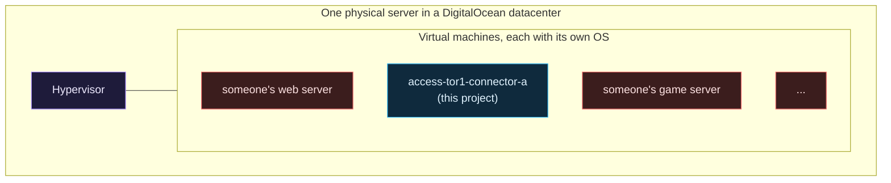

# What is the cloud

Start-from-zero page 1 of 8. Previous: [Start here](Start-Here-If-You-Are-New.md). Next: [Networking basics for this project](Networking-Basics-for-This-Project.md).

"The cloud is just someone else's computer" is true and almost useless. Yes, a cloud provider owns racks of servers in a building you will never visit. The part that matters is **how** you get to use them: by the hour, through an API, with a public internet address attached, and with a bill that follows whatever you leave running.

## What a cloud provider actually sells

Three shapes of thing, from most to least like a computer at home:

| Shape | What you get | Homelab equivalent | In this project |
|---|---|---|---|
| **Virtual machine** (DigitalOcean: **droplet**; AWS: EC2 instance) | A slice of a physical server that behaves like a whole Linux computer: its own CPU share, memory, disk, operating system, and network address. You log in and run whatever you want. | A Raspberry Pi or a Proxmox VM | The two connector droplets (stage 1), the workload droplet (stage 3) |
| **Object storage** (DigitalOcean: **Spaces**; AWS: S3) | A place to put files, reached over HTTPS with an access key. No operating system, no disk to manage, pay per gigabyte stored. | A NAS share, roughly | The state bucket planned for stage 3 |
| **Serverless functions** (DigitalOcean: **Functions**; AWS: Lambda) | You hand over a small program and a schedule or a web address. The provider runs it when triggered and bills the seconds it ran. No machine to maintain at all. | A cron job, with no computer | The timer jobs planned for stage 3 |

Everything else a provider sells (managed databases, Kubernetes, load balancers, CDNs) is a packaged combination of those three with staff on call. This project uses none of them, on purpose; the [Roadmap](Roadmap.md) explains why each is "not yet".

## A virtual machine, a little more precisely

One physical server runs a program called a **hypervisor**. It carves the hardware into slices and runs a separate operating system in each. Each slice is a virtual machine. The VM does not know it is sharing; it sees "a computer" with, say, one CPU and one gigabyte of memory. That is why the cheapest droplet here is called `s-1vcpu-1gb`: one virtual CPU, one gigabyte of RAM.

Your neighbours on the physical server are strangers. The hypervisor keeps you apart, and that separation is a large part of what you pay the provider to get right. It is also why "a droplet" is cheap: the machine is shared.

## The three differences from a Pi at home that change everything

### It has a public address from the first second

At home your Pi has an address like `192.168.1.20` that only works inside your house. The router between you and the internet does not forward anything in unless you tell it to. You are protected by default and by accident.

A droplet is the opposite. DigitalOcean gives every droplet a **public IP address** that anyone in the world can send packets to, and you cannot turn that off. Within minutes of a new machine coming online, automated scanners from all over the internet will have probed it, because they probe every address all the time. If SSH is listening with a password, the password guessing starts within the hour. This is not a theoretical risk; it is the background noise of the internet, and the [Threat model](Threat-Model.md) lists it as threat number one.

So the first job in the cloud is the reverse of the first job at home. At home you open things up. In the cloud you close things down, and you do it before the machine exists, not after. This project's answer is a firewall with **zero inbound rules** attached to every droplet at the moment it is created. The [Networking basics](Networking-Basics-for-This-Project.md) page explains how a machine with no inbound rules can still work.

### You never touch it

There is no keyboard, no monitor, no power button, no SD card to pull. If you lock yourself out, you are out. Providers offer a web console as a last resort, but this project turns that off too (no password exists on the machine for it to use). The accepted way back in is to destroy the machine and build it again from code, which takes a few minutes and is only painless because nothing on the machine is irreplaceable. "Stateless" is the word for that, and it is a design goal here.

### It bills you for existing

A Pi costs electricity. A droplet costs money every hour it exists, whether or not it does anything, and so does every disk, snapshot and backup attached to it. Forgetting to delete something is the most common way a learner gets a surprise bill. Whole page on this: [How money works in the cloud](How-Money-Works-in-the-Cloud.md).

## Regions and datacenters

A provider has buildings in several cities. Each is a **region** with a short code: `nyc3` is a New York datacenter, `tor1` is Toronto, `ams3` is Amsterdam. A VM lives in exactly one region, and so does a private network. You pick a region for latency, for price, and for which sizes are offered there. This project moved from New York to Toronto because the $6 droplet size was not offered in the New York datacenter on a new account; the story is on [Lessons learned](Lessons-Learned.md), and it is a good example of the kind of fact you only find out by trying.

## Everything is an API

At home, you configure things by logging in and typing. In the cloud, every action (create a machine, attach a firewall, add a rule, delete a disk) is an **API call**: a request to the provider's web service, authenticated with a **token**. The web console you can click around in is just a front end that makes those calls for you.

This matters for two reasons:

1. Because everything is an API call, everything can be written down as code and run by a program. That is [infrastructure as code](What-Is-Infrastructure-as-Code.md), and it is how this whole environment is built.
2. Because a token can do anything the account can do, the token is the crown jewel. Whoever holds a write-capable DigitalOcean token can delete every machine, or create a hundred expensive ones and send you the bill. Every page about secrets on this wiki comes back to that.

## Who is responsible for what

Providers talk about a **shared responsibility model**. The split for a virtual machine is roughly:

| The provider is responsible for | You are responsible for |
|---|---|
| The building, power, cooling, physical security | Which ports your firewall opens |
| The physical servers and the hypervisor | The operating system updates on your VM |
| Keeping tenants separated | Who can log in and how |
| The network between datacenters | Every secret you create and where you put it |
| Their own API and console being secure | Your account's password and MFA, and your tokens |

Almost every cloud breach you read about is in the right-hand column. The provider's half is mostly very good. The customer's half is where "I left SSH open with a password" and "the token was in a public GitHub repo" live. This project is, in a sense, an exercise in taking the right-hand column seriously on a tiny scale.

## Why DigitalOcean here, and not AWS

AWS, Azure and Google Cloud are the big three and are what most job postings mention. DigitalOcean is smaller and simpler: a droplet is a droplet, a firewall is a firewall, and the price list fits on one page. For a teaching repository that wants to explain networking and access before it explains a provider's permission system, that simplicity is the point. The ideas transfer. An AWS security group is a cloud firewall; a VPC is a VPC; an EC2 instance is a droplet with a longer name. The [Roadmap](Roadmap.md) already notes that some pieces may move to AWS later, once there is a reason to take on its complexity.

## Where this shows up in the repo

- `stacks/00-foundation/` creates the project (a folder in the console), the private network and the baseline firewall. None of them is a machine, and none of them costs money.
- `modules/twingate-connector/main.tf` contains the `digitalocean_droplet` resource: the one place in the code where a virtual machine is created. Read it and you will see the size, the operating system image (`ubuntu-24-04-x64`), the region, and `backups = false`.
- `docs/cost-prices.json` is the price list for the droplet sizes, with the date it was fetched.

## Try it yourself

Without spending anything:

- Open DigitalOcean's pricing page and find the smallest droplet. Note the price per month and the price per hour. Work out what a forgotten droplet costs over a weekend.
- Look up your own home's public IP address (search "what is my IP") and then look up a private address like `192.168.1.1`. The first is reachable from anywhere; the second only means something inside your house. A droplet has both kinds of address at once, and the next page is about why that matters.

Next: [Networking basics for this project](Networking-Basics-for-This-Project.md).
