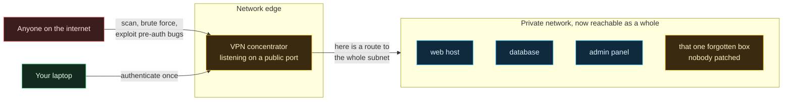
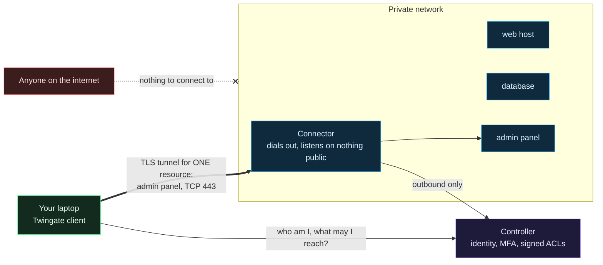
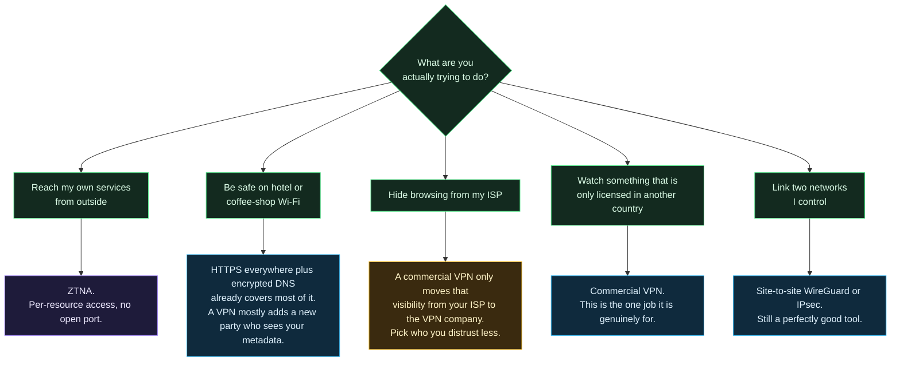

# Why ZTNA and not a VPN

The obvious way to reach a few cloud droplets from home is a VPN: stand up WireGuard or OpenVPN, open one UDP port, done in an afternoon. This project does not do that, on purpose. This page explains why, where that reasoning holds, and where it does not, because "VPNs bad, zero trust good" is a slogan, and slogans are how people end up buying a zero trust sticker for their old VPN appliance.

## TL;DR

- A remote-access VPN answers one question, "is this person allowed on the network?", and then gets out of the way. Everything after that is up to whatever else is on the network.
- ZTNA (zero trust network access) answers a different question on every connection: "is this person, right now, allowed to reach *this host on this port*?" If the answer is no, the host is not even routable for them.
- The VPN model fails badly in the threat models that actually show up in incident reports: stolen credentials, an exploited internet-facing VPN appliance, and lateral movement after one foothold.
- In this repository, ZTNA also means **zero inbound ports on every droplet**. The connectors dial out. There is no listener for anyone to scan, brute force, or throw an exploit at.
- I still use a VPN for exactly one thing: pretending to be in another country so a streaming service will show me something. That is a location-shifting tool, not a security control.

## First, two different things are both called "VPN"

| | Remote-access VPN | Commercial "privacy" VPN |
|---|---|---|
| Examples | WireGuard, OpenVPN, IPsec, Cisco AnyConnect, GlobalProtect, Ivanti/Pulse, FortiGate SSL VPN | The ones that sponsor every YouTube video |
| Job | Put your device on a private network | Make your traffic exit from someone else's IP address |
| Who you trust | Whoever runs the concentrator, and everything on the network behind it | The VPN company, instead of your ISP |
| Relevant here? | Yes, it is the alternative to Twingate | Only at the end of this page |

Most of this page is about the first kind.

## What a remote-access VPN actually does

Two properties of that picture cause almost every problem below:

1. **The front door is on the internet.** The concentrator has to accept packets from anyone so that legitimate users can reach it. Its authentication code runs before it knows who you are.
2. **Authentication buys network reach, not resource reach.** After the tunnel is up, the device is "inside", and what it can touch is decided by routes and by whatever firewalling exists between internal hosts. In most networks that is less than people think.

## What ZTNA does instead

In Twingate's design the controller hands the client a signed ACL, the client only captures traffic for addresses on that list, and the connector checks the client's signature and ACL claim again before forwarding. The tunnel between client and connector is certificate-pinned TLS; when a direct peer-to-peer path is not possible a relay carries it, but the relay never terminates the encrypted connection. ([How Twingate works](https://www.twingate.com/docs/how-twingate-works), [Understanding relays](https://twingate.com/docs/understanding-relays))

Notice what is gone: the public listener, and the idea of being "on the network".

## Threat model by threat model

This is the core of the argument. "Less secure" only means something against a specific threat, so here they are one at a time.

| Threat | With a remote-access VPN | With ZTNA as built here |
|---|---|---|
| **Internet-wide scanning and exploitation of the access gateway** | The concentrator is a public target running complex pre-auth code. This is the most-exploited category of edge device in recent years (examples below). | No public listener exists. Connectors only make outbound connections; the droplet firewall has zero public inbound rules. There is nothing to exploit from outside. |
| **Stolen or reused password** | Password (plus MFA, if it is enforced on *every* profile) buys network-wide reach. | Credentials buy access only to the resources that user's group is assigned, here one host and port each. Sign-in goes through the identity provider, so MFA policy lives in one place. |
| **Forgotten or legacy accounts** | One stale profile is a full network on-ramp. | A stale account still only reaches what its group grants, and groups are code in this repo, so removing access is a reviewed pull request. |
| **Lateral movement after one foothold** | A compromised host or laptop can reach everything the route table allows. | The client only routes ACL'd resources. On the DigitalOcean side, firewalls filter VPC-internal traffic too, so droplets cannot reach each other unless a tag-scoped rule says so. |
| **Compromised endpoint (malware on the laptop)** | Malware rides the tunnel with the same network reach as the user. | Malware gets the same *resource* reach as the user, which is far smaller. Not zero: ZTNA does not make a compromised laptop safe. |
| **Insider or over-privileged account** | Coarse: "VPN users" is often one group. | Fine-grained: access is defined per resource and per port. |
| **Audit: who touched what** | Logs show a tunnel IP moving packets. | Access is logged per user per resource. |
| **Availability of the access path** | You control it entirely. | You depend on the vendor's control plane. This one genuinely favors the VPN; see the honest section below. |

### The internet-facing gateway problem is not hypothetical

Remote-access VPN appliances have been one of the most reliable initial access routes of the last several years, for nation-state groups and ransomware crews alike. A short, non-exhaustive list:

- **Ivanti Connect Secure (2024).** An authentication bypass ([CVE-2023-46805](https://nvd.nist.gov/vuln/detail/CVE-2023-46805)) chained with command injection ([CVE-2024-21887](https://nvd.nist.gov/vuln/detail/CVE-2024-21887)). CISA issued Emergency Directive 24-01 on January 19, 2024 ordering federal agencies to mitigate, hunt for compromise and reset credentials on the gateways, and researchers counted roughly 2,100 compromised devices worldwide within weeks of disclosure. ([The Hacker News coverage](https://thehackernews.com/2024/01/cisa-issues-emergency-directive-to.html))
- **Palo Alto GlobalProtect (2024).** [CVE-2024-3400](https://nvd.nist.gov/vuln/detail/CVE-2024-3400), unauthenticated command injection in the GlobalProtect gateway, exploited before a patch existed.
- **Citrix NetScaler "Citrix Bleed" (2023).** [CVE-2023-4966](https://nvd.nist.gov/vuln/detail/CVE-2023-4966) leaked session tokens from the gateway, letting attackers skip authentication and MFA entirely.
- **Fortinet FortiOS SSL VPN.** [CVE-2018-13379](https://nvd.nist.gov/vuln/detail/CVE-2018-13379), a path traversal that read credential files off the device. Years after the patch, credentials harvested through it were still being dumped publicly.
- **Pulse Secure (2019).** [CVE-2019-11510](https://nvd.nist.gov/vuln/detail/CVE-2019-11510), unauthenticated arbitrary file read, widely used to steal credentials and session data.

The pattern is the point: the device whose job is authentication is running large amounts of code that an anonymous attacker can reach *before* authentication. Every one of these was a "patch now or be owned" event for anyone with that box on the internet. A design with no inbound listener does not have that class of problem.

### The stolen credential problem is not hypothetical either

The Colonial Pipeline ransomware attack in May 2021 began, according to the company's CEO testifying to the Senate on June 8, 2021, through a legacy VPN profile that was not supposed to be in use and that required only a password, no second factor. ([Dark Reading](https://www.darkreading.com/cyberattacks-data-breaches/colonial-pipeline-ceo-ransomware-attack-started-via-pilfered-legacy-vpn-account)) One forgotten profile, one password, a whole network. That is the VPN failure mode in a sentence.

### Government guidance moved the same way

- In September 2021 the NSA and CISA published [Selecting and Hardening Remote Access VPN Solutions](https://media.defense.gov/2021/Sep/28/2002863184/-1/-1/0/csi_selecting-hardening-remote-access-vpns-20210928.pdf). The fact that VPNs needed a dedicated hardening guide says a lot on its own.
- In June 2024 CISA, the FBI and partner agencies in New Zealand and Canada published [Modern Approaches to Network Access Security](https://cisa.gov/resources-tools/resources/modern-approaches-network-access-security), which walks through the risks of traditional remote access and VPN deployments and urges organizations toward Zero Trust, SSE and SASE models. ([announcement](https://cisa.gov/news-events/alerts/2024/06/18/cisa-and-partners-release-guidance-modern-approaches-network-access-security))
- [NIST SP 800-207](https://csrc.nist.gov/pubs/sp/800/207/final) is the reference definition of zero trust architecture. The mapping to this repo is below.

## How this repository maps to NIST SP 800-207

| Zero trust idea (paraphrased from SP 800-207) | Where it lives here |
|---|---|
| All data sources and services are resources | Each host is a separate `twingate_resource`; there is no "allow the VPC" resource. |
| All communication is secured regardless of network location | Client-to-connector traffic is pinned TLS. Being inside the VPC grants nothing on its own because firewalls filter VPC-internal traffic. |
| Access is granted per session, per resource | Twingate checks the signed ACL per connection; the connector re-checks it. |
| Access is decided by dynamic policy | Group membership in Twingate, managed as code in `stacks/10-access`. |
| Monitor the integrity and posture of assets | Stage 2 ships connector and access logs to the on-prem SIEM. Not done yet; listed honestly on the [Roadmap](Roadmap.md). |
| Authentication and authorization are strictly enforced before access | Identity provider sign-in, then ACL, then SSH key auth to a single allowed user. |
| Collect as much information as possible to improve security posture | Stage 2 again. |

## The honest section: where ZTNA is not magic and VPNs are fine

Useful disagreement beats validation, including with myself.

**WireGuard is not an SSL VPN appliance.** WireGuard does not answer unauthenticated packets at all, it has a small code base, and it has a far better track record than the appliances above. A WireGuard setup with tight per-peer `AllowedIPs` and real firewall rules between internal hosts closes much of the gap. What it does not change is the *model*: authorization is still "which subnets can this peer route to", it is still a listening UDP port, and per-user, per-resource policy with an identity provider in the loop is something you would be building by hand. The crypto was never the problem; the "you are on the network now" model is.

**Site-to-site tunnels are a different job.** Linking two networks you control (a home lab and a colo rack, say) with IPsec or WireGuard is normal and fine. ZTNA is about getting *people and services* to *specific resources*, not about stitching networks together.

**You are trusting the ZTNA vendor's control plane.** Twingate's controller issues the ACLs. If it were compromised, it could in principle authorize things it should not. Mitigations here: sign-in is delegated to the identity provider (enforce MFA there), every resource is scoped to one host and port, the data path is encrypted end to end to a connector I run, and the SSH key on the droplet is a second, independent gate. If that trade is unacceptable for you, self-hostable options exist: [OpenZiti](https://openziti.io/), [NetBird](https://netbird.io/), and [Headscale](https://github.com/juanfont/headscale) (a self-hosted control server for Tailscale clients). They cost you a control plane to run, patch and protect, which is a security job of its own.

**Availability depends on the vendor.** If Twingate's control plane has a bad day, so does access to these droplets. Two connectors protect against a connector dying, not against the vendor. The recovery path documented in the [stage 1 guide](https://github.com/ChiefGyk3D/Clouds-Against-Humanity/blob/main/docs/stages/01-access.md) is to rebuild the stateless droplets through Spacelift, which does not need Twingate at all. That was an accepted trade for a lab; a production system might keep a tightly scoped break-glass path.

**ZTNA does not fix a compromised laptop.** It shrinks the blast radius to what that user is allowed to reach. Endpoint security, patching and device posture still matter.

## Why Twingate specifically

- **Outbound-only connectors.** The single property that lets every droplet keep zero public inbound rules.
- **Per-resource access as code.** The [Twingate OpenTofu/Terraform provider](https://registry.terraform.io/providers/Twingate/twingate/latest) manages sites, connectors, groups and resources, so access policy is reviewed in pull requests like everything else.
- **No server to babysit.** No control plane VM to patch, back up and defend.
- **It mirrors how ZTNA is deployed at real organizations**, which is the point of a teaching repo.

The free and paid tier limits of Twingate (and Spacelift and Doppler) are listed as unverified in [cost](https://github.com/ChiefGyk3D/Clouds-Against-Humanity/blob/main/docs/cost.md) on purpose; check the vendor pages before relying on them.

## Why I stopped using a VPN (except for geo-blocks)

I used to run a VPN for everything. Here is where each of those uses went.

**Remote access to my own stuff** moved to ZTNA. The reasoning that applies to these droplets applies to a homelab: administrative access should not hang off a listening port that the whole internet can poke at. (Services that are meant to be public, like a Mastodon instance, are a different problem with their own hardening; ZTNA is for the things that should never be public.)

**The public Wi-Fi pitch** is mostly a leftover from before nearly everything moved to TLS. With HTTPS on almost every site and encrypted DNS, someone on the same café network sees that you are talking to some IP addresses and not much else. A VPN does not remove that observer; it replaces it with the VPN provider, who now sees *all* of it, every day, everywhere you go. There are real exceptions (hostile networks, captive portals that tamper with traffic, places that censor), and in those a VPN or Tor can be the right tool. That is a threat model, not a default.

**Hiding from my ISP** with a commercial VPN just picks a different company to trust with the same metadata, one whose entire business model is a promise about logs. Sometimes that is the better trade. It is never a free one.

**Geo-blocks** are the one place a commercial VPN does exactly what it says on the box: it makes my traffic come out of another country. No security claim attached. That is the only reason one is still installed.

## Further reading

- [How Twingate works](https://www.twingate.com/docs/how-twingate-works) and [Understanding relays](https://twingate.com/docs/understanding-relays), Twingate docs
- [Connector best practices](https://www.twingate.com/docs/connector-best-practices), Twingate docs
- [NIST SP 800-207: Zero Trust Architecture](https://csrc.nist.gov/pubs/sp/800/207/final)
- [Modern Approaches to Network Access Security](https://cisa.gov/resources-tools/resources/modern-approaches-network-access-security), CISA, FBI and partners, June 2024
- [Selecting and Hardening Remote Access VPN Solutions](https://media.defense.gov/2021/Sep/28/2002863184/-1/-1/0/csi_selecting-hardening-remote-access-vpns-20210928.pdf), NSA and CISA, September 2021
- [Colonial Pipeline CEO testimony coverage](https://www.darkreading.com/cyberattacks-data-breaches/colonial-pipeline-ceo-ransomware-attack-started-via-pilfered-legacy-vpn-account), Dark Reading, June 2021
- [CISA Emergency Directive 24-01 coverage](https://thehackernews.com/2024/01/cisa-issues-emergency-directive-to.html), The Hacker News, January 2024
- [CISA Known Exploited Vulnerabilities catalog](https://www.cisa.gov/known-exploited-vulnerabilities-catalog): search for your own VPN vendor and see how long the list is
