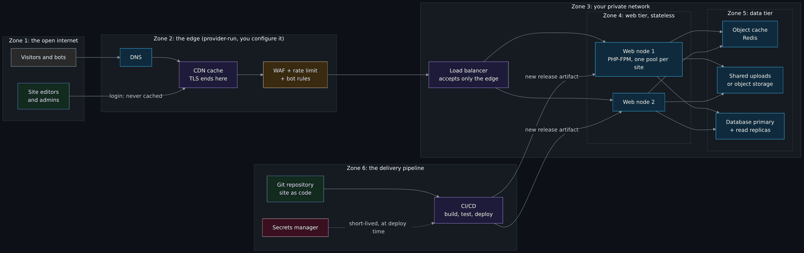
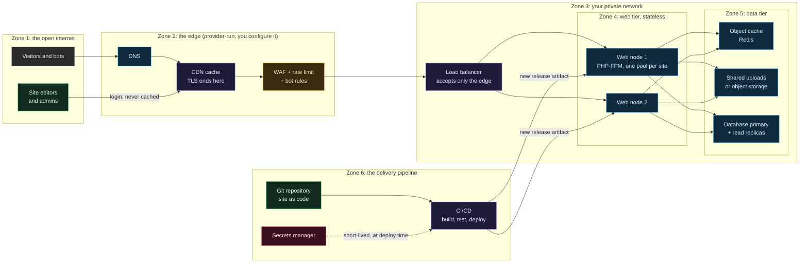
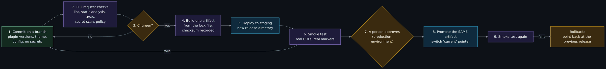
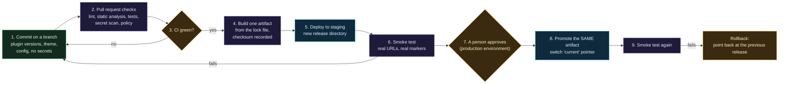

# WordPress at scale: CDN, WAF, caching and CI

Lesson 4 of 4 in the web-hosting track. Read it after the lesson on [DNS, Cloudflare and hosting your own website](DNS-Cloudflare-and-Hosting-Your-Own-Website.md) (lesson 3), and before or beside [From commit to pipeline](From-Commit-to-Pipeline.md), whose pipeline ideas it applies to a web fleet. It does not teach how to install WordPress or secure one site: lessons 1 and 2 do that. It takes the one site you can already run and shows how the same site is run by a company with thousands of them. 
Next: [Reading order](Reading-Order.md).

> Unfamiliar word or acronym? The [Glossary](Glossary.md) defines it.

> **The track, and a note about links.** The four lessons are [LAMP and LEMP from zero](LAMP-and-LEMP-From-Zero.md) (1), [WordPress and PHP security, WAF and static sites](WordPress-and-PHP-Security-WAF-and-Static-Sites.md) (2), [DNS, Cloudflare and hosting your own website](DNS-Cloudflare-and-Hosting-Your-Own-Website.md) (3) and this page (4). They are written at the same time. If you read this before the others have merged, a link to one of them may not open yet; that is why the navigation line at the top names only a page that exists today. The infrastructure-as-code track this page leans on is [OpenTofu from zero](OpenTofu-From-Zero.md), [Plans, state, drift and recovery](Plans-State-Drift-and-Recovery.md), [Spacelift from zero](Spacelift-From-Zero.md) and [Build and destroy: one stack per service](Build-and-Destroy-Stack-Per-Service.md); the same caution about links applies to those four.

> **Status: the free local lab was run on Linux; everything else was not run.** On **2026-10-22** the author ran every Bash command in the free lab and the local pipeline on Linux with Podman (using its Docker-compatible socket and Compose), `nginx:1.30.6-alpine`, `redis:8.6.7-alpine`, `python:3.12.11-slim`, curl and Python 3.13, and pasted trimmed output from those runs. **Not run:** the PowerShell versions (there was no PowerShell on the machine; they are written from the Bash ones and marked **est.**), anything on Docker Desktop, macOS or Windows, the whole "own account" parts (nothing here was applied to a cloud account), and WordPress itself: the lab uses a 150-line stand-in that is **not** WordPress (the section on [what the lab is](#what-the-lab-is-and-is-not) says why). Vendor and standards claims were read on **2026-10-22** unless a row in the [claims register](#claims-register) says otherwise; everything else is general knowledge or marked **est.**

> **Prerequisites.** Lessons 1 to 3 of the track if you can, in particular what a web server, PHP and a database are, and what DNS and a CDN do at a high level. Also [How a web request works](How-a-Web-Request-Works.md) (DNS, TCP, TLS, HTTP) and [Containers and Docker basics](Containers-and-Docker-Basics.md). The free lab needs Docker with Compose (or Podman with its Docker-compatible socket), `curl` and `python3`, about 3 GiB of free disk for three small images, and nothing else: no account, no money. Plan about three hours for the reading and the free lab (est.). The parts that use your own cloud account are a pointer, with the cost worked out first.

## What you will be able to do

- Draw the path from one server to a scaled design in order, and say what problem each step solves and what new problem it brings.
- Tell apart a page cache, an object cache and an opcode cache, and say which one a CDN is.
- Say what a CDN, a WAF and a load balancer each do, where each sits, and why each is a trust boundary.
- Explain how a logged-in visitor's page is kept out of a shared cache, and show it on a machine you own.
- Name the classic failure modes (cache stampede, a node that remembers things, a plugin that writes to disk, cron on every node) and reproduce three of them safely.
- Say what changes when you host many sites for many owners: tenant isolation, noisy neighbors, patching a fleet, and why one compromised site must not reach another.
- Describe how a pipeline manages the servers (infrastructure as code), the site's code (WordPress as code) and the content, and say what the pipeline must never be able to do.
- Read a cost table for every tier of the design and choose how much of it to build, with the arithmetic for each choice.

## What the wiki already says (and the gap)

| Idea | Where it is today | The gap this page fills |
|---|---|---|
| Reverse proxy, cache, CDN, load balancer | One sentence each in [How a web request works](How-a-Web-Request-Works.md#caching-cdns-proxies-and-load-balancers-a-sentence-each). | Where each sits in a real design, what it must never cache, and a lab that shows it. |
| Trust boundaries and STRIDE | [Threat model](Threat-Model.md) and [Threat frameworks](Threat-Frameworks-STRIDE-ATTACK-ATLAS.md), on this project's pipeline. | The same method on a web fleet, and the risks that only appear when you scale. |
| High availability, golden images, IaC at scale | [Enterprise infrastructure differences](Enterprise-Infrastructure-Differences.md), in a paragraph each. | One concrete workload built up step by step. |
| Pipelines, `CI green`, reusable workflows | [From commit to pipeline](From-Commit-to-Pipeline.md) for this project's own chain. | A pipeline for a different kind of repository: a website. |
| Backups, restores and patching | [Backups, recovery and patching](Backups-Recovery-and-Patching.md). | Patching and restoring a fleet, per tenant. |

## From one server to a scaled design, one step at a time

Everything below starts from the thing lesson 1 builds: one machine running a web server, PHP and a database. Each step is added only when a specific problem shows up. Skipping ahead is the usual mistake, because each layer adds cost, moving parts and new ways to fail.

| Step | What you add | The problem it solves | The new problem it brings |
|---|---|---|---|
| 0 | Nothing: one box with web server, PHP and database | Simple and cheap. | The box is one failure, one bottleneck and one security boundary. |
| 1 | A separate database server | The database and PHP stop fighting over memory; you can back up and secure the database on its own. | A network hop on every query; two machines to patch; the database password now crosses a network. |
| 2 | An opcode cache (OPcache) | PHP stops re-reading and re-compiling the same files on every request. | Stale code after a deploy unless the cache is reset or told to check file times. |
| 3 | An object cache (Redis or Memcached) | Repeated database reads are answered from memory. | A new service to run; cached data can be stale; it must not hold anything private about one visitor under a shared key. |
| 4 | A page cache (a reverse proxy in front of PHP) | Most visitors are anonymous and see the same page; build it once. | The rule for who may be served a cached page. Get it wrong and one visitor sees another's page. |
| 5 | A CDN in front of everything | Static files and whole pages come from a server near the visitor, and most traffic never reaches yours. | Your origin's address must be protected, and "purge the cache" is now a step in every publish. |
| 6 | A WAF in front of that | Known-bad requests are dropped before they reach PHP. | False positives block real users; rules need tuning and updating; it is not a substitute for patching. |
| 7 | A load balancer and two or more web nodes | One node can fail or be patched while the others serve. | Nodes must be stateless: sessions, uploads, cron and caches can no longer live on one node's disk. |
| 8 | Shared or object storage for uploads | Every node sees the same media files. | A shared writable place that more than one node, and more than one site, can touch. |
| 9 | Database primary plus read replicas, or a managed database | Reads spread out; a failed primary can be replaced. | Replication lag (a write is not instantly visible on a replica) and a second place where data lives. |

Four words used loosely in the table, defined once:

- **Origin.** Your own servers, the place the real page is built. Everything in front of it (CDN, WAF, load balancer) exists to protect or relieve it.
- **Stateless.** A web node that keeps nothing it cannot afford to lose or that another node would need. Kill it and nothing is gone. The state lives somewhere shared (database, object cache, shared storage).
- **Edge.** The part of the design closest to the visitor, usually the CDN and WAF. "Edge" means the outside end of your system.
- **Cache hit and miss.** A hit is a request answered from a cache; a miss is one that had to go to the next layer. The **hit ratio** is the fraction of hits, and it is the number that decides how much the layers behind a cache must handle.

### Which "cache" is which

People say "caching" for four different things. Mixing them up is how a team clears the wrong one at 2 a.m.

| Cache | What it stores | Where it lives | Who benefits | WordPress note |
|---|---|---|---|---|
| **Opcode cache** (OPcache) | PHP code, already compiled | In PHP's memory on each node | CPU on every request that runs PHP | Built into PHP. By default PHP checks files for changes every few seconds; if you turn that check off for speed, a deploy must reset the cache ([PHP manual](https://www.php.net/manual/en/opcache.configuration.php), 2026-10-22). |
| **Object cache** | Results of database reads and computed values, by key | In a service such as Redis or Memcached, shared by all nodes | The database | WordPress has an object cache API, but on its own it lasts only for one request; a persistent cache needs a plugin and a server such as Redis or Memcached ([WordPress developer reference](https://developer.wordpress.org/reference/classes/wp_object_cache/), 2026-10-22). |
| **Page cache** | The finished HTML of a page | A reverse proxy or a caching plugin | PHP and the database (they are skipped entirely) | The biggest win for anonymous traffic, and the one with the privacy rule below. |
| **CDN cache** | Files, and optionally whole pages, copied to servers near visitors | The provider's network | Your origin, your bandwidth and the visitor's latency | A page cache that you do not run. Same rule, different place. |

**Redis** and **Memcached** are two in-memory key-value stores. Redis can also be told what to throw away when it is full: its `maxmemory-policy` setting picks a policy such as evicting the least recently used keys, and the default policy of refusing to store new data is a bad fit for a cache ([Redis eviction docs](https://redis.io/docs/latest/develop/reference/eviction/), 2026-10-22). The lab sets `allkeys-lru` for that reason.

### The rule for who may be served a cached page

A page cache stores one copy of a URL and hands it to the next visitor. That is right for a public article. It is a data leak for a page that says "Welcome back, Sam" or shows a cart. So a cache needs a rule that says **this visitor must not be answered from the cache, and this response must not be stored.** Those are two jobs, and they are two settings:

- **Bypass:** do not answer *from* the cache for this request (a logged-in person, someone with items in a cart, a password-protected post).
- **Do not store:** do not *save* this response into the cache.

In Nginx they are `proxy_cache_bypass` and `proxy_no_cache`, and the manual describes them as two separate conditions ([Nginx proxy module docs](https://nginx.org/en/docs/http/ngx_http_proxy_module.html), 2026-10-22). Setting only the first means the logged-in person is served fresh, and their private page may still be saved for the next visitor. The usual signal is a cookie: WordPress sets a login cookie whose name starts with `wordpress_logged_in_` ([WordPress developer reference](https://developer.wordpress.org/reference/functions/wp_cookie_constants/), 2026-10-22), and WooCommerce's own caching guidance says cart, account and checkout pages must stay dynamic because they are specific to the customer ([WooCommerce docs](https://woocommerce.com/document/configuring-caching-plugins/), 2026-10-22). Cloudflare, by default, does not cache HTML or JSON, and offers a "Cache Everything" setting whose documentation warns that it caches all HTML regardless of dynamic content, so visitors may receive information not intended for them ([Cloudflare default cache behavior](https://developers.cloudflare.com/cache/concepts/default-cache-behavior/) and [cache level rule](https://developers.cloudflare.com/cache/how-to/cache-rules/examples/cache-everything/), 2026-10-22); the matching fix is a rule that bypasses the cache when a cookie is present ([Cloudflare: bypass cache on cookie](https://developers.cloudflare.com/cache/how-to/cache-rules/examples/bypass-cache-on-cookie/), 2026-10-22). The lab lets you see both the careful setup and the careless one.

## What a CDN, a WAF and a load balancer each do

Three boxes on the diagram, three different jobs. They are often sold together, and one product can do more than one, which is why they blur. Keep the jobs separate in your head.

| Aspect | CDN | WAF | Load balancer |
|---|---|---|---|
| **Full name** | Content delivery network | Web application firewall | Load balancer (LB) |
| **One-sentence job** | Serve copies of your content from places near the visitor. | Look at each web request and drop the ones that match known attack patterns or bad behavior. | Spread requests across several identical servers and stop sending to one that has failed. |
| **Where it sits** | In front of everything, on the provider's network. | Usually inside the CDN or in front of the LB; sometimes on the node itself. | Between the edge and the web nodes, inside your network. |
| **What it sees** | Every public request, and (if it terminates TLS) the clear text. | Same, and it reads the content of requests. | Requests that already passed the edge. |
| **What it cannot do** | Fix a vulnerable plugin. | Catch everything: rules are patterns, and attackers rewrite requests to avoid the patterns. | Protect against a request that is *valid* but harmful. |
| **Trust boundary** | Between the open internet and you. | Between "unfiltered" and "filtered". | Between the edge and your private network. |

**TLS termination** is where encrypted web traffic is decrypted. A CDN or WAF that terminates TLS can read every request and response, which is what lets it cache and filter, and also means you are trusting the provider with the plaintext. That is a real trade, not a defect; it is the same trade a company makes with any outside service in the middle.

### Origin protection

If an attacker learns your origin's real address, they can send requests straight to it and skip the CDN and the WAF. So the origin must **refuse anything that did not come through the edge**. There are three common ways, and you can combine them:

1. **Allow-list the edge's network ranges** in the firewall in front of the origin, so only the CDN provider's addresses can connect. Cloudflare publishes its ranges and recommends blocking other addresses at the origin ([Cloudflare IP addresses](https://developers.cloudflare.com/fundamentals/concepts/cloudflare-ip-addresses/), 2026-10-22).
2. **Mutual TLS from the edge to the origin.** The origin demands a client certificate that only the edge holds. Cloudflare calls this Authenticated Origin Pulls, and its docs say that without it anyone who finds the origin address can bypass Cloudflare ([Cloudflare Authenticated Origin Pulls](https://developers.cloudflare.com/ssl/origin-configuration/authenticated-origin-pull/), 2026-10-22).
3. **An outbound-only tunnel** from the origin to the edge, so the origin has no public listener at all. (Cloudflare says Authenticated Origin Pulls does not apply to tunnels, because there is nothing inbound to authenticate; same page.)

The lab uses a simpler stand-in for the first two: the edge adds a header holding a random secret, and the load balancer refuses a request without it. A shared header is the weakest of these (anyone who can read the traffic can copy it), but it shows the shape, and it costs nothing.

### Rate limiting and bot management, at concept level

- **Rate limiting** caps how often one client may call one URL. Login pages and search are the usual targets. It slows password guessing and cheap denial of service. It is a blunt tool: many real users share one address (an office, a mobile carrier), so a limit tight enough to stop an attacker may block them.
- **Bot management** tries to tell automated clients from people, using signals such as request patterns, headers, behavior and challenges. Not all bots are bad (search engines are bots), and the signals are guesses. Treat it as one layer that reduces noise, not a gate that is always right.

Neither replaces fixing the underlying weakness. The lab includes a rate limit on the login path and a **toy** WAF with three rules, so you can see both work and see how a small change in the request walks around the toy rules.

## Storage and the database

- **Uploads.** In a fleet, media files cannot sit on one node's disk, because the next request may go to another node. The usual answers are a shared file system, or object storage (an API-driven store of files, such as the S3 style) with the site's media routed to it. The lab shows the failure and the shared-volume fix.
- **Database primary and read replicas.** One database server (the **primary**) takes all writes. **Read replicas** copy it and answer reads. **Replication lag** is the delay before a write on the primary shows up on a replica; a page that saves and then immediately reads from a replica can show old data. Replicas also help recovery, but they copy mistakes as faithfully as they copy data: a deleted table is deleted on the replica too, so a replica is not a backup ([Backups, recovery and patching](Backups-Recovery-and-Patching.md) says why).
- **Managed versus self-run.** A managed database is run by the provider (patches, failover, backups included to some extent); you give up control and pay for it. Self-run means you own every task in that list. The line between "your job" and "theirs" is the shared responsibility model from [Virtual machines, containers and cloud service models](Virtual-Machines-Containers-and-Cloud-Service-Models.md#iaas-paas-saas-and-shared-responsibility).

## Many sites: multisite and mass hosting

A hosting company, an agency or a university may run hundreds or thousands of WordPress sites. There are two basic ways to do it.

| Aspect | WordPress Multisite | Many separate instances |
|---|---|---|
| **What it is** | One WordPress installation that serves many sites. Each site has its own content tables, and the user table is shared ([WordPress Multisite docs](https://developer.wordpress.org/advanced-administration/multisite/), 2026-10-22). | Each site is its own installation, with its own files, database (or schema) and PHP settings. |
| **Good at** | Sites that share a theme, plugins and an owner: one update, one set of code. | Sites owned by different people, with different plugins and different risk. |
| **Cost of a mistake** | A vulnerable plugin or a compromised administrator account touches *every* site in the network. | A compromise starts in one site. Whether it stays there depends on how well the instances are isolated. |
| **Operations** | Fewer things to patch. One big thing to get right. | Many things to patch: a fleet, so patching needs automation. |

### Tenant isolation

A **tenant** is one customer or one site in a shared system. **Isolation** is making sure one tenant cannot read, change or slow another. For WordPress on PHP, the common building blocks are:

- **One PHP-FPM pool per site** (PHP-FPM is the common way Nginx and Apache hand work to PHP). Each pool runs as its own operating-system user, with its own memory and process limits.
- **File permissions** so each site's user can write only to that site's upload and cache directories and read only its own code.
- **Separate database users**, each allowed only its own database.
- **Resource limits** (memory, CPU, number of processes) per site, so one runaway plugin cannot starve the rest. That problem has a name: a **noisy neighbor** is a tenant whose heavy use slows everyone else on the same machine.
- **Stronger boundaries** where the risk justifies the cost: a separate container per site, a separate virtual machine, or a separate account. Each step costs more and isolates more.
- **Per-tenant backups and restores**, so restoring one customer's mistake does not roll back everyone else.

The **blast radius** of a compromise is how far the damage can reach. Isolation is how you shrink it. A common mass-hosting failure is a design where all sites run as one user in one pool: then one hacked site can read every other site's configuration file, which holds that site's database password.

> **Why a fleet needs a patch pipeline: the October 2026 PHP advisory.** On 21 October 2026 the PHP project published a security advisory for two critical remote code execution vulnerabilities, fixed in PHP 8.5.12, 8.4.27, 8.3.36 and 8.2.35, and said all PHP installations serving web requests were affected, including PHP-FPM ([php.net](https://www.php.net/), read 2026-10-22). It describes one flaw where stale request state could survive and be used by a *later request handled by the same worker*. Read that as a lesson about both halves of this page. First, a fleet of PHP servers is patched by a process that can roll a new PHP version across hundreds of nodes in hours, with a smoke test and a rollback, not by someone logging in to each one. Second, a PHP worker that serves one tenant must not be a worker that serves another, and a compromised worker must not be able to reach other tenants' files or databases, which is the isolation list above. The WordPress-specific and PHP-specific hardening is the subject of [WordPress and PHP security, WAF and static sites](WordPress-and-PHP-Security-WAF-and-Static-Sites.md); this page supplies the fleet around it. I did not verify the details of the two flaws beyond the project's advisory text.

### Patching a fleet

Patch a fleet the way [Backups, recovery and patching](Backups-Recovery-and-Patching.md#patching-cadence-emergencies-and-windows) describes for one machine, with three additions. **Inventory** first: you cannot patch what you cannot list, so the list of sites, their PHP version, their plugins and their owners is data, kept in code. **Rings**: patch a small set of low-risk sites first, watch, then the rest. **Automation with a stop button**: a pipeline that updates, tests and rolls forward in batches, and halts on the first failure.

## Failure modes

These are the failures that scaling creates. Several are reproduced in the lab.

| Failure | What happens | Lab drill |
|---|---|---|
| **Cache stampede** (also "thundering herd") | A popular cached item expires; many requests arrive before it is rebuilt; all of them go to the origin at once. | Exercise 4 |
| **A node that remembers** | Sessions, counters or login state are kept in one node's memory; the next request goes to another node and the visitor is "logged out". "Sticky sessions" (always send a visitor to the same node) hide this but break failover. | Exercise 5 (shared counter) |
| **A plugin that writes to disk** | An upload or generated file is saved on one node; other nodes do not have it. Visitors get random 404s. | Exercise 6 |
| **Cron on every node** | WordPress runs scheduled tasks when pages are loaded, not on a clock ([WordPress cron docs](https://developer.wordpress.org/plugins/cron/), 2026-10-22). With many nodes and a CDN, tasks may run on several nodes, or not run at all if every request is a cache hit. The usual fix is to turn off the page-load trigger (`DISABLE_WP_CRON`, documented in the [wp-config reference](https://developer.wordpress.org/advanced-administration/wordpress/wp-config/), 2026-10-22) and run one scheduler. | The app counts runs (see `/stats`) |
| **The cache serves a private page** | A "cache everything" rule without a cookie bypass. | Exercise 3 |
| **Origin address leaks** | An old DNS record, an email header or a certificate log reveals the origin; attackers skip the edge. | Exercise 8 |
| **Object cache down** | If Redis is unreachable, a well-built site falls back to the database (slower), a badly built one errors. | Exercise 7 |
| **One bad node** | The balancer keeps sending to a node that is up but broken (returns errors or hangs). Passive checks only notice failed connections; a "health check" that tests a real page notices more. | Exercise 7 |
| **A node comes back at a new address** | An Nginx upstream resolves names once at start; a restarted node at a new address is never used again. | Found while building the lab (see the note in exercise 7) |

## Threat model of the scaled architecture

Below is the architecture as a data flow diagram with its trust boundaries, then the STRIDE walk (the method from [Threat frameworks: STRIDE, ATT&CK and ATLAS](Threat-Frameworks-STRIDE-ATTACK-ATLAS.md)). A **trust boundary** is a line where data moves between parts that trust each other differently. Every line crossing one is a place to ask who is on each side and what is checked.



<details>
<summary>Diagram source (Mermaid)</summary>



</details>

Six zones, so five main boundaries: internet to edge, edge to your network, load balancer to web tier, web tier to data tier, and the pipeline's reach into all of it. The seventh line, the one people forget, is the **pipeline to production** boundary: whoever controls the pipeline controls every node.

### STRIDE, by element

| Element | S: Spoofing | T: Tampering | R: Repudiation | I: Information disclosure | D: Denial of service | E: Elevation of privilege |
|---|---|---|---|---|---|---|
| **CDN and DNS** | A forged or hijacked DNS record sends visitors elsewhere. Mitigate: provider account MFA, registrar lock. | A purge or rule change by a stolen provider login. Mitigate: roles, audit log. | Nobody knows who changed a rule. Mitigate: per-person accounts, logs. | A cache serves a private page to the wrong visitor. Mitigate: bypass plus do-not-store on session cookies; test it. | Cache bypass floods (random query strings) force every request to the origin. Mitigate: ignore or limit unknown query strings, rate limit. | A provider-account takeover rewrites everything. Mitigate: MFA, least-privilege roles. |
| **WAF** | A request made to look like the edge. Mitigate: origin accepts only the edge. | A rule edited to allow an attack. Mitigate: rules in version control, reviewed. | Blocked requests not logged. Mitigate: log decisions and ship them. | The WAF sees plaintext. Mitigate: choose the provider knowingly. | A rule that blocks real users is a self-inflicted outage. Mitigate: "log only" mode first. | A WAF bypass reaches a vulnerable plugin. Mitigate: patching; the WAF is a layer, not a fix. |
| **Load balancer** | A request that skipped the edge claims to be from it. Mitigate: secret header or mutual TLS, plus network rules. | Headers like `X-Forwarded-For` forged by the client. Mitigate: set them at the edge, not trusted from outside. | No access log. Mitigate: log at the edge and the nodes. | Error pages leak internal names. Mitigate: generic errors. | Too few nodes or no health checks. Mitigate: capacity, checks. | A management interface open to the internet. Mitigate: private only. |
| **Web nodes** | A node impersonated inside the network. Mitigate: network rules, mutual TLS between tiers where warranted. | A plugin edits files on disk. Mitigate: read-only code, no file edits from the admin screen, new release per change. | Admin actions not attributed. Mitigate: per-person admin accounts, audit plugin or log. | One tenant's PHP reads another's config. Mitigate: pool per site, permissions, separate database users. | Noisy neighbor. Mitigate: per-site limits. | A PHP flaw gives code execution as the pool user. Mitigate: patch pipeline, pool per site, no shared secrets, least privilege. |
| **Object cache (Redis)** | Anything on the network can talk to an open Redis. Mitigate: private network only, authentication, no public port. | A tenant overwrites another's keys. Mitigate: key prefixes per site, separate instances for high-risk tenants. | No record of who wrote what. Mitigate: accept and say so, or log commands. | Private data cached under a shared key. Mitigate: never cache per-visitor data without the visitor in the key. | Memory full. Mitigate: a `maxmemory` limit and an eviction policy. | A cache poisoned with a crafted value that code later trusts. Mitigate: treat cache contents as untrusted input. |
| **Shared uploads / object storage** | A node impersonating another to write. Mitigate: per-site paths and credentials. | Uploaded PHP file executed. Mitigate: never execute code from the uploads path; serve it from a different origin or with execution off. | Uploads not attributed. Mitigate: log writes. | One site reading another's files. Mitigate: per-site permissions or buckets. | Disk fills. Mitigate: quotas. | Write access to the code directory through the same mount. Mitigate: keep code and uploads on different mounts, code read-only. |
| **Database** | Stolen database credentials used from elsewhere. Mitigate: network rules, per-site users. | Direct modification. Mitigate: least privilege, backups, point-in-time recovery where offered. | Who ran what query. Mitigate: audit logging where available. | A dump with user data. Mitigate: encryption at rest, backup access control. | Slow queries from one site hurt all. Mitigate: limits, replicas. | A site user with admin rights on the server. Mitigate: no. |
| **Pipeline and secrets** | A forged commit or workflow identity. Mitigate: signed commits optional, protected branches, pinned actions. | A changed workflow ships a backdoor. Mitigate: review, pin by commit, protect the workflow files. | Deploy with no record. Mitigate: environment approvals and run logs. | A secret printed in a log. Mitigate: masked secrets, never `echo`. | A broken deploy takes all nodes at once. Mitigate: batches, smoke test, rollback. | The pipeline can do more than deploy. Mitigate: the reviewer's rule below. |

### New risks that scaling introduces

These did not exist on one box:

1. **Shared fate in the middle layers.** One Redis, one shared volume and one pipeline serve every site. A weakness there is a weakness in all of them at once.
2. **A bigger secret surface.** More services means more credentials, and more places they can be copied.
3. **Cache poisoning and cache deception.** An attacker tricks a cache into storing something and serving it to others. Cloudflare documents a "Cache Deception Armor" setting for the variant where a dynamic page is requested with a static-looking path ([Cloudflare cache rules](https://developers.cloudflare.com/cache/how-to/cache-rules/examples/), 2026-10-22; I did not read the setting's detail).
4. **Configuration drift between nodes.** Two nodes that were identical last month and are not now. Only "no editing production" plus automation keeps them identical.
5. **Slower, bigger patching.** More nodes, more owners, more reasons to delay.
6. **A bigger blast radius for the pipeline.** The tool that updates every node is the best target.

## CI/CD for a WordPress fleet: the servers, the code and the content

CI/CD means continuous integration and continuous delivery. [From commit to pipeline](From-Commit-to-Pipeline.md) explains the idea on this project's own repository: every change is tested by machines, then carried toward production with a person making the last decision. The same chain fits a website. This section says how, for three things that change: the **servers**, the **site's code** and the **content**.



<details>
<summary>Diagram source (Mermaid)</summary>



</details>

### The servers: infrastructure as code

The nodes, the balancer, the firewall rules, the database and the DNS records are all things a tool can create from files. That is [What is infrastructure as code](What-Is-Infrastructure-as-Code.md); the hands-on version is [OpenTofu from zero](OpenTofu-From-Zero.md). Two rules matter more for a fleet than for one machine:

- **One stack per service, so one change cannot touch everything.** The state file (the tool's record of what it built) is split by blast radius: the network, the database, the web tier and the edge are separate stacks. [Build and destroy: one stack per service](Build-and-Destroy-Stack-Per-Service.md) covers the split, and [Plans, state, drift and recovery](Plans-State-Drift-and-Recovery.md) covers what to do when the real world and the files disagree. [Spacelift from zero](Spacelift-From-Zero.md) is the hosted runner this project uses to plan and apply with a human confirm.
- **Replace, don't patch.** A web node is built from an image or a script. To update it you build a new one and retire the old one. Nobody logs in to "fix" a node, because then it no longer matches the code. This is the idea of a **golden image** from [Enterprise infrastructure differences](Enterprise-Infrastructure-Differences.md#golden-images-and-patching).

### The site's code: WordPress as code

A normal WordPress install is edited in place: someone clicks "update" in the admin screen, someone uploads a plugin, someone edits a theme file. After a year nobody can say exactly what is running. **WordPress as code** means the opposite: the site's code is described in files in Git, and the running site is built from those files.

- **Dependency management with Composer.** Composer is PHP's package manager. A `composer.json` lists what you depend on and a `composer.lock` records the exact version of everything installed; the Composer docs say to commit the lock file so everyone gets the same versions, and `composer install` with a lock file present installs exactly the locked versions ([Composer basic usage](https://getcomposer.org/doc/01-basic-usage.md), 2026-10-22). A **Bedrock-style** layout (Bedrock is a WordPress boilerplate from Roots built on Composer and Git, with configuration kept outside the web root; [Roots Bedrock](https://roots.io/bedrock/), 2026-10-22) puts WordPress core, plugins and themes under Composer so they are installed rather than uploaded. The sample in `labs/wordpress-at-scale/site/` has the same shape, with invented package names.
- **No editing of production files.** The admin screen can be told not to install, update or edit code: `DISALLOW_FILE_MODS` blocks plugin and theme installation and updating from the admin area and also disables the file editor ([wp-config reference](https://developer.wordpress.org/advanced-administration/wordpress/wp-config/), 2026-10-22). Set it, and an update becomes a pull request. The WordPress hardening guide notes that `DISALLOW_FILE_EDIT` on its own does not stop an attacker uploading files ([Hardening WordPress](https://wordpress.org/documentation/article/hardening-wordpress/), 2026-10-22), which is why the code should be read-only on the node as well.
- **WP-CLI for configuration.** WP-CLI is WordPress's command-line tool ([WP-CLI handbook](https://make.wordpress.org/cli/handbook/), 2026-10-22). A pipeline uses it to run database upgrades, flush caches and set options in a repeatable way, instead of someone clicking.
- **Config from the environment, not from the file.** The database password and the keys that sign login cookies come from environment variables set at deploy time, from the secrets manager. The repository holds no secret. The sample `config/application.php` shows this, and the policy check refuses a literal.
- **Releases, not edits.** Each deploy writes a new directory (`releases/<id>`) and then switches one pointer (`current`) to it. A rollback is switching the pointer back. The local pipeline in the lab does exactly this with a pointer file.

### The content: Git, static export, and what a database sync cannot do

Content is harder than code, because content lives in the **database** and in **uploads**, and editors change it on production all day. Three patterns, and the honest cost of each:

| Pattern | How it works | Good at | Caveat |
|---|---|---|---|
| **Content stays in the database; code moves through the pipeline** | Editors write on production (or a staging copy that they promote from). The pipeline never copies content *down* to production. | The default for most sites. | Staging copies of the database hold real user data: scrub it, or you have copied personal data to a less protected place. |
| **Staging, then promotion** | Editors work on staging; a tool moves *selected* changes to production. | Large editorial teams. | Merging database changes is not like merging code: two people changing the same row, IDs that differ between copies, and settings that must not move (URLs, keys). Plan on conflicts and on a freeze window. |
| **Static export / content in Git** | WordPress (or a Markdown source) is built into plain HTML files that are served from a CDN or object storage. The dynamic site is never public. | Security (nothing to exploit in the public path), speed and cost. | Forms, comments, search and logins need a separate service. Lesson 2 covers [static sites](WordPress-and-PHP-Security-WAF-and-Static-Sites.md) in more detail. |

A rule that survives all three: **never sync the whole database from staging to production**, because it overwrites everything editors did on production since the copy.

### The pipeline stages

The stages in the diagram, each with the mistake it catches:

| Stage | What runs | Catches |
|---|---|---|
| **Lint** | `php -l` on every file, coding-standard checks | Syntax errors, style drift. |
| **Static analysis** | A tool such as PHPStan or Psalm reads the code without running it | Type mistakes, calls to functions that do not exist. |
| **Tests** | Unit tests; integration tests against a throwaway site | Behavior changes. |
| **Security scan** | Secret scanning, dependency audit (`composer audit`), workflow checks | A committed credential, a known-vulnerable dependency. |
| **Policy** | Rules as a script, run on the files | An unpinned version, a literal password, file edits left enabled. The lab's `ci_policy_check.py`. |
| **Build** | Install from the lock file; make one archive; record its checksum | "Works on my machine." The same archive goes to staging and production. |
| **Deploy to staging** | Unpack as a new release directory; run database upgrades | Deploy mistakes, before they matter. |
| **Smoke test** | Fetch real URLs and look for expected text | A site that deployed but does not work. |
| **Promote** | Same archive, production, after approval | Changes nobody reviewed. |
| **Rollback** | Switch the pointer to the previous release | A bad release; recovery in seconds instead of hours. Database changes make rollback harder: write upgrade steps that old code can tolerate. |

### GitHub Actions, reusable workflows and GYST

A **workflow** is a file in `.github/workflows/` that GitHub Actions runs. A **reusable workflow** is one that other repositories call, so the common checks live in one place. **Git Your Ship Together (GYST)** is the maintainer's library of such workflows, and [From commit to pipeline](From-Commit-to-Pipeline.md#reusable-workflows-and-git-your-ship-together) explains how calling one works, why callers pin to a full commit, and the `CI green` gate. This page does not repeat that. What is specific to a website:

- GYST has workflows for Python, Bash, OpenTofu, security scanning, releases and more (README read 2026-10-22). It has **no PHP or WordPress workflow today**. The example `labs/wordpress-at-scale/ci/example-wordpress-ci.yml` therefore calls `security.yml` and `bash-ci.yml` from GYST and keeps the PHP job local. By this project's own rule, a generic PHP gate is something that belongs in GYST first and gets called from here; the example says so in its first lines.
- The example keeps `permissions: {}` at the top and grants each job only what it needs, runs deploy jobs only on `main`, gives the two deploy jobs `environment:` names so approvals can attach, and ends with a `CI green` job.

**Environments and approvals.** GitHub environments let a workflow job wait for named reviewers before it starts; the setting can also stop people approving their own runs ([GitHub: managing environments](https://docs.github.com/en/actions/how-tos/deploy/configure-and-manage-deployments/manage-environments), 2026-10-22). On GitHub Free, protection rules for private repositories are not available (same page), so check your plan.

**Update bots.** Dependabot can open pull requests for Composer dependencies ([supported ecosystems](https://docs.github.com/en/code-security/dependabot/ecosystems-supported-by-dependabot/supported-ecosystems-and-repositories), 2026-10-22). Renovate is another bot for the same job (not read for this page, est.). A bot turns "a plugin has an update" into a pull request that the pipeline tests, which is the safe version of clicking "update". Keep a person in the loop for the merge, or auto-merge only the narrow case your tests really cover.

### Secrets

Secrets (database password, keys, deploy credentials) never go in the repository. They live in a secrets manager and arrive at the moment of deploy. This project's example is [Doppler and secrets](Doppler-and-Secrets.md); the pattern is the same with any manager. Prefer a short-lived credential obtained at run time over a stored long-lived one: GitHub describes OIDC as letting a workflow request a short-lived token from the cloud provider so you do not duplicate cloud credentials as long-lived GitHub secrets ([GitHub: OpenID Connect](https://docs.github.com/en/actions/concepts/security/openid-connect), 2026-10-22). [APIs and tokens from zero](APIs-and-Tokens-From-Zero.md) explains scopes, expiry and the first five minutes after a leak.

### The reviewer's rule: what the CI must never be able to do

When you review a pipeline, read what it *can* do, not what it is supposed to do. The pipeline touches every node, so its permissions are the most valuable ones in the design. A short rule set, each with a reason, each checked in the lab where a machine can check it:

1. **It must not run code from an untrusted pull request with secrets.** `pull_request_target` and `secrets: inherit` are the two usual ways this happens. (Checks W3, W4.)
2. **It must not use code it did not pin.** Every action and called workflow is pinned to a full commit; GitHub's secure-use guidance says a commit SHA is the way to use an action as an immutable release ([GitHub: secure use](https://docs.github.com/en/actions/reference/security/secure-use), 2026-10-22). (W1.)
3. **It must not hold more permission than the job needs.** Top-level `permissions: {}`, then grants per job. (W2.)
4. **It must not put untrusted text into a shell.** `${{ github.event.pull_request.title }}` pasted inside a `run:` step is command injection. (W5.)
5. **It must not deploy to production without a person.** A production environment with required reviewers. (W6.)
6. **It must not hold a long-lived production credential.** OIDC or a secrets manager at deploy time, and nothing stored in the repository. (W7 catches literals.)
7. **It must not edit a release in place,** or change the pipeline's own definition without review. Releases are new directories; workflow files are protected like code.
8. **It must not be able to read or change other tenants.** The deploy credential for one site cannot reach another. If one pipeline job has the keys to every site, a compromise of that job is a compromise of the fleet.
9. **It must not be the only copy of the truth.** The code, the lock file and the infrastructure files are in Git; the pipeline is replaceable.

## Build it piece by piece or all at once

You do not have to build this whole design to learn it, and you do not have to build any of it to read this page. Every tier below can be built alone, in any order that respects its dependencies, or together. You choose how much to spend and how much to run. The local lab at the end teaches the same concepts for nothing.

### Every tier, its dependencies, its cost and its order

Prices are for the provider this project uses (DigitalOcean) at the smallest realistic size for a **small** site, in US dollars per month at list price. "File" means [`docs/cost-prices.json`](https://github.com/ChiefGyk3D/Clouds-Against-Humanity/blob/main/docs/cost-prices.json) (retrieved 2026-10-21) or [`docs/cost.md`](https://github.com/ChiefGyk3D/Clouds-Against-Humanity/blob/main/docs/cost.md); "page" means a provider page read on 2026-10-22 and listed in the claims register. Anything else is **est.** Traffic (bandwidth) overage, backups and snapshots are not included, and a region can make a size unavailable, so check your own account first.

| # | Tier | Needs | Smallest realistic size and monthly cost | Build order | Destroy order |
|---|---|---|---|---|---|
| 1 | Network (private network) and DNS | An account | The provider's private network is $0 (est.); DNS at your registrar or CDN is $0 on a free plan (est.) | 1 | Last |
| 2 | Firewall | 1 | $0 (cloud firewalls are free on this provider, per [Droplet hardening](Droplet-Hardening.md) and [DigitalOcean network and firewalls](DigitalOcean-Network-and-Firewalls.md); est. for your plan) | 2 | Second to last |
| 3 | Origin web node (PHP and web server) | 1, 2 | One `s-1vcpu-2gb`: **$12** (file) | 3 | After the tiers that point at it |
| 4 | Database | 1, 2 | On the same box: $0 extra. Separate managed MySQL, single node: from **$15** (page). With a standby for failover: **$30** primary plus **$30** standby (page). Each read-only node: from **$15** (page) | 4 | Before the network |
| 5 | Object cache | 1, 2 | On the web node: $0 extra. Managed Redis-compatible (Valkey), single node: from **$15** (page) | 5 | Early |
| 6 | Shared storage for uploads | 1 | Object storage (Spaces): **$5** base subscription (page; also in the file). Block storage volume: **$0.10 per GiB** per month (page), but it attaches to one node | 6 | Early (after exporting what you need) |
| 7 | Second and later web nodes | 3, 4, 5, 6 | Another `s-1vcpu-2gb`: **$12** each (file) | 7 | Before the load balancer is removed |
| 8 | Load balancer | 3 or 7 | Regional HTTP load balancer: **$12** per node (page); one node is a single point of failure, two nodes cost $24 (arithmetic, est. that two is enough) | 8 | Before the nodes behind it |
| 9 | CDN | A domain, 8 or 3 | Cloudflare Free: **$0**; Pro: **$25** per month billed monthly (page read 2026-10-22; I did not check which features each plan has) | 9 | First |
| 10 | WAF and rate limiting | 9 | Rules included with some plans, more with others: **est.**, read the plan page before relying on a rule | 10 | First |
| 11 | Staging environment | 3 | A second small copy: another `s-1vcpu-2gb` **$12** (file), or run it only when needed and destroy it | 11 | Before production |
| 12 | CI/CD | A Git host | GitHub Actions is $0 for public repositories (est.); private-repository minutes, environment protection and Doppler's plan depend on your plan (est., check the pricing pages) | Any time | Last |

**Build order** rule of thumb: bottom up (network, firewall, data, web, balancer, edge), then the pipeline. **Destroy order** is the reverse: remove what depends on a thing before you remove the thing, and take the edge down first so no traffic arrives at half-deleted infrastructure. [Teardown checklist](Teardown-Checklist.md) is the project's habit for proving that nothing billable is left.

### Three ways to build it

1. **By hand.** Click through the provider's console, or run its command-line tool, one tier at a time. Best for understanding: you feel every step. Worst for repeating: nobody can say later exactly what was done. The "own account" parts of lessons 1 to 3 work this way.
2. **One OpenTofu stack per piece.** Each tier is its own stack (network, firewall, database, web tier, balancer, edge), planned and applied separately, each with its own state. The maintainer's ruling for this project is that services are split into individual stacks; [OpenTofu from zero](OpenTofu-From-Zero.md) teaches the tool and [Build and destroy: one stack per service](Build-and-Destroy-Stack-Per-Service.md) teaches the split and the order above, including how to destroy a single piece without touching its neighbors. This is the way to get partial builds that you can repeat and tear down exactly.
3. **One composed launch of the whole architecture.** A single top-level configuration (or a pipeline that applies the stacks in order) creates everything. It is fast and it is exactly reproducible. It is also the easiest way to spend money you did not plan to, and the hardest to stop halfway, so read the cost table first and apply only after a plan you have read ([Plans, state, drift and recovery](Plans-State-Drift-and-Recovery.md)).

None of the three is "the right one". Ways 1 and 2 can build the same thing; way 3 is way 2 with a single button. The enterprise version of way 3 is a landing zone and a platform team ([Enterprise infrastructure differences](Enterprise-Infrastructure-Differences.md#many-accounts-in-a-hierarchy-landing-zones)).

### The cost of partial builds, with the arithmetic

Same small site, five levels of build. Monthly list prices from the table above. "CF" is the CDN provider's plan: Free ($0) or Pro ($25). The database for the first three rows runs on the same box.

| Build | Items | Arithmetic | Monthly, CF Free | Monthly, CF Pro |
|---|---|---|---|---|
| **Just the origin** | 1 web node with the database on it | $12 | **$12** | not applicable (no CDN) |
| **Origin plus CDN** | + CDN | $12 + $0 or $25 | **$12** | **$37** |
| **Plus WAF** | + WAF and rate limits (est. that the plan you pick includes the rules you need) | $12 + $0 or $25 | **$12 (est.)** | **$37 (est.)** |
| **Plus HA web tier** | 2 web nodes ($24), 1 balancer node ($12), managed MySQL single node ($15), managed Valkey single node ($15), Spaces ($5) | $24 + $12 + $15 + $15 + $5 = $71, plus CF | **$71** | **$96** |
| **Whole thing** | 3 web nodes ($36); balancer with 2 nodes ($24); MySQL with standby ($30 + $30) and 1 read-only node ($15); Valkey ($15); Spaces ($5); staging node ($12); CF Pro ($25) | $36 + $24 + $60 + $15 + $15 + $5 + $12 + $25 = $192 | not shown | **$192** |

The last two rows add a managed database, which is the largest single line. The numbers show a shape, not a quote: they leave out bandwidth overage, backups, snapshots, DNS, the cost of the pipeline and the value of your time. The "HA" row is not highly available at the database or the balancer (each is one node); it removes the web tier as a single point of failure, which is what step 7 of the ladder buys. Treat the totals as est. even though each line comes from a page or a file: you add up a bill, you do not read it from one page.

> **A transparent cost box.** This lesson sets no ceiling on what you spend, and it does not rate a reader who builds more differently from one who builds less. Some readers can afford the whole design and some can afford nothing; the reading, the diagrams, the cost tables and the local lab are free and stay free. What the lesson offers instead is honest numbers and realistic expectations:
>
> - **Forgotten resources cost the most.** A server you meant to delete for a week costs a week. On this provider a powered-off droplet is still billed; only destroying it stops the charge ([Droplet pricing](https://docs.digitalocean.com/products/droplets/details/pricing/), read 2026-10-21, cited in [How a web request works](How-a-Web-Request-Works.md#cost-and-teardown-read-first)). Volumes are charged "whether or not they are attached to a Droplet" (page).
> - **A spend alert is not a spending cap.** An alert emails you when a threshold is crossed; it does not stop the spending ([How money works in the cloud](How-Money-Works-in-the-Cloud.md#1-a-billing-alert-before-anything-else)). I did not re-read the provider's alert page for this lesson (est.), so read it for your provider before you rely on it.
> - **Meter the traffic.** Bandwidth and request fees are charged per use. A cached page costs nothing at your origin; a bot that bypasses your cache is a bill.
> - **Build a piece, prove it, destroy it.** The tiers are separable on purpose. You can learn the load balancer for the price of an afternoon of one.
> - **The local replica teaches the same concepts for free.** Everything in the lab below (cache hits, bypass, stampede, node failure, origin protection) happens on your own computer for $0.
>
> If you do build on your own account, follow [Teardown checklist](Teardown-Checklist.md) and prove nothing is left. Your cost is yours; the lessons remain free.

## What the lab is, and is not

Rather than ask you to install WordPress, a database and a cache and wire them together (lessons 1 and 2 do the single-site version), the lab builds the **architecture** and puts a very small stand-in application inside it. It is about 150 lines of Python. It is **not WordPress**: it has no plugins, no admin screen and no database. It does enough to show the things the layers around WordPress do: it builds a page slowly and caches the "post" in Redis, serves a different page to a visitor with a login cookie, writes uploads to a node's own disk or to a shared volume, counts "database queries" in Redis, and runs a scheduled job from page loads. Every layer around it is real Nginx and real Redis. The honest limit: it shows how the layers behave, not how a particular plugin behaves under them.

| Piece | What it is | Plays the role of |
|---|---|---|
| `edge` on `127.0.0.1:8080` | Nginx with `proxy_cache`, a cookie rule, `proxy_cache_lock`, a rate limit on the login path and three toy WAF rules | A CDN and WAF, done carefully |
| `edge` on `127.0.0.1:8081` | The same Nginx with a second cache that ignores the origin's cache headers and has no bypass and no lock | A "cache everything" CDN rule set up carelessly |
| `lb` | Nginx upstream group with two nodes, passive health checks and retry | The load balancer; also refuses requests without the edge's secret |
| `web1`, `web2` | Two copies of the stand-in app, read-only file systems, no capabilities | Two stateless web nodes |
| `redis` | Redis with a memory limit and an eviction policy | The shared object cache |
| `shared-uploads` | A named volume mounted on both nodes | Shared storage |

Safety properties, each checked by a test in the repository: the only published ports are the two edge ports on `127.0.0.1`; the load balancer, the web nodes and Redis are on an internal network with no route out and publish nothing; no Docker socket is mounted; images are pinned to exact versions; the origin secret is generated on your machine when you run `up` and is never in a file in the repository.

## Free hands-on lab

All commands run in `labs/wordpress-at-scale/` of a clone of this repository. Each exercise has the same four steps: **predict** (write down what you expect), **do**, **check**, **undo**. Where the text says "PowerShell", the command is `.\lab.ps1 <name>`; that script was **not run** by the author (est.) and needs `curl.exe`, which comes with current Windows.

```bash
cd labs/wordpress-at-scale
./lab.sh up
```

```powershell
cd labs\wordpress-at-scale
.\lab.ps1 up
```

`up` writes `.env` (an untracked file holding a random secret), starts five containers and prints a page. The first run pulls two images (Nginx and Redis, a few tens of megabytes each, est.) and uses a Python image you may already have; that is the only download. If the page prints `Hello, visitor` and `object cache: miss`, you are running. Check it any time with `./lab.sh status` (PowerShell: `.\lab.ps1 status`).

> **Screenshot to take yourself:** your terminal after `./lab.sh up` and `./lab.sh status`.
> Capture: five containers running and the one published port line for `edge`.
> Look for: only `127.0.0.1:8080` and `127.0.0.1:8081` are published.
> Redact: your username and path if they identify you.

### Exercise 1: a cache hit you can see

**Predict.** You ask the edge for a URL it has never seen, then ask again. What will the header `X-Cache-Status` say each time, and which node builds the page?

**Do.**

```bash
./lab.sh cache
```

```powershell
.\lab.ps1 cache
```

**Check.** Output from the author's run (trimmed):

```text
--- first request for http://127.0.0.1:8080/?page=27926
HTTP/1.1 200 OK
X-Node: web2
X-Obj-Cache: miss
X-Cache-Status: MISS
--- second request for the same URL
HTTP/1.1 200 OK
X-Node: web2
X-Cache-Status: HIT
```

The first request went all the way to a web node, which missed the object cache. The second never reached the node: Nginx answered from its own cache, so `X-Obj-Cache` is absent. That header is the "cache hit" signal a CDN also gives you (Cloudflare calls its version `CF-Cache-Status`, with values such as HIT, MISS, BYPASS and DYNAMIC; [Cloudflare cache responses](https://developers.cloudflare.com/cache/concepts/cache-responses/), 2026-10-22). The edge cached the page because the app said it may (`Cache-Control: public, max-age=30`); Nginx honors that header ([Nginx docs](https://nginx.org/en/docs/http/ngx_http_proxy_module.html), 2026-10-22), and the cache entry expires after 30 seconds.

**Undo.** Nothing; the cache empties itself.

### Exercise 2: where the layers are

**Predict.** Request the same page twice in a row but with a different query string each time. Which nodes answer? (Hint: a cache key includes the query string.)

**Do.**

```bash
for i in 1 2 3 4 5 6; do curl -s -D - -o /dev/null "http://127.0.0.1:8080/?n=$RANDOM" | grep -i -E '^(x-node|x-cache-status)'; done
```

```powershell
1..6 | ForEach-Object { curl.exe -s -D - -o NUL "http://127.0.0.1:8080/?n=$(Get-Random)" | Select-String -Pattern '^(x-node|x-cache-status)' }
```

**Check.** Six `MISS` lines and `X-Node` alternating between `web1` and `web2`: the balancer is round-robin. Each new URL is a new cache key, which is also how an attacker defeats a cache by adding random query strings (the "cache bypass flood" row in the STRIDE table).

**Undo.** Nothing.

### Exercise 3: a logged-in visitor must never be served from, or into, the cache

**Predict.** A visitor with a `wordpress_logged_in_demo` cookie asks for a page that anonymous visitors have already cached. Which cache status do they get? And on the careless edge on port 8081, what does an anonymous visitor see after a logged-in one has visited?

**Do.**

```bash
./lab.sh bypass
```

```powershell
.\lab.ps1 bypass
```

**Check.** Output from the author's run:

```text
PASS  anonymous visitor: second request is a HIT (got HIT)
PASS  logged-in cookie: cache is BYPASSed (got BYPASS)
PASS  logged-in visitor sees the private page
PASS  the next anonymous visitor does NOT see it
LEAK  careless edge served the logged-in page to an anonymous visitor
all checks passed
```

The careful edge pairs `proxy_cache_bypass` with `proxy_no_cache` on the cookie. The careless edge ignores the origin's `private, no-store` and has no cookie rule, so the logged-in visitor's page ("Welcome back, demo-user") is stored and handed to the next anonymous visitor. This is the same failure Cloudflare's documentation describes for "Cache Everything" on pages with dynamic content. The script's `LEAK` line is the intended result of the careless edge, not a test failure; the exit code covers the four careful-edge checks.

**Undo.** Nothing.

### Exercise 4: a cache stampede

**Predict.** Twenty requests for the same uncached, one-second-slow URL arrive at the same instant. How many times does the origin run the slow query: on an edge with `proxy_cache_lock on`, and on one without it?

**Do.**

```bash
./lab.sh stampede
```

```powershell
.\lab.ps1 stampede
```

**Check.** From the author's run:

```text
careful edge (cache lock on): 20 simultaneous cold requests -> 1 origin queries
careless edge (no lock):        20 simultaneous cold requests -> 20 origin queries
```

With the lock, one request fills the entry and the other nineteen wait for it ([Nginx `proxy_cache_lock`](https://nginx.org/en/docs/http/ngx_http_proxy_module.html), 2026-10-22). Without it, all twenty go through. Scale twenty to twenty thousand on a popular page at the moment a cache entry expires and this is how a healthy origin falls over. The usual defenses are a lock like this one, serving a stale copy while a fresh one is built (`proxy_cache_use_stale ... updating`), and adding randomness to expiry times so many entries do not expire together.

**Undo.** Nothing.

### Exercise 5: shared state versus node state

**Predict.** A counter kept in Redis is incremented by whichever node serves each request. What do six requests show?

**Do.**

```bash
for i in 1 2 3 4 5 6; do curl -s "http://127.0.0.1:8080/hits?n=$RANDOM"; done
```

```powershell
1..6 | ForEach-Object { curl.exe -s "http://127.0.0.1:8080/hits?n=$(Get-Random)" }
```

**Check.** `hits=1 served by web1`, `hits=2 served by web2`, and so on: the count rises across both nodes because the state is in Redis, not in a node. If each node had its own counter, you would see 1,1,2,2,3,3. That is the "node that remembers" failure: a login session kept in a node's memory would log the visitor out on every second request. WordPress keeps sessions in cookies and the database; plugins that keep their own in files or memory are the problem.

**Undo.** `./lab.sh status` shows the counters; `curl -s -X POST http://127.0.0.1:8080/reset-stats` resets them.

### Exercise 6: the plugin that writes to disk

**Predict.** A file is uploaded to one node's own disk, then read six times through the balancer. How many reads succeed? Then the same with the shared volume.

**Do.**

```bash
./lab.sh uploads
```

```powershell
.\lab.ps1 uploads
```

**Check.** From the author's run:

```text
--- one upload written to ONE node's own disk, then read 6 times through the balancer:
a.txt written on web1
status codes: 404 200 404 200 404 200 
--- one upload written to the shared volume, then read 6 times:
b.txt written on web2
status codes: 200 200 200 200 200 200 
```

Half the reads fail, in a pattern you can see: the balancer alternates, and only one node has the file. Visitors would see images that load on some page views and not others. A shared volume (or object storage) makes every node see the same files. It also creates a writable place several nodes share, which is why the threat model says never to execute code from an uploads path.

**Undo.** `./lab.sh down` at the end of the lab deletes the volumes.

### Exercise 7: kill a node, then the object cache

**Predict.** You kill one web node while sending traffic. How many of twelve requests fail? Then you stop Redis. Does the page still load, and what does `X-Obj-Cache` say?

**Do.**

```bash
./lab.sh drill
./lab.sh redis-drill
```

```powershell
.\lab.ps1 drill
.\lab.ps1 redis-drill
```

**Check.** The author ran `drill` three times: the number of failed requests out of twelve was 0 in two runs and 1 in one. A typical run:

```text
both nodes up:         6 web1       6 web2
web1 killed:          12 web2  errors out of 12 requests: 0
web1 restarted:        6 web1       6 web2
```

Traffic continued on `web2` because the balancer skipped the dead node and retried. The occasional single failure is honest: Nginx's passive check only learns a node is dead when a request to it fails or times out, and the connect timeout in the lab is one second. A real balancer adds active health checks. For Redis, expect `HTTP/1.1 200 OK` with `X-Obj-Cache: down` while it is stopped, then `miss` after it returns: the stand-in falls back to its slow "database". A site that errors out when its cache is down has turned a cache into a dependency.

*A note found while building the lab:* the first version of the load balancer listed the nodes as plain names. Nginx looks names up once at start. After a node was killed and restarted it came back at a different address, and the balancer never used it again: traffic stayed on one node, with no error. The fix in the lab is the `resolve` parameter on the upstream servers (open source since Nginx 1.27.3, per [the upstream docs](https://nginx.org/en/docs/http/ngx_http_upstream_module.html), 2026-10-22) with a resolver and a shared zone. The lesson is general: **test the recovery, not only the failure.**

**Undo.** `./lab.sh status` should show all five containers running; if not, `./lab.sh up` again.

### Exercise 8: origin protection

**Predict.** From inside the web tier, you call the balancer directly, skipping the edge. What happens? Which services publish a port to your computer?

**Do.**

```bash
./lab.sh origin
```

```powershell
.\lab.ps1 origin
```

**Check.** `403 origin: this request did not come through the edge`, and only `edge` shows a published port. The balancer wants the secret header the edge adds. Real designs use the stronger options in the origin protection section. In the real world the equivalent of the second command is "can I reach the origin's address from the internet at all?", which you test only against infrastructure you own.

**Undo.** Nothing.

### Exercise 9: the toy WAF, the rate limit, and walking around the toy

**Predict.** Three requests: a harmless one, a classic SQL injection fragment (`union select`), and the same fragment with one letter written as `%6f` (the percent-encoded `o`). Which does the toy WAF block? Then eight quick login attempts: how many are refused?

**Do.**

```bash
./lab.sh waf
```

```powershell
.\lab.ps1 waf
```

**Check.** From the author's run:

```text
/?q=1                              -> 200
/?q=1%20union%20select%201         -> 403
/?q=%3Cscript%3E                   -> 403
/?q=uni%6fn%20select%201           -> 200
--- 8 quick logins from one address (limit: 1 per second, burst 3)
200 200 200 200 429 429 429 429
```

The toy rules match text patterns in the raw request line. Encoding one letter differently gives the same meaning to a server that decodes the request and a different string to the rule: the rule is walked around. A real WAF normalizes and decodes before matching and has far more rules, and attackers still find gaps, which is why a WAF reduces noise and gives you time, and does not replace patching. The login limit allowed four requests (one plus a burst of three) and refused the rest with `429 Too Many Requests` ([Nginx `limit_req`](https://nginx.org/en/docs/http/ngx_http_limit_req_module.html), 2026-10-22).

This is an attack-shaped request sent only to your own local toy. Do not send such requests to a site you do not own or operate.

**Undo.** Nothing.

### Exercise 10: run the pipeline locally

The pipeline stages from the diagram, as plain local steps. No cloud; "deploy" copies into a `.state/` folder.

**Predict.** Which stage will refuse a site whose plugin version is written `^2.3` instead of `2.3.1`? What does the production pointer look like after two deploys, and after a rollback?

**Do.**

```bash
cd ci
./ci_local.sh all
./ci_local.sh negative
./ci_local.sh all        # a second deploy of the same artifact
./ci_local.sh rollback
./ci_local.sh status
cd ..
```

```powershell
cd ci
.\ci_local.ps1 all
.\ci_local.ps1 negative
.\ci_local.ps1 all
.\ci_local.ps1 rollback
.\ci_local.ps1 status
cd ..
```

**Check.** `all` prints `lint`, `policy (the reviewer's rules)` with `0 finding(s)`, `build one artifact` with a release id, `deploy to staging`, a smoke test, then `deploy to production` and its smoke test (the Bash run printed `release.tar.gz: OK` for the checksum before each deploy). `negative` builds a deliberately bad copy at run time and the policy check refuses it with eight findings, including (paths trimmed):

```text
bad.yml:3: W3: pull_request_target runs with secrets on code from a fork
bad.yml:6: W1: `some-owner/some-repo/.github/workflows/x.yml@main` is not pinned to a full 40-character commit
bad.yml:7: W4: `secrets: inherit` hands every secret to the called workflow
site/composer.json:1: S2: `example-vendor/example-plugin-a` is `^2.3`, not an exact version
site/config/application.php:1: S6: DISALLOW_FILE_MODS is not true
site/config/application.php:16: S7: a secret is written as a literal (value not shown)
```

The checker never prints the value of a secret-shaped literal. In the local script the smoke test is a structural check (the release exists and passes the site rules) and, if the lab stack is running, also a real request through the edge expecting `200` and the marker text; the workflow's smoke steps are placeholders you replace with a request to your own staging URL. The example workflow is an illustration, not a deployable release: the sample site has no `composer.lock` and invented package names, so the build step's `composer install` line is commented out; in a real repository you commit the lock file and keep that line. Read `ci/example-wordpress-ci.yml` next to the diagram: each job in the file is one box. To run the real file with the real runner image, the tool `act` runs GitHub Actions workflows locally using Docker ([act README](https://github.com/nektos/act), 2026-10-22); it is not needed for this lab, and I did not run it.

**Undo.** `ci/ci_local.sh clean` (PowerShell: `.\ci_local.ps1 clean`) deletes `.state/`.

### Tear the lab down

```bash
./lab.sh down
```

```powershell
.\lab.ps1 down
```

This stops the containers, deletes the lab's volumes and removes `.env`. Prove it:

```bash
docker ps --filter name=cah-wp-scale
docker volume ls --filter name=cah-wp-scale
```

Both should list nothing.

## Optional: the same design on your own account (a pointer)

Nothing on this page requires a cloud account. If you want to build tiers of this design for real, use the build table above to choose, build one tier at a time with the cost of that tier in front of you, and tear down in the destroy order. The step-by-step account preparation, the billing alert and the teardown proof are in the other lessons and pages rather than repeated here: [DNS, Cloudflare and hosting your own website](DNS-Cloudflare-and-Hosting-Your-Own-Website.md) for the domain, CDN and WAF; [LAMP and LEMP from zero](LAMP-and-LEMP-From-Zero.md) for a first origin; [Build and destroy: one stack per service](Build-and-Destroy-Stack-Per-Service.md) for the stack-per-piece route; and [Teardown checklist](Teardown-Checklist.md) for proving nothing billable is left. Your usage is on your provider bill; the lessons stay free.

## Build, break, detect, evade, defend

The loop from the other lessons, on the lab.

**Build.** You built an edge with a cache, a cookie rule and a lock; two stateless nodes behind a balancer; a shared object cache; and a local pipeline whose policy script holds the pipeline to a rulebook.

**Break.** Three ways, each with a drill above: serve a private page from a shared cache (exercise 3, port 8081); hit the origin with 20 simultaneous misses (exercise 4); write an upload to one node's disk (exercise 6). Add a fourth by editing the sample site in a scratch copy: set a plugin's version to `*` and run the policy check, or put a password literal into `config/application.php`, and watch the pipeline refuse it.

**Detect.** What would show each of these in a real fleet?

- A leaked private page: a user report, or a test that requests a page with and without the login cookie and compares them (exercise 3's script is that test; run it in the pipeline after each deploy).
- A stampede: the origin's request rate and database query count spike while the CDN hit ratio dips; Nginx exposes `$upstream_cache_status` so you can log it, and the lab's `/stats` counts origin queries.
- A node that remembers or a plugin that writes to disk: errors that depend on which node answered. Log the node name in every response and every access log line so you can see the pattern, as the lab's `X-Node` header does.
- Origin bypass: requests at the origin whose source is not the edge. Log the source address and the origin-secret check result and alert on any that fail it.
- A WAF block spike: a sudden rise in 403s from one rule, either an attack or a rule that breaks real traffic.

**Evade, in words and on your own toy.** Exercise 9 walked around the toy WAF with an encoding change. The general lessons are: pattern matching on raw text loses to re-encoding; a rate limit per address loses to many addresses; a "cache everything" rule loses to a dynamic page that looks static. Each is why defense comes in layers. This page shows no working attack against anyone else's system, and none is needed to understand the defense.

**Defend.** Pair every cache bypass with a do-not-store rule and test it with a script; lock cache fills; keep nodes stateless; put code on a read-only mount and uploads on another; give each tenant its own pool, user and database account; protect the origin so it refuses anything that skipped the edge; keep the pipeline's permissions narrow, pinned and approved; and patch through a pipeline that has a smoke test and a rollback.

### Flip the board

You built and attacked the design. Now take the other two jobs.

**The reviewer.** A colleague proposes this plan for 400 customer sites. Find at least six problems without running anything.

```text
Plan: "WordPress hosting, version 1"
- One big server. All 400 sites run as the same PHP user in one pool, so updates are easy.
- A CDN with "cache everything" for every page, to keep the bill small.
- The origin has a public address; the firewall allows ports 80 and 443 from anywhere.
- Plugin updates are applied by customers from the admin screen. The server also runs updates nightly.
- Uploads are stored on the server's disk. The pipeline deploys by uploading files by hand over FTP.
- Backups: a nightly copy of the whole server to the same server.
- The CI has an admin token for all customers' sites so it can fix anything.
```

<details>
<summary>What to find</summary>

1. **One user and one pool for all tenants:** one compromised site reads every other site's config and database password. No isolation, no per-tenant limits (noisy neighbors).
2. **"Cache everything" with no cookie bypass:** logged-in pages and carts can be cached and served to other visitors.
3. **Public origin:** attackers can skip the CDN and WAF entirely. The origin should accept only the edge.
4. **Updates from the admin screen on production:** every site drifts; there is no record, no test and no rollback. Set `DISALLOW_FILE_MODS` and update through a pipeline.
5. **FTP by hand:** no review, no artifact, no checksum, and FTP sends credentials in clear text unless wrapped.
6. **Uploads on one disk, one server:** a single point of failure and no way to add a second node without breaking media.
7. **Backups on the same server:** one failure domain; nothing is tested; no per-tenant restore.
8. **One admin token for every customer:** a compromise of the pipeline is a compromise of all 400 sites. Use a credential per tenant.
9. **No patch pipeline for PHP itself,** as the October 2026 advisory shows is needed.

</details>

**The responder.** At 03:00 the CDN hit ratio has fallen to near zero and the origin's CPU is full. Write the questions in order before you touch anything: is it an attack or a bad deploy (check the deploy log for a change in the last hour); are requests carrying random query strings (a cache-bypass flood); did a purge or a cache rule change just happen; is the origin reachable directly; what do the access logs say about the top URLs and sources. Then the order of actions: slow it (rate limit and a stricter cache rule at the edge), protect the origin (confirm only the edge can reach it), then fix the cause, and record the timeline.

**The patch version.** The PHP advisory lands on a Wednesday. Using this page, write the plan: inventory the PHP versions in the fleet; update the image or package in the pipeline; roll out in rings (a small set of low-risk sites first); smoke test each ring; stop on the first failure; roll back by switching the pointer; confirm the version on every node afterward; and decide, in advance, which exposure you accept while rolling (for example a WAF rule or limiting the affected endpoints) and who signs for it.

## Checkpoint

You are done when you can say, without looking:

- The difference between an opcode cache, an object cache, a page cache and a CDN cache.
- Why a cache needs two settings for a logged-in visitor (do not answer from the cache, do not save to it), and what happens if only one is set.
- What each of CDN, WAF and load balancer does and where it sits, and what a WAF cannot do.
- Three ways to protect an origin, and why a shared header is the weakest.
- Why web nodes must be stateless, and what breaks when a plugin writes to a node's disk.
- What tenant isolation is and what a noisy neighbor is.
- Why the October 2026 PHP advisory is an argument for a patch pipeline and for isolation.
- Three things a pipeline for a website must never be able to do.
- The cost of building just the origin, the origin plus a CDN, and a highly available web tier, from the table, and what the totals leave out.

## Common mistakes

| Symptom | Most likely cause | What to check |
|---|---|---|
| The lab does not start: "cannot connect to the Docker daemon" | With Podman, its Docker-compatible socket is off | `systemctl --user start podman.socket` (Linux), or start Docker. |
| `up` says `ORIGIN_SECRET` is missing | You ran `docker compose` directly, so `.env` was not read | Use `./lab.sh up`, which writes `.env`. |
| `Hello, visitor` never appears | The first start is waiting for images to pull or for the balancer to resolve the nodes | `./lab.sh status`; wait thirty seconds and retry. |
| Every request shows `MISS` | Each URL had a different query string, or the app sent a `no-store` header | Request the exact same URL twice. |
| A logged-in page shows to everyone | A caching rule stores responses that the origin marked private, or bypass without do-not-store | Pair `proxy_cache_bypass` with `proxy_no_cache`; test with a cookie. |
| One node gets no traffic after a restart | The balancer cached the old address | Use `resolve` with a resolver, or reload the balancer. |
| Random 404s on media | Uploads on one node's disk | Shared volume or object storage. |
| Scheduled posts publish late | Cron runs only on page loads and the CDN absorbs the loads | A real scheduler running one job. |
| `ci_local.sh` fails on `php -l` | PHP is not installed locally | The script skips it when `php` is absent; the CI container job runs it. |

## Claims register

All read-only requests; retrieved 2026-10-22 unless stated.

| Claim | Source | Status |
|---|---|---|
| `proxy_cache_bypass` and `proxy_no_cache` are separate conditions (not answered from the cache, not saved to it); `proxy_cache_lock` lets one request populate an entry; `proxy_cache_use_stale` serves stale in listed cases; the default cache key; Nginx honors `X-Accel-Expires`, `Expires`, `Cache-Control`, and does not cache a response that has `Set-Cookie` unless that header is ignored; `proxy_ignore_headers` can disable that; `$upstream_cache_status` values | [Nginx proxy module](https://nginx.org/en/docs/http/ngx_http_proxy_module.html) and [upstream module](https://nginx.org/en/docs/http/ngx_http_upstream_module.html) | Read; behavior also run in the lab |
| `proxy_next_upstream` default is `error timeout`; non-idempotent requests are not retried by default; the `resolve` server parameter is open source since 1.27.3 and needs a resolver and a shared zone | Nginx proxy and upstream module docs | Read; `resolve` behavior run |
| `limit_req_zone`, `limit_req ... burst`, `limit_req_status` | [Nginx limit_req module](https://nginx.org/en/docs/http/ngx_http_limit_req_module.html) | Read; run (429 after the burst) |
| Cloudflare does not cache HTML or JSON by default; does not cache when `Cache-Control` is `private`, `no-store`, `no-cache` or `max-age=0`, when `Set-Cookie` exists, or for methods other than GET | [Default cache behavior](https://developers.cloudflare.com/cache/concepts/default-cache-behavior/) | Read |
| "Cache Everything" caches all HTML regardless of dynamic content and visitors may receive information not intended for them; a rule can bypass cache when a cookie is present | [Cache level (Cache Everything)](https://developers.cloudflare.com/cache/how-to/cache-rules/examples/cache-everything/) and [Bypass cache on cookie](https://developers.cloudflare.com/cache/how-to/cache-rules/examples/bypass-cache-on-cookie/) | Read |
| `CF-Cache-Status` values include HIT, MISS, BYPASS, DYNAMIC | [Cloudflare cache responses](https://developers.cloudflare.com/cache/concepts/cache-responses/) | Read |
| Without Authenticated Origin Pulls anyone who finds the origin address can bypass Cloudflare; AOP is not compatible with Tunnel | [Authenticated Origin Pulls](https://developers.cloudflare.com/ssl/origin-configuration/authenticated-origin-pull/) | Read |
| Cloudflare publishes IP ranges and recommends allowing them and blocking other addresses at the origin | [Cloudflare IP addresses](https://developers.cloudflare.com/fundamentals/concepts/cloudflare-ip-addresses/) | Read (headings and summary; the ranges not used) |
| A "Cache Deception Armor" setting exists | [Cloudflare cache rules examples](https://developers.cloudflare.com/cache/how-to/cache-rules/examples/) | Heading seen; setting not read in detail |
| WordPress's object cache lasts one request unless a persistent cache plugin is installed; Redis and Memcached backends exist as plugins | [WP_Object_Cache reference](https://developer.wordpress.org/reference/classes/wp_object_cache/) | Read |
| The logged-in cookie name begins `wordpress_logged_in_` | [wp_cookie_constants](https://developer.wordpress.org/reference/functions/wp_cookie_constants/) | Read |
| WP-Cron is triggered by page loads | [WordPress cron](https://developer.wordpress.org/plugins/cron/) | Read |
| `DISABLE_WP_CRON`; `DISALLOW_FILE_MODS` blocks plugin and theme installation and updates in the admin area and disables the file editor; `WP_CACHE` does not enable caching by itself | [wp-config reference](https://developer.wordpress.org/advanced-administration/wordpress/wp-config/) | Read |
| `DISALLOW_FILE_EDIT` will not stop an attacker uploading malicious files | [Hardening WordPress](https://wordpress.org/documentation/article/hardening-wordpress/) | Read |
| Multisite: several sites in one installation, each with its own content tables, the user table shared | [Multisite handbook](https://developer.wordpress.org/advanced-administration/multisite/) | Read |
| WP-CLI is WordPress's command-line tool | [WP-CLI handbook](https://make.wordpress.org/cli/handbook/) | Page fetched; contents not read in depth |
| Woo cart, account and checkout pages must stay dynamic | [WooCommerce caching guidance](https://woocommerce.com/document/configuring-caching-plugins/) | Read |
| Composer: commit `composer.lock`; `install` with a lock file uses the exact locked versions | [Composer basic usage](https://getcomposer.org/doc/01-basic-usage.md) | Read |
| Bedrock is a WordPress boilerplate with Composer and Git | [Roots Bedrock](https://roots.io/bedrock/) | Read (tagline) |
| OPcache checks file timestamps unless `opcache.validate_timestamps` is off, and then a reset is required | [PHP manual: OPcache configuration](https://www.php.net/manual/en/opcache.configuration.php) | Read |
| Redis `maxmemory-policy` selects an eviction policy including `allkeys-lru`; `noeviction` returns errors on writes at the limit | [Redis eviction](https://redis.io/docs/latest/develop/reference/eviction/) | Read |
| PHP 8.5.12, 8.4.27, 8.3.36 and 8.2.35 fix two critical unauthenticated RCE vulnerabilities (advisory of 21 Oct 2026); all PHP installations serving web requests, including PHP-FPM, are affected; one flaw lets stale state be used by a later request in the same worker | [php.net front page](https://www.php.net/) | Read; I did not read the individual CVE or GitHub advisories |
| GitHub environments can require reviewers and prevent self-review; on GitHub Free, protection rules are for public repositories only | [GitHub: manage environments](https://docs.github.com/en/actions/how-tos/deploy/configure-and-manage-deployments/manage-environments) | Read |
| Pinning to a full-length commit SHA mitigates a tampered action | [GitHub: secure use](https://docs.github.com/en/actions/reference/security/secure-use) | Read |
| OIDC lets a workflow request a short-lived cloud token instead of storing long-lived credentials | [GitHub: OpenID Connect](https://docs.github.com/en/actions/concepts/security/openid-connect) | Read |
| Dependabot supports the Composer ecosystem | [Supported ecosystems](https://docs.github.com/en/code-security/dependabot/ecosystems-supported-by-dependabot/supported-ecosystems-and-repositories) | Read (table row) |
| `act` runs GitHub Actions locally using Docker | [nektos/act README](https://github.com/nektos/act) | Read; not run |
| GYST has workflows for Python, Bash, OpenTofu, security and releases, and none for PHP | [GYST README](https://github.com/ChiefGyk3D/git-your-ship-together) | Read |
| Regional HTTP load balancer $12 per node per month; global LB $15 | [DigitalOcean: load balancer pricing](https://docs.digitalocean.com/products/networking/load-balancers/details/pricing/) | Read |
| Managed database: single node from $15, high availability from $30 for the primary plus $30 for a standby; read-only nodes from $15 | [DigitalOcean: MySQL pricing](https://docs.digitalocean.com/products/databases/mysql/details/pricing/) | Read |
| Managed Valkey: single node from $15 | [DigitalOcean: Valkey pricing](https://docs.digitalocean.com/products/databases/valkey/details/pricing/) | Read |
| Spaces: $5 base subscription | [DigitalOcean: Spaces pricing](https://docs.digitalocean.com/products/spaces/details/pricing/) | Read |
| Block storage volumes $0.10 per GiB per month, charged whether or not attached | [DigitalOcean: volume pricing](https://docs.digitalocean.com/products/volumes/details/pricing/) | Read |
| Cloudflare plans: Free $0; Pro $25 per month billed monthly | [Cloudflare plans](https://www.cloudflare.com/plans/) | Read; which security features each plan includes was not read |
| Droplet sizes and prices ($6, $12, $18 and others); powered-off droplets are still billed | `docs/cost-prices.json` (2026-10-21) and the droplet pricing page read 2026-10-21 | Read in this repository |
| Image tags `nginx:1.30.6-alpine` and `redis:8.6.7-alpine` exist | Docker Hub tag listing | Read; images pulled and run |
| A billing alert does not stop spending | [How money works in the cloud](How-Money-Works-in-the-Cloud.md) | Read in this repository; the provider's alert page was not re-read |
| The shared-header origin check is the weakest of the three origin protections; Renovate does the same job as Dependabot; tenant-isolation building blocks; replicas copy mistakes; "two LB nodes is enough"; GitHub Actions is $0 for public repositories; firewalls and private networks are $0 on this provider | General knowledge | Not verified: **est.** |

Not verified, plainly: the PowerShell scripts (`lab.ps1`, `ci_local.ps1`); Docker Desktop, macOS and Windows; WordPress itself under any of this (the lab uses a stand-in); real CDN and WAF behavior on any provider (the lab builds equivalents in Nginx); the cost totals as a whole (each line is from a page or file, the sums are mine); anything in the own-account parts, none of which was applied; `act`; the example workflow on GitHub (it lives under `labs/`, so it never ran); and the details of the two PHP vulnerabilities beyond the project's advisory text.

Next: [Reading order](Reading-Order.md), to choose the next page. Back to [From commit to pipeline](From-Commit-to-Pipeline.md) for the pipeline this page builds on.
